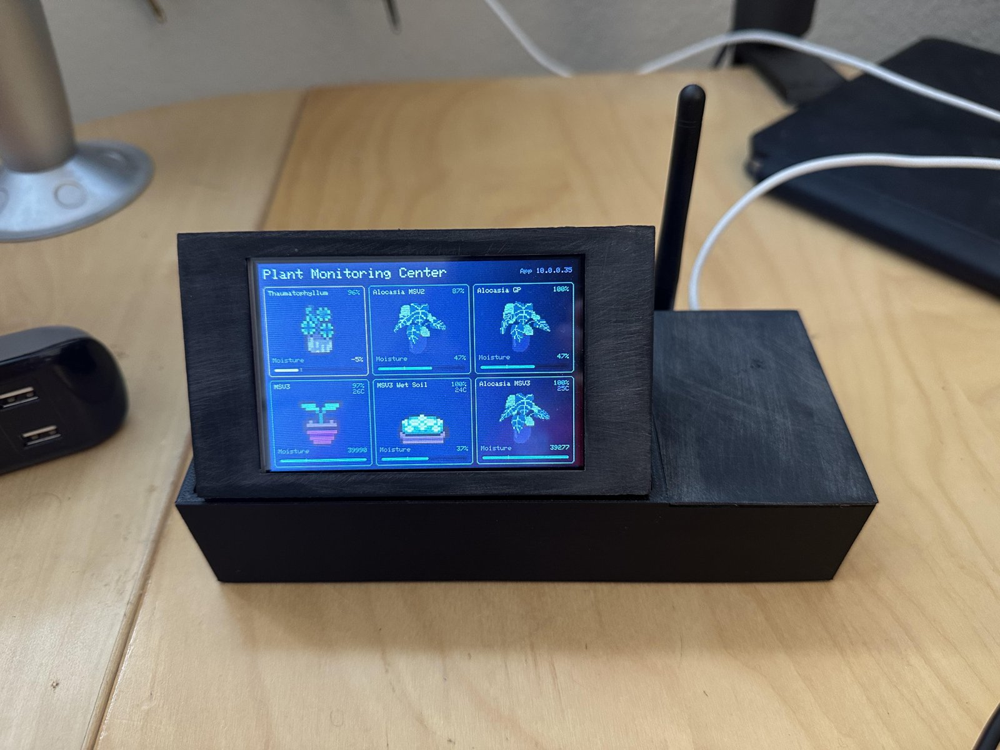
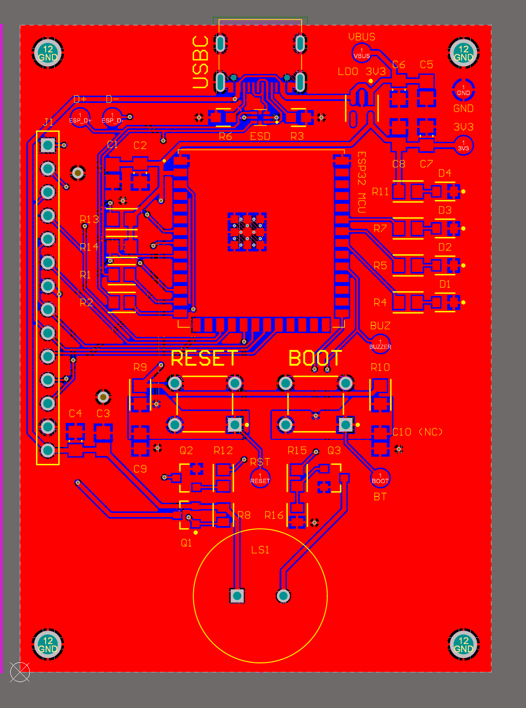
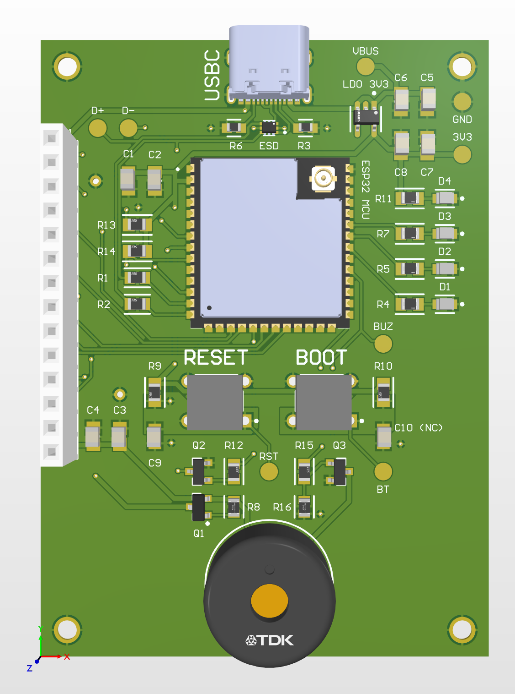

# DisplayCenter controller PCB

Two-layer receiver board: an ESP32-S3 that listens to every probe over Bluetooth LE, drives a
480 × 320 touch display, and uploads over Wi-Fi. The board carries USB-C, a 3.3 V regulator,
reset and boot buttons, display brightness control and a buzzer.

  
  &nbsp;
  
  &nbsp;
  

| File | What it is |
| --- | --- |
| [`DisplayCenter_controller_fabrication_2026-07-14.zip`](DisplayCenter_controller_fabrication_2026-07-14.zip) | Gerbers, drill files and reports as exported from Altium on 2026-07-14 |
| [`images/DisplayCenter_schematic_overview.png`](images/DisplayCenter_schematic_overview.png) | The whole schematic sheet (Altium's preview image, readable at block level) |
| [`../V2/`](../V2/) | The tabletop enclosure |
| [`../../../README.md`](../../../README.md) | Receiver firmware, setup and wiring |
