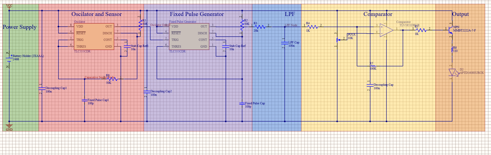

# MSV1 probe PCB

The two-layer analog prototype. An interdigitated comb electrode is read by 555 timers, an RC
low-pass filter and a comparator. The oscillation ran from about 27 kHz in dry potting soil to
7.5 kHz wet, and the electrode measured from 274 pF in dry air to about 1.28 nF saturated.

| Part | Role |
| --- | --- |
| 555 timers (astable and monostable) | Turn the electrode's capacitance into a frequency and pulses |
| RC low-pass filter | Turns the pulses into a voltage |
| Comparator | Dry-soil alarm |

  
  

## Files

| File | What it is |
| --- | --- |
| [`MSV1_fabrication_2026-05-01.zip`](MSV1_fabrication_2026-05-01.zip) | Gerbers, drill file, pick-and-place and BOM, exported for JLCPCB on 2026-05-01 |
| [`images/MSV1_schematic.png`](images/MSV1_schematic.png) | Schematic |

## Related

[Course report](<../EEC284_Final_Paper (2).pdf>) (EEC 284, UC Davis)
