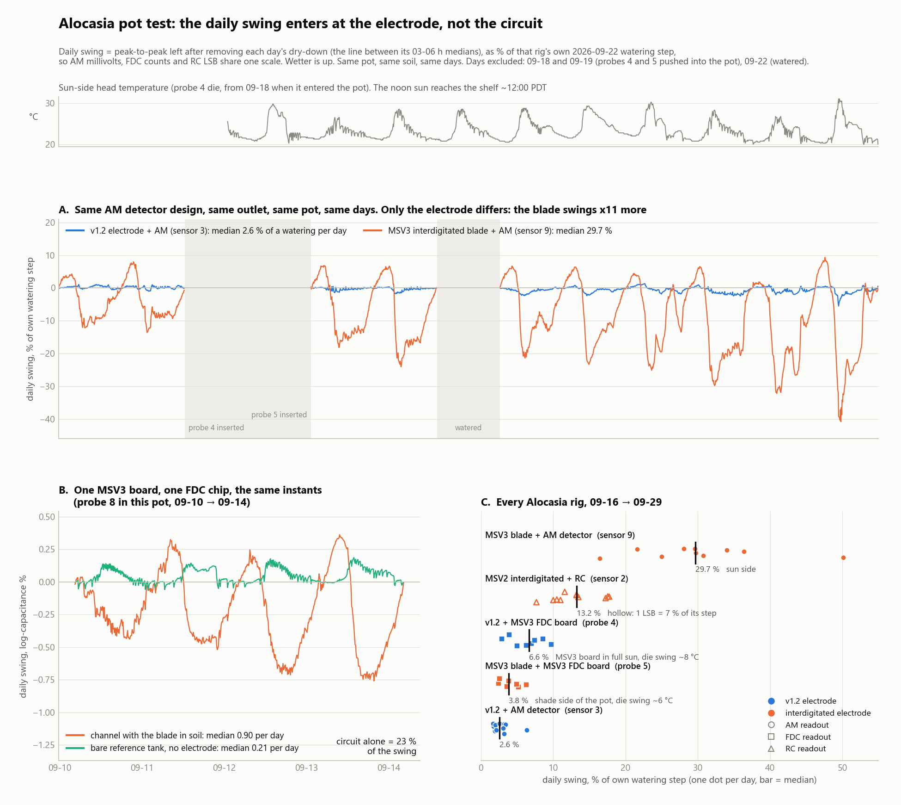

# Alocasia pot test: the daily swing enters at the electrode, not the circuit (2026-09-29)

Raw cloud history for sensors 2, 3, 4, 5, 8 and 9 (receiver `MSV2088A3104A7AC`) through
**2026-09-29 22:50 PDT**. Reproduce with the commands in the docstring of
[`analyze_alocasia_electrode_vs_circuit.py`](../scripts/analyze_alocasia_electrode_vs_circuit.py),
which also writes the figure. Physical state is from [`fleet.json`](../fleet.json). The maintainer
confirmed on 2026-09-29 that nothing in the Alocasia pot has moved since 09-24, and there has been no
watering since 09-22.

## Answer

The maintainer's reading of the history tab holds up. **Wherever the circuit's own term can be
isolated, it is at most about a fifth of the swing. Swapping the electrode while keeping the
circuit changes the swing tenfold.** The large daily swings in this pot enter through the
interdigitated electrode. One qualification: this is not a fixed coefficient of the blade. The one
blade on the shade side of the pot (probe 5) is as quiet as the v1.2s.

> **2026-09-30, at teardown (maintainer observation, qualitative):** probe 5 had the **tightest fit**
> of every sensor in the pot and was hard to pull out; many of the others came out very easily
> (which ones not itemised). That makes soil contact a second candidate, alongside shade, for why
> this one blade was quiet. A ~0.2 mm median sensing depth reads mostly the soil-blade interface,
> and the 2026-09-19 field solve puts an MSV3-style comb's response at −16.8 % (lossless) to −58.5 %
> (1 MHz, moist soil) for a 10 µm air gap. A gap that breathes daily would show up as a large daily
> swing. Inferred, not measured: one probe, and confounded with position. Recorded in
> `fleet.json` under probe 5's `last_soil_installation`.

## 1. Same circuit, different electrode

Each day (04:30 → 04:30 PDT) has the straight line between its two predawn medians (03–06 h)
subtracted, which removes that day's dry-down. The peak-to-peak of what is left is divided by that
rig's own 09-22 watering step, so every readout lands on one scale. Days excluded: 09-18 and 09-19
(probes 4 and 5 were pushed into the pot; sensor 3 reads 5.6 and 5.3 % on those days against ~2 %
otherwise) and 09-22 (the watering). Days within 24 h of a sensor's own insertion are also skipped.

| rig | electrode | readout | days | **daily swing, % of a watering** | range | before 09-22 | after |
|---|---|---|---:|---:|---:|---:|---:|
| sensor 3 | v1.2 | AM detector | 11 | **2.6** | 1.7–6.3 | 1.9 | 3.2 |
| probe 5 | MSV3 blade | MSV3 FDC, *shade side* | 7 | **3.8** | 2.5–6.3 | 3.6 | 4.4 |
| probe 4 | v1.2 | MSV3 FDC, *full sun* | 8 | **6.6** | 2.9–9.7 | 3.4 | 7.2 |
| sensor 2 | MSV2 interdigitated | MSV2 RC | 11 | 13.2 | 7.7–17.8 | 13.5 | 10.8 |
| sensor 9 | MSV3 blade | AM detector | 10 | **29.7** | 16.5–50.1 | 23.3 | 31.9 |

Watering steps (09-22 predawn → 09-23 predawn, wetter-positive): sensor 3 +506 mV, sensor 9
+226.75 mV, probe 4 +18.54 logC%, probe 5 +52.84 logC%, sensor 2 +14 LSB.

- **Sensors 3 and 9 are the controlled swap.** Same AM detector design, same mains outlet, same pot
  and days. Only the electrode differs. Paired by day, the blade swings **×10.7** more (range
  ×7.9–×14.4, 10 days). Every single day is above ×7.9.
- Sensor 2, the other interdigitated electrode, sits between the two, but it is quantization-limited:
  1 LSB is 7.1 % of its step, so its whole daily swing is 1–3 LSB.
- Robustness: dropping 09-23 (the steepest dry-down day) moves no median by more than 0.35 pp, and
  the paired ratio goes from ×10.7 to ×10.6. Synthetic self-test: a known 5.00 bump comes back as
  5.000. A straight chord leaves a bow on a curved dry-down, which is below 5 % of that day's drop,
  so the bias is below ~1 % of a watering on the steepest day and smaller on every other day.

## 2. The circuit's own term, bounded two independent ways

| test | circuit alone | circuit + electrode | **circuit share** |
|---|---:|---:|---:|
| **FDC:** probe 8's bare reference tank vs its blade channel. Same FDC2214, same board, same instants, this pot, 09-10 → 09-13 | 0.21 logC%/day | 0.90 logC%/day | **23 %** |
| **AM:** credit *all* of sensor 3's millivolt swing to the detector design it shares with sensor 9 | 13.2 mV/day | 67.3 mV/day | **≤ 21 %** (paired median; worst day 28 %) |
| **MSV3 board in full sun:** probe 4 drives the v1.2. Its die swings ~8 °C, and battery, solar charging and the air-padding blade are all in circuit | — | 6.6 % of a watering | the whole MSV3 circuit is ≤ 6.6 % of a watering |
| *Outside this pot, for reference:* probe 4 bare tank vs blade channel, its own pot, 09-05 → 09-09 | 0.28 logC%/day | 2.48 logC%/day | 11 % |

On probe 8 the circuit term also has the **opposite sign**. The bare tank reads wetter when warm
(+0.026 logC%/°C, r ≈ +0.99), and the blade channel reads drier when warm (−0.03 to −0.10). So the
electrode path is somewhat *larger* than the connected channel's swing, and 23 % overstates the
circuit's share rather than understating it.

## 3. What the blade's swing depends on

- **Probe 5 (blade + FDC) is quiet: 3.8 %.** It is the only Alocasia rig on the shade side of the pot.
  Its die swings 5.6 °C against probe 4's 7.9 °C (daily medians). Per °C of its own die range, probe 5
  is 0.70 % of a watering and probe 4 is 0.77 %. Through the FDC in this pot, the blade is not
  measurably worse than the v1.2.
- **Every large blade swing on record comes with a sunlit installation:** sensor 9 (sun side,
  29.7 %), probe 8 (this pot, die range 6.75–8.5 °C, blade channel 4.3× its bare tank), probe 4 in
  its own pot (die range 6.75–8.0 °C, 2.48 logC%/day, 8.8× its bare tank), and probe 7 in the Begonia
  (09-24 findings). Probe 5's earlier record (09-05 → 09-12, a different soil, die range 2.75–5.1 °C)
  has a median blade-channel swing of 0.71 logC%/day.
- **So the blade's swing is an installation property, not a fixed blade coefficient.** That also
  qualifies the 09-24 audit's "electrode and readout interact" (blade ×0.66 through the FDC, ×10
  through the AM). That comparison sets sensor 9 (sun side) against probe 5 (shade side), so pot side
  is confounded with readout, and these data cannot separate the two.

## Why this points at depth (modelled, not measured)

From the 2D field solve in
[`MSV4_ELECTRODE_FIELD_SOLVE_2026-09-19.md`](../../MSV4/docs/MSV4_ELECTRODE_FIELD_SOLVE_2026-09-19.md),
the share of the full response that comes from soil within *d* of the board surface:

| d | 0.25 mm | 0.5 mm | 1 mm | 3 mm |
|---|---:|---:|---:|---:|
| MSV3-style interdigitated | 55 % | 81 % | 95 % | — |
| MSV4 as drawn | 19 % | 32 % | 50 % | 82 % |

The MSV3 blade reads a film about a quarter-millimetre thick at its own surface, so whatever happens
at that interface dominates its reading. A response that depends on where one blade sits, rather
than on the blade type, is what an interface-dominated sensor would show. MSV4's field reaches about
5× deeper. **Whether that removes the swing is untested.** No MSV4 board has measured anything yet.

## Measured vs inferred

- **Measured:** every number in sections 1 and 2, and the die ranges in section 3.
- **Inferred:** that probe 5 is quiet *because* it is on the shade side. It is the only shade-side rig,
  so side and board cannot be separated. The same goes for the depth explanation above.
- **Not excluded:** sensor 9's AM detector board could sit somewhere hotter than sensor 3's. Their
  placement is not recorded (open question from 09-24). The ≤ 21 % AM bound assumes both detector
  boards see the same temperature. Swapping the two electrodes at the AM connectors, leaving the
  boards where they are, would close this.
- **One watering calibrates every rig.** The scale in section 1 rests on the 09-22 step alone.
