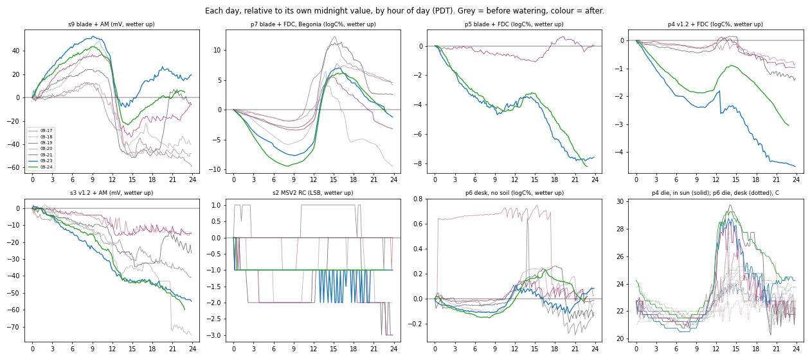
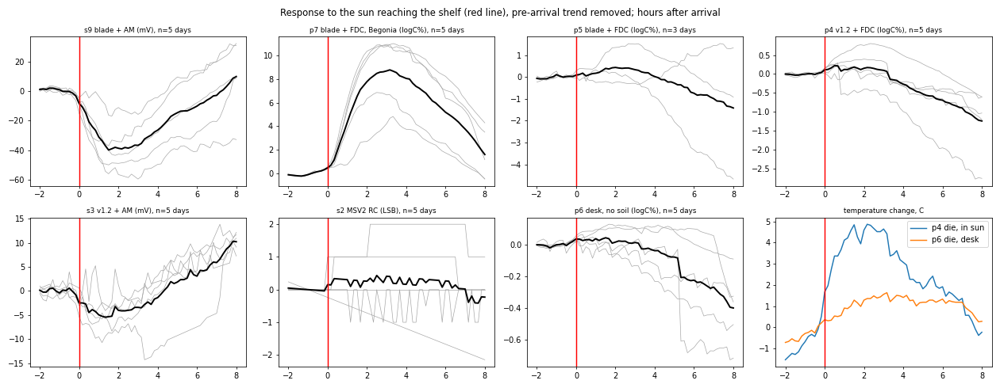

# Multi-probe pot test: what the data show on their own — 2026-09-24

Raw cloud history for sensors 2, 3, 4, 5, 6, 7 and 9 (receiver `MSV2088A3104A7AC`) through
**2026-09-24 22:55 PDT**, looked at directly rather than through any earlier mechanism theory.
Reproduce with the commands in the docstring of
[`analyze_multiprobe_sun_response.py`](../scripts/analyze_multiprobe_sun_response.py), which also
writes the two figures below. Physical setup is from [`fleet.json`](../fleet.json): Alocasia pot
sensors verified 2026-09-21, plus the maintainer's 2026-09-24 statements. The Alocasia pot saturates
uniformly on watering, and the Begonia was watered at the same time.

Signals are oriented wetter-up. FDC probes are in `logC%` (`100·ln C/C_ref`), AM rigs in detector mV
(negated), and the MSV2 RC count in LSB.

## 1. The sun reaching the shelf is the daily event

Every day at **11:50–12:10 PDT**, probe 4's die jumps 3–5 °C above probe 6's desk die within
minutes: the sun reaches the shelf. Every rig on the shelf changes shape at that same clock time,
every day. Aligning the five clean sunny days on that instant, and removing each day's pre-arrival
trend, gives each rig's average response with no temperature model involved:

| rig | +30 min | +2 h | +4 h | +6 h | watering step | +2 h as % of a watering |
|---|---:|---:|---:|---:|---:|---:|
| **s9 blade + AM** | −20.7 | **−38.7** | −26.4 | −10.2 | 226.75 mV | **−17.1 %** |
| **p7 blade + FDC, Begonia** | +1.9 | **+7.8** | +8.1 | +5.2 | (see §3) | larger than its watering |
| p5 blade + FDC | +0.05 | +0.43 | +0.02 | −0.75 | 52.84 | +0.8 % |
| p4 v1.2 + FDC | +0.22 | +0.15 | −0.27 | −0.69 | 18.54 | +0.8 % |
| s3 v1.2 + AM | −4.5 | −4.0 | −1.4 | +3.1 | 506 mV | −0.8 % |
| s2 MSV2 RC | +0.33 | +0.26 | +0.16 | +0.27 | 14 LSB | +1.8 % |
| p6 desk, no soil | +0.03 | +0.01 | −0.04 | −0.23 | — | — |

Measured:

- **Two rigs respond hard to the sun, and the other four barely do.** Each sun pulse moves sensor 9
  by 17 % of a full watering, in the drier direction. It moves probe 7 by more than its entire
  watering response, in the wetter direction.
- **The MSV3 blade is not intrinsically the sun-sensitive part.** Probe 5 is a blade in the same
  Alocasia pot, and it responds +0.8 %, the same as both v1.2 rigs. Sensors 9 and 7 are both blades
  too, and they are the only two large responders. Whatever sets those two apart is specific to
  them, not to the blade design.
- The two large responders have **different timing**. Sensor 9 falls within 30 minutes and bottoms
  out at about 2 h, following probe 4's die. Probe 7 rises over 2–4 h and decays over the rest of
  the day, lagging the die by hours. That is the timing of something heating slowly, like a
  pot of soil, not a circuit board.
- After about 3 h, probes 4 and 5 fall faster than their morning trend. From these data, that is
  either faster afternoon drying or a thermal term. With no soil-temperature channel the two cannot
  be separated.

## 2. What drives the rest of the daily variation

Each rig's de-trended variation was regressed on room air (probe 6's desk die) and on sun heating
(probe 4's die minus probe 6's), each through a first-order lag. The table shows the share of the
daily variance each explains, for the period after the watering (09-23 → 09-25):

| rig | room + sun | room only | sun only | per °C room | per °C sun |
|---|---:|---:|---:|---:|---:|
| s9 blade + AM | 0.95 | **0.92** | 0.86 | −14.3 mV, no lag | −6.5 mV, 3 h lag |
| p7 blade + FDC, Begonia | 0.99 | 0.79 | **0.99** | +0.77 | **+4.86, 4 h lag** |
| p5 blade + FDC | 0.90 | 0.86 | 0.81 | +0.56 | +0.23 |
| p4 v1.2 + FDC | 0.88 | 0.80 | 0.70 | +0.31 | +0.11 |
| s3 v1.2 + AM | 0.82 | 0.08 | 0.76 | unstable | −2.9 mV |
| s2 MSV2 RC | 0.10 | — | — | quantization-limited | |
| p6 desk, no soil | 0.90 | 0.78 | 0.27 | +0.125 | |

- **Sensor 9 follows room air temperature almost instantly** (0–1 h lag, 77 % of variance before the
  watering, 92 % after), at −14 to −20 mV/°C. Before the watering that is about 8× sensor 3's room
  coefficient. Sensor 9's is also stable, while sensor 3's is not (−2.4 before, +1.8 after), though
  both use the same AM detector design. A response with no lag to room air
  points at something in air rather than in soil. Which part of the sensor 9 rig sits where is not
  recorded (see questions).
- **Probe 7 follows the sun with a 2–4 h lag** (85 % of variance before, 99 % after), with a room
  term on top.
- **Probes 4 and 5 are both small**, and both read slightly wetter when warm after the watering.
- **Probe 6 is not a clean control before 09-22.** Room and sun explain only 9 % of its variation,
  because it has step jumps of about +0.6 logC% (09-16 ~13:00 → 09-17 ~01:00, and 09-20 ~00:00 →
  ~19:00) that match no temperature. Its blade is in open air on a desk, so it responds to anything
  placed near it.

## 3. Probe 7 did register the Begonia watering

With probe 7's sun and room terms fitted out (§2), a step at the watering time comes back at
**+5.1 logC%**, and the fit is best at the real watering time (rms 1.57). The same model with the
step placed at 10:50 on days nothing happened:

| placebo day | 09-18 | 09-19 | 09-20 | 09-21 | 09-23 | 09-24 |
|---|---:|---:|---:|---:|---:|---:|
| step | −13.5 | −1.9 | +2.5 | −0.8 | −2.4 | −4.1 |
| fit rms | 2.01 | 1.87 | 2.03 | 2.10 | 1.78 | 2.32 |

The real step (+5.1) sits above every placebo, and the fit is best at the real time. Probe 7 saw
the watering. The response is about a tenth of probe 5's, but it is buried under a sun response
bigger than itself. The Begonia's water volume is not recorded, so how much of that factor of ten is
the pot and how much is the installation cannot be said.

## What this means, in one paragraph

Moisture is being measured by every rig. The daily artifact is not a property of the MSV3 blade,
the FDC or the AM readout as such. It is dominated by **the noon sun on the shelf, acting on two
specific installations**: sensor 9 (fast, drier) and probe 7 (slow, wetter). The other four rigs
(two v1.2s, the MSV2 and the Alocasia blade on the FDC) each move about 1–2 % of a watering per sun
pulse. The most useful next step is finding out **what the sun actually hits** on the sensor 9 rig
and the Begonia pot.

## Why is probe 5 better? Power and facing direction

Probe 5 is the probe on USB from the computer, with no battery (`fleet.json`). History for the
other blade + FDC installations, with the same sun-arrival method. Arrival is taken from each
probe's own die, and results before C17 removal are multiplied by that board's
`(counts_after/counts_before)²` to put them in today's units, which is approximate:

| blade + FDC | where | power | charging from solar | +2 h sun response, logC% |
|---|---|---|---|---:|
| p7 | Begonia, now | battery + solar | yes, 4000 → 4220 mV over 09-17..24 | **+7.8** |
| p4 | its own pot, 09-04..13 | battery + solar | yes, 3889 → 4311 mV | **+4.1** |
| p8 | this Alocasia pot, 09-09..13 | USB, **inferred**: same two-level 4300/4380 mV PC-sleep signature as p5 | no | −1.65 |
| p5 | earlier soil, 09-04..13 (die swing only 2–5 °C, little sun) | USB, no battery | no | −1.65 |
| p5 | this Alocasia pot, now | USB, no battery | no | +0.4 to +0.7 |

Measured: the two blade + FDC probes with large, positive sun responses are the two that were
**actively charging from solar**. The three on USB are all small. Probe 8 was a USB blade in this
same pot, and its sun response was about 2–4× probe 5's, with the opposite sign. So USB is
consistent with being small but does not by itself make a probe as flat as probe 5.

Probe 7's timing leans thermal but is not decisive. Charging and heating both start when the sun
arrives (~11:50), so the rise cannot separate them. On 09-18..21 probe 7's signal had already
started falling while the battery was still charging. The signal peaks about 1 h after its die and
then decays over ~15 h, long after charging has stopped and the die has cooled. That is the
timing of a large mass cooling slowly (soil, or a sunlit pot wall), not of charging current.

The maintainer's theory is that the one-sided blade's **facing direction** matters, and probe 7
appears to face its pot wall. That fits probe 7's data unusually well: facing the wall predicts
both a **small moisture response** (less soil in the field) and a **large, slow thermal response**
(a sunlit wall in the field). Probe 7 shows both at once (about a tenth of probe 5's watering step,
and +7.8 per sun pulse), which the "it's the blade" story could not explain.

**Probe 5 is also on the shade side of the pot** (maintainer, 2026-09-24, because of its USB
cable), and every other Alocasia probe is on the sun side. The data agree: on the same sunny days
probe 5's die swings 5.3–6.0 °C against probe 4's 7.5–9.5 °C. So probe 5's flatness is partly its
position, and comparisons of probe 5 with the sun-side rigs mix electrode/readout with pot side.

One variable at a time, two tests would each settle a half of this. The maintainer is running the
first: see [`MSV3_PROBE7_FLIP_TEST_2026-09-24.md`](MSV3_PROBE7_FLIP_TEST_2026-09-24.md).

- **Rotate probe 7 to face into the soil**, leaving everything else alone. If facing is the cause,
  its sun response collapses and its watering response grows.
- **Cover only probe 7's solar panel for a sunny day.** If charging is the cause, the noon rise
  disappears even though the pot is still in sun.

## Questions only the maintainer can answer

These are physical facts that cannot be inferred from telemetry (CLAUDE.md rule 4):

1. When the sun is on the shelf, what does the beam land on: the soil surface of each pot, the
   blade heads, the probe 4/5/7 boards, the sensor 3/9 AM boards and their cables?
2. Where do the sensor 3 and sensor 9 AM detector boards physically sit, and are they side by side?
3. Did anything change near probe 6 on the desk on 09-16 around 13:00, or on 09-20 around 00:00?
4. Which way do probe 5's and sensor 9's sensing faces point: into the soil, or toward the pot wall?
   (Answered in part: probe 5 is on the shade side of the pot; its facing is still unrecorded.)
5. Was probe 8 powered from the computer's USB while it was in this pot (09-08..09-14)? The telemetry
   suggests so, but that is an inference.
