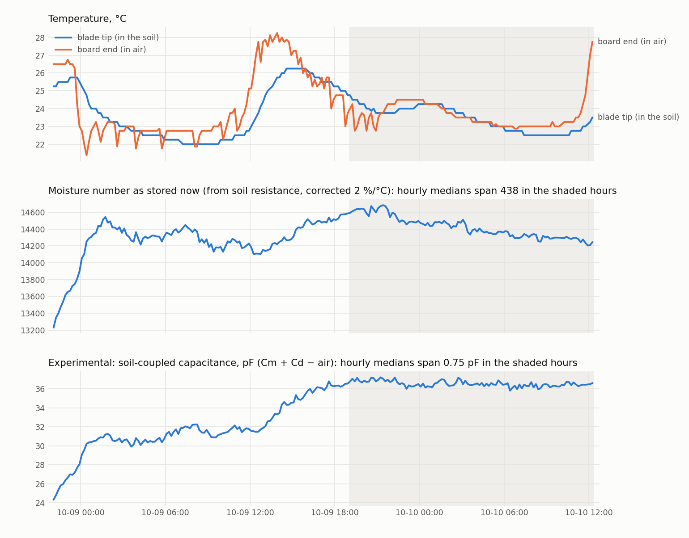
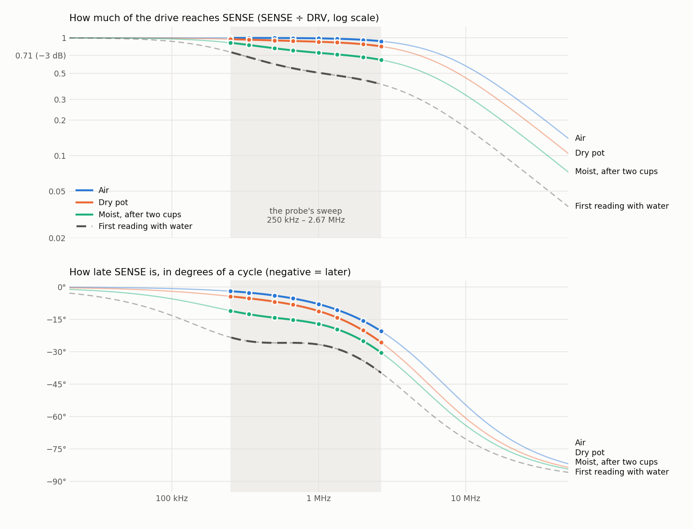
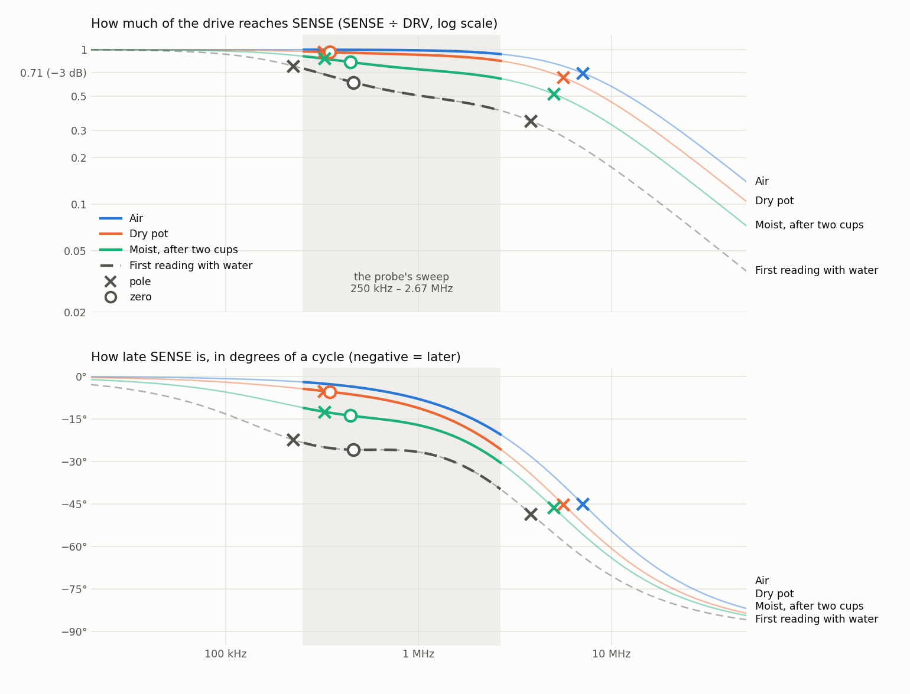
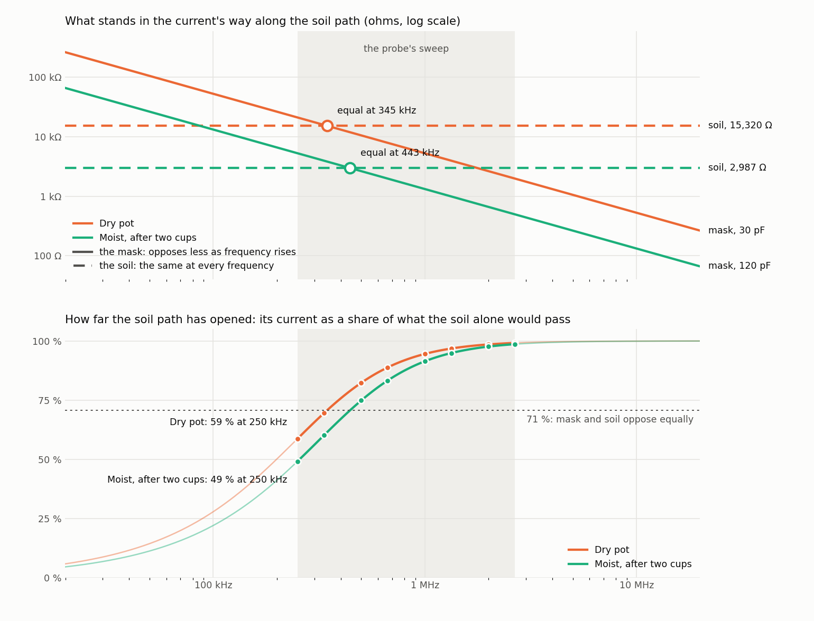

# MSV4: an experimental moisture reading that is not made from resistance (2026-10-10)

The maintainer, 2026-10-10 ~11:50 PDT: "Lets make a new experimental moisutre reading that
actually attempts to track moisutre properly, without this temp dependence. Somehow nothing we
have done has worked with 4 different verisons, so I have to belive that this is a firmware issue
at this point, consult codex and figure this out".

**The reading:**

```
soil-coupled capacitance  =  Cm + Cd − (this probe's Cd in air)        [pF]
```

`Cm` and `Cd` are two of the three numbers the probe already fits and sends. Air is its zero,
it reads 36.5 pF in the Alocasia pot now, and it exists for every reading since the probe went
in, because it is computed from what is already stored. The moisture number in use is left as it
is.

**Status: it has held within 0.75 pF for 17 hours while the present number moved 440. It has not
been through a watering, and it moved 5 pF on the first afternoon with no watering.** Both are
below. **The main risk:** a slow change in soil contact or settling can move it by more than a
watering is required to (3 pF), so the first watering can show that it responds, not that
everything it does is water. Worked through with Codex (phone-a-friend consultation
`msv4-temp-free-moisture-2026-10-10`).



## Where it is

| | |
|---|---|
| `MSV4/scripts/msv4_experimental_moisture.py` | the reading, a comparison table, the watering test, the figure; `--self-test` |
| History page, card "EXPERIMENTAL moisture reading" | `msv4SoilCoupledPf()` in `MobileAppPage.h`, receiver build tag `2026-10-10 msv4-soil-coupled-v1`. **Flashed 2026-10-10 14:19 PDT** at the maintainer's word ("Ok you can flash, add it as an experimental new thing in the history tab, not replacing old moisture"); the page the receiver serves contains the card. Not yet seen rendered in a browser |
| `DisplayCenter/scripts/verify_msv4_history_decode.mjs` | runs the page's function on the same cases as the script's self-test and holds the two air-value tables equal; in the receiver's build gate |

```
python cloud/scripts/fetch_supabase_history.py --receiver MSV2088A3104A7AC --sensor 10 --raw --since-hours 100 --csv data/sensor_logs/msv4_sensor10_all_2026-10-10.csv
python MSV4/scripts/msv4_experimental_moisture.py data/sensor_logs/msv4_sensor10_all_2026-10-10.csv --bin 30 --window "2026-10-09 19:00" "2026-10-10 23:59" --figure MSV4/docs/MSV4_EXPERIMENTAL_MOISTURE_2026-10-10.png
```

## Is it the firmware? What was checked (measured)

- **The capacitance measurement does not move with the board's temperature or its supply.** In
  air, in a sunny window, 252 readings from 2026-10-06 22:00 to 2026-10-08 15:50: `Cd` hourly
  medians 12.86–13.11 pF while the tip went 21.5–29.5 °C, the die 21.75–31.4 °C and the cell
  3704–3840 mV. Every one of those readings was open, and the fit residual stayed 2.13–2.31 %.
- **The fit's memory is not the lag.** The probe starts each fit from the last full fit and does
  a full one every twelfth measurement. If that held the answer back there would be a step every
  twelve readings. Over 2246 readings in soil, grouped by reading number modulo 12: mean step in
  `ln Rsoil` between −0.11 and +0.11 % in every group (standard error 0.09 %), residual
  121.7–123.1 in every group, and a twelve-reading line of 0.039 % against 0.034–0.038 % at ten
  and eleven.
- **Nothing restarted and the fit quality did not change:** one boot since 22:07 on 10-08,
  residual 1.19–1.27 % all day.
- **The resistance follows the tip, late, and not the board.** `ln Rsoil` against the lagged tip
  leaves 1.48 %; against the lagged die 2.26 % at best
  (`MSV4_SOIL_THERMAL_SECOND_NIGHT_2026-10-10.md`).
- **Not tested: whether the resistance the board extracts from a conducting load moves with the
  board's temperature.** In air nothing conducts, so the air record cannot show it. A fixed
  resistor and capacitor across a second board's plates, left through a day, would.
- **Not tested: whether the three-number model, fitted to soil that is not three components,
  turns a temperature-driven change in the shape of the response into a change in `Rsoil`.** A
  constant residual does not rule that out. The raw sweep would show it (last section).

So: nothing on record shows the measuring electronics or the fit's memory to be the main source
of the swing, and two things that could still be are untested. What the record does show on the
firmware side is a choice, not a malfunction: the moisture number is `log10` of the fitted
**resistance**, the one fitted quantity that carries how well the soil conducts, which changes
with temperature in any soil. The resistance may be a correct measurement of that. All four
generations work below 10 MHz through a coated electrode, where conduction is most of what the
soil does; that is what they have in common. MSV4 is the first that separates conduction from
capacitance, and its moisture number was then built from the conduction.

## Why this quantity

The fitted model is `Cd` in parallel with (`Cm` in series with `Rsoil`). At the low-frequency end
it is a capacitor of `Cd + Cm`: the electrode with the soil acting as a conductor. Change only
how well the soil conducts and the response slides along the frequency axis; `Cd + Cm` and `Cd`
do not change and `Rsoil` takes all of it. That is exact for the model, and it is what the pot
did overnight: `Rsoil` +11.5 % with `Cm` flat.

What can break it in soil: the turn-over is at 380 kHz and the sweep starts at 250 kHz, so `Cm`
is partly extrapolated; real soil is many paths and not one; water can move with temperature;
the contact can change.

Passed over, with the reason (17 hours, 10-09 19:00 on):

| Candidate | Why not |
|---|---|
| `Cd` minus air alone | the capacitance that follows temperature most: r +0.85 with the tip, 9.1 % of its own median |
| `log Cm`, `log (Cm + Cd − air)` | undefined in air |
| `Rsoil × Cm` | carries the whole swing of `Rsoil` and the step in `Cm` |
| `Cd` de-trended with `Rsoil` as the thermometer | a watering moves `ln Rsoil` by far more than a day does, so the correction would be larger than the signal |
| `Cm` alone | as steady, but has no value in air |

In the reading itself the two parts lean opposite ways over these hours (`Cm` r −0.24 with the
tip, `Cd` +0.85), so some of its steadiness may be the two cancelling during one cool-down.

## What it has done so far (measured)

10-09 19:00 to 10-10 12:14, 1034 readings, tip 22.25–24.75 °C:

| | Median | Range of hourly medians | As % of median | Scatter inside an hour | r with tip |
|---|---:|---:|---:|---:|---:|
| Moisture number, as stored | 14,408 | 440 | 3.1 % | 32 | +0.75 |
| `Rsoil` | 14,980 Ω | 1,720 Ω | 11.5 % | 105 Ω | −0.88 |
| `Cm` | 28.40 pF | 0.80 pF | 2.8 % | 0.20 pF | −0.24 |
| `Cd` minus air | 8.13 pF | 0.74 pF | 9.1 % | 0.04 pF | +0.85 |
| **Soil-coupled capacitance** | **36.54 pF** | **0.75 pF** | **2.1 %** | **0.25 pF** | **+0.26** |

Before that window it was not steady:

| | Soil-coupled capacitance |
|---|---:|
| First firm reading, 10-08 21:57 | 22.9 pF |
| 10-09 01:00–03:00 | 30.8 |
| 10-09 11:00–13:00 | 31.7 |
| 10-09 19:00–21:00 | 36.9 |

- The first hours are the soil closing on the blade.
- **From 12:45 to 19:00 on 10-09 it rose 5.2 pF (16 %) with no watering stated**, during the
  first warm afternoon, and did not come back. It is `Cm` (23.5 → 28.4 pF). Whether that was the
  last of the settling or something each warm afternoon does is not known; the afternoon of
  10-10 is the first repeat.
- The percentages are of each quantity's own median and are not a common scale. The only common
  scale is a watering.

**Added 13:58 on 10-10: it is rising again with this afternoon's warm-up.** 10-minute medians,
12:00 → 13:50: tip 23.33 → 26.75 °C, soil-coupled capacitance 36.50 → 37.77 pF (+1.27 pF), `Cm`
28.7 → 29.8 pF, `Cd` 21.51 → 21.73 pF, `Rsoil` 15,698 → 14,971 Ω (−4.6 %). So the rise of 10-09
was not only settling: a warm afternoon moves this reading. Not yet known: whether it comes back
down tonight (a daily swing) or stays (a ratchet). No watering had been stated at that time; the
pot was lifted onto a scale at about 13:55, after the rise had begun.

**Added 14:30 on 10-10: the maintainer, looking at the card, "it already looks completelt busted
it just keeps rising forever". As a description of the record that is right.** It has never come
down: 22.9 pF at the first firm reading, 31 pF four hours later, +5.2 pF on the first warm
afternoon, flat for 17 hours, and 38.4 pF at 14:00 on the second (+1.8 pF since noon). No
watering has been stated in that time, so a rise of this size is not water. The same hours on
the two mornings, 09:00–11:00, tip 22.16 and 22.54 °C (measured):

| | 10-09 morning | 10-10 morning | Change |
|---|---:|---:|---:|
| Moisture number, as stored | 14,209 | 14,296 | +87 |
| `Rsoil` | 16,120 Ω | 15,649 Ω | −2.9 % |
| `Cm` | 23.2 pF | 28.6 pF | +5.4 pF (+23 %) |
| `Cd` minus air | 8.11 pF | 7.82 pF | −0.29 pF (−3.6 %) |
| Soil-coupled capacitance | 31.29 pF | 36.41 pF | +5.12 pF (+16 %) |

- The rise is all `Cm`, the part the firmware's own notes call contact and not moisture. Adding
  it to `Cd` is what made this reading drift.
- `Cd` minus air is the one quantity that went the way a pot with no watering should, and the
  one this record passed over for following temperature within a day. One day apart is one
  comparison, not a result.
- The card is drawing the stored values correctly (38.2 pF at 14:21 on the page, 38.4 pF median
  for 14:00–14:30 from the script).

## The air value belongs to a boot

`Cd` is the node capacitance minus `Cp`, and `Cp` is whatever that boot runs on (8.66–8.93 pF
across board 1's boots). So `Cd` in air is a per-boot number:

| Sensor | Boot began | `Cd` in air | Source |
|---|---|---:|---|
| 10 | 2026-10-08 21:47:10 | 13.72 pF | in air after the epoxy, 20:39–21:39: `Cd` 13.46–13.50 pF on `Cp` 8.93, so 22.41 pF at the node; this boot calibrated `Cp` 8.69 on its first reading, part-way in |
| 10 | 2026-10-08 22:07:55 | 13.72 pF | 262161, with that `Cp` compiled in; DIS read `Cp 8.69 pF default` |

- **Every boot needs its own entry, and a reading from a boot without one gets no value**, on
  the page and in the script alike. `Cp` is not in the packet, so nothing else says which `Cp`
  a new boot is on (a boot that recalibrates in air moves `Cd` by up to about 0.25 pF).
- Which boot a reading belongs to is taken from the reading: the probe counts one wake a minute
  from 1 at boot, so the boot began `wake − 1` minutes earlier. An entry matches within two
  minutes of that plus 0.2 % of the time since.
- Nothing is applied backwards: readings before a probe's first entry have no value.
- After any restart of the probe (an update included): read its `Cp` with
  `msv4_adv_scan.py --read-build`, add the entry to both tables, and reflash the receiver. The
  script prints the boot that is missing and how many readings it left out.

## The watering test, fixed before any MSV4 probe is watered

Constants at the top of the script; `--watered "YYYY-MM-DD HH:MM"` applies them.

1. Twelve hours of record before the watering, every hour with at least three readings, and no
   restart from then to +8 h.
2. Before = median over −6 h to −1 h. After = median over +2 h to +8 h.
3. The step must be at least the largest of: **3 pF**; 5 × the scatter inside an hour before;
   3 × the range of the hourly medians over those twelve hours. On today's record that is 3 pF.
4. Every hour from +2 h to +8 h must have at least three readings and stay above before + that
   step.
5. `Rsoil`, `Cm`, `Cd`, the stored number and the tip are printed alongside and are not part of
   the test.

A pass shows that the reading responds to water. It does not show that it responds to nothing
else: the 10-09 afternoon already moved it 5.2 pF.

## Not known

- How far it moves for a watering. The field solve's 671 pF for wet soil against the whole mask
  has never been approached on this board: the largest `Cm` on record is 55.7 pF, with a hand on
  the blade.
- How it behaves between conducting soil and open. No reading has ever landed between 30 kΩ and
  the 400 kΩ ceiling.
- Whether anything about the pot has changed since 2026-10-08 (`MSV3/fleet.json`, `msv4_boards`,
  verified that day). No watering is assumed.

## Where 671 pF comes from, and where the rest of it is (asked 2026-10-10)

The maintainer: "can you account for the descrepancy of estimated 600pf cap for the Cm in soil
but 30pf expected?"

- **671 pF is a ceiling, and it is plain parallel-plate arithmetic.** Each plate is 4.725 ×
  81.1 mm on both faces, 766 mm²; under 20 µm of mask at er 3.8 that is 1289 pF a plate, and the
  two in series are 645 pF (`msv4_electrode_fieldsolve.py`; the fit of its output gives 671). It
  assumes a conductor against the mask over every square millimetre. The mask is worth 5.3 µm of
  air, so any air between it and the soil counts heavily: 5 µm halves it.
- **`Cm` is not all of the coupling.** The fit puts capacitance that reaches a good conductor
  into `Cd` and capacitance in series with a resistance into `Cm`. The number to hold against
  645 pF is the two together, over air.

| Medium on board 1 | `Cm` | `Cd` over air | Together | Share of 645 pF | Same as a uniform air gap of |
|---|---:|---:|---:|---:|---:|
| Hand grip, 10-01 (measured) | 51–55 pF | about 120 pF | about 175 pF | 27 % | 14 µm |
| Damp paper towel, 10-01 (measured) | 26.7 pF | about 12 pF | about 39 pF | 6 % | 82 µm |
| Alocasia pot, 10-10 14:00 (measured) | 30.3 pF | 8.0 pF | 38.4 pF | 6 % | 83 µm |

- **So the board is not twenty times off its model.** A hand, which wraps a conductor round
  the blade, reached about 175 pF. Dry potting mix touches a flat surface at points; 0.08 mm of
  average standoff is all it takes.
- **The resistance is off the same way** (inferred): 15 kΩ against the modelled 355 Ω is ×42
  up, `Cm` is ×21 down, and their product is 0.45 µs against 0.24 µs. Less soil in contact
  gives less capacitance and more resistance together.
- **Not verified:** the 20 µm mask thickness and its er 3.8 (the ceiling scales with one over the
  thickness), and where the epoxy of 10-08 lies. Nothing on this board has been in water.
- **What a watering shows:** water fills the gaps, so with the model right the coupled
  capacitance should rise several-fold and the resistance fall with it. If wet soil leaves it
  under about 100 pF, the dielectric over the copper is thicker than assumed.

## First watering, 2026-10-10 19:14 PDT (the first minutes; the test itself is not due yet)

The maintainer: pot and saucer 4674 g just before, "exactly 2 cups" poured, 5135 g just after
(+461 g on the scale), water in the saucer, nothing removed (`MSV3/fleet.json`,
`pots.shared-alocasia`). Sensor 10, one reading a minute, no restart (measured):

| | 19:13:57, before | 19:14:59 | 19:15:59 |
|---|---:|---:|---:|
| `Rsoil` | 15,338 Ω | 1,077 Ω | 1,797 Ω |
| `Cm` | 29.9 pF | 321.6 pF | 184.2 pF |
| `Cd` | 21.49 pF | 76.88 pF | 45.64 pF |
| Soil-coupled capacitance | 37.67 pF | 384.76 pF | 216.12 pF |
| Moisture number, as stored | 14,141 | 25,697 | 23,454 |

- **Every quantity moved the way water should move it, within one minute.**
- **The coupled capacitance reached 385 pF, 60 % of the 645 pF ceiling**, on the first reading
  with water on the blade. The 30 pF of the dry pot was contact, not a mask twenty times
  thicker than assumed.
- **These readings are the water running past the blade**, already falling a minute later.
  They are not the response to 461 g of water in the pot. That is what the test's +2 h to +8 h
  hours are for: `--watered "2026-10-10 19:14"`, complete after 03:14 on 10-11.

**The test, run 2026-10-11 ~11:00 on the record to 10:54: PASS** (measured; constants as fixed
on the morning of 10-10, `data/sensor_logs/msv4_sensor10_all_2026-10-11.csv`).

| | Before (−6 h to −1 h) | After (+2 h to +8 h) |
|---|---:|---:|
| Soil-coupled capacitance | 38.23 pF | 138.99 pF |
| `Cm` | 30.30 pF | 118.30 pF |
| `Cd` above air | 7.93 pF | 20.70 pF |
| `Rsoil` | 14,987 Ω | 3,055 Ω |
| Moisture number, as stored | 14,149 | 21,232 |
| Tip | 26.25 °C | 24.25 °C |

- **Step +100.76 pF against 8.00 pF needed** (3 × the 2.67 pF swing of the 12 h before). All
  six hourly medians above the line: +105.21, +104.33, +101.91, +100.10, +98.09, +96.84 pF.
- **It falls every hour and was still falling at the last reading:** 143.4 pF at 21:14, 135.1
  at 02:14, 128.9 at 10:00–10:54. The pot lost weight over the same hours; see the competition
  below.

## The fit residual as a share of the signal (added 2026-10-10 ~20:10)

The maintainer, after the residual card rose at the watering: "signal relatvive risidual is a
better metric than just raw residual, if it has different biases based on its operating point
that doesnt really help".

The probe sends its residual as a share of the **drive**. Wetter soil loads the node harder, so
the response being fitted is larger and the same proportional misfit is a larger number. The new
quantity divides by the size of what the electrodes add: the rms, over the eight sweep
frequencies, of the fitted transfer minus the transfer with the electrodes switched out (`Cp`
alone). It is computed from the stored fit and the boot's `Cp` (now in the per-boot table), in
`relative_residual_percent()` in the script and `msv4RelativeResidualPercent()` on the page;
the build gate runs both on the same four readings. Board 1 (measured):

| | Residual, of the drive | Electrode signal, of the drive | Residual, of the signal |
|---|---:|---:|---:|
| Air, 10-08 evening | 2.28 % | 11 % | 20.5 % |
| Dry soil, 18:00–19:14 on 10-10 | 1.29 % | 18 % | 7.2 % |
| First reading with water, 19:14:59 | 2.01 % | 56 % | 3.6 % |
| 40 minutes after the watering | 1.41 % | 34 % | 4.1 % |

- The raw number rose at the watering (1.29 → 2.01 → 1.41 %); as a share of the signal the fit
  got **better** (7.2 → 3.6 → 4.1 %).
- It is the fitted model standing in for the measured sweep, which differ by the residual
  itself; computing it on the probe from the measured points would need a probe build.
- The receiver card was flashed at 20:43 on 10-10 at the maintainer's word. At 21:01 the raw
  residual card was taken off the History page, also at the maintainer's word ("remove the fit
  residual raw from history"; build tag `2026-10-10 msv4-relative-residual-v3`). The probe still
  sends the raw value and it is still stored; the script prints both.

### The raw residual sits at three levels (found 2026-10-10 in the maintainer's chart)

2167 readings in dry soil, 10-09 06:00 to 10-10 19:10 (measured). The residual is not one
cloud: 1822 readings at 1.20–1.33 %, 303 at 1.04–1.16 % and 42 at 0.93–1.00 %, with almost
nothing between.

- **The lower readings are a different measurement, not noise.** Against its two neighbours a
  low-residual reading has `Cd` +0.156 pF (sd 0.061), `Rsoil` −1.44 % (sd 0.99) and `Cm` +0.8 %.
- **It is not the scheduled full fit.** The low readings are spread evenly over the twelve
  positions in the fit's cycle (23–37 in each), and 38 of the gaps between them are longer than
  twelve readings (the longest 172).
- **It follows the time of day:** 25–41 an hour from 06:00 to 10:00 over the two days, 1–4 an
  hour from 12:00 to 16:00.
- **Not explained.** Something differs from wake to wake in how the sweep is taken or fitted.
  It puts about 1.4 % of two-level scatter into `Rsoil` on one reading in six.

## Signal strength and missed packets (asked 2026-10-10)

Sensor 10's RSSI at the receiver and the gaps in its wake counter, from the same history
(measured):

- **The link is not marginal.** In the pot it has read −66 to −72 dBm in three-hour means, and
  13 of 16 three-hour blocks since planting lost no packet at all.
- **Where the pot stands moves it more than the hour does.** −57 → −67 dBm when the probe went
  from the window into the pot; −72 dBm the first night, −68 the second; −68.6 → −65.3 across
  the weighing at 13:55 on 10-10; −67.5 → −70.2 across the watering, when the pot was also
  lifted twice. Mid-afternoon was 1–2 dB stronger than the night before it on both days.
- **The missed packets are the receiver, not the probes.** Two bursts, 10-09 09:30–10:40 and
  10-10 13:00–14:15. In them sensor 10 lost 38 % and 30 %, sensor 7 lost 34 % and 37 %, and
  sensor 4, at −54 dBm, lost 20 % and 52 %; the hours either side were 0 % for all three on
  10-09. RSSI did not change in the bursts. What the receiver was doing then is not on record.
- **The reading-to-reading jumps are two levels, not noise** (asked later that night). Sensor
  10, packets per level (measured): night of 10-09, 314 at −67 to −70 dBm and 166 at −75 to −81
  with nothing between (34.6 % low); night of 10-10, 307 at −68 to −70 and 133 at −66 (27.7 %
  high) with 30 at −67 between them and no packet more than 5 dB down; 10-10 daytime, 135 of 564
  at −61 to −64 (24 %). Runs of
  the minority level are mostly one wake long (219 single, 57 double, 19 triple).
- **Inferred: the three advertising channels.** The probe sends each packet on 2402, 2426 and
  2480 MHz, the receiver logs whichever it caught, and reflections in a room fade one frequency
  more than another at a fixed spot. About a third of the packets on the odd level is what one
  channel in three gives. It happens at night with nobody moving, the levels rearrange when the
  pot is moved, and sensors 7 and 4 do not dip in the same minutes (7.7 % and 1.7 % of sensor
  10's dips, against their own base rates of 13.0 % and 1.9 %). The receiver does not record
  the channel, so this is not measured directly.

## The soil's own capacitance, by arithmetic (asked 2026-10-10 ~23:20)

The maintainer: "do we attempt to fit a soil capacitance value and then throw it out? ... It
would be nice just to see it for testing now".

- **It is not fitted and thrown away; it is not fitted.** The four-element model (the soil's
  capacitance `Cs` across its resistance, behind the mask) was taken out on 2026-09-23 because
  a sweep fixes three numbers and that model has four
  (`MSV4_SPECTRUM_FIT_CONDUCTANCE_ONLY_2026-09-23.md`).
- **Pin one of the four and the other three follow from what is already stored.** Taking the
  board's own direct capacitance as the probe's `Cd` in air, with `Cx` = `Cd` − air:

```
mask capacitance   = Cm + Cx               (the experimental reading above)
soil capacitance   Cs = Cx * (1 + Cx / Cm)
soil resistance    Rs = Rsoil * (Cm / (Cm + Cx))^2
```

Board 1 (measured values through that arithmetic):

| | Tip | Mask | `Cs` | `Rs` | `Rs × Cs` |
|---|---:|---:|---:|---:|---:|
| 10-09 09:00–11:00, dry | 22.2 °C | 31.3 pF | 10.96 pF | 8,839 Ω | 0.097 µs |
| 10-09 15:00–17:00, warm | 26.1 | 35.5 | 11.17 | 8,147 | 0.091 |
| 10-10 09:00–11:00, dry | 22.5 | 36.4 | 9.97 | 9,624 | 0.096 |
| 10-10 14:00–15:00, warm | 27.3 | 38.8 | 10.13 | 9,211 | 0.093 |
| 10-10 18:00–19:14, before the watering | 25.5 | 37.9 | 9.82 | 9,651 | 0.095 |
| First reading with water, 19:14:59 | 25.0 | 384.8 | 75.56 | 753 | 0.057 |
| 20:00–21:00 | 24.9 | 145.2 | 25.82 | 2,023 | 0.052 |
| 22:00–23:00 | 24.5 | 142.9 | 25.13 | 2,115 | 0.053 |

- **`Cs` rose 2.6-fold with the watering** (9.82 → 25.1–25.8 pF) and over the dry day before
  it moved 1.26 pF in hourly medians with no relation to the tip temperature (r −0.09): about
  +0.2 pF on a warm afternoon and −1.0 pF from one morning to the next.
- **`Rs × Cs` does not depend on how much of the blade the soil touches** (it is the soil's
  permittivity over its conductivity): 0.091–0.097 µs through two dry days, 0.052–0.053 µs
  after the watering.
- **It is the same three numbers written another way, not a fourth measurement.** And the pin
  is an assumption: in soil some of what `Cd` reads in air is replaced by soil, so the true
  fixed part is smaller than the air value and `Cs` comes out low.
- One dry day and one watering. Not on the History page.

## The competition: every candidate against the pot's weight (set up 2026-10-10 ~23:55)

The maintainer: "which of all of these many metrics at this point, is the best proxy for
moisutre? Can we do a competion between them to see vs the mass of water in the pot which one
tracks it the best?"

`MSV4/scripts/msv4_moisture_competition.py` (`--self-test`). The truth is the pot's weight above
its driest weighing, from `pots.shared-alocasia.mass.log` in `MSV3/fleet.json` (every new
weighing needs an `at` time there). Each candidate is paired with each weighing and scored **in
grams of water**: how far the weighings sit from its line (miss), how far it strays from a
straight line through a settled day with no watering (daily wobble: a pot dries through a day,
and falling with it is not an error), and its scatter inside an hour. A weighing taken within
two hours of a watering is paired with the hour after those two; one with water in the saucer is
marked.

```
python MSV4/scripts/msv4_moisture_competition.py data/sensor_logs/msv4_sensor10_all_2026-10-10.csv
```

Standing at 23:46 on 10-10, on four weighings (three amounts of water: 0, 24 and 462 g) and one
settled dry day, 10-09 19:14 to 10-10 19:14 (measured):

| Candidate | Per gram | Miss | Daily wobble | Scatter |
|---|---:|---:|---:|---:|
| Moisture number in use | 16.1 units | 9.2 g | 8.9 g | 1.7 g |
| Soil-coupled capacitance (`Cm` + `Cd` − air) | 0.232 pF | 9.0 g | 9.8 g | 1.1 g |
| Contact capacitance `Cm` | 0.202 pF | 9.4 g | 9.6 g | 1.1 g |
| Direct capacitance above air | 0.030 pF | 6.6 g | 12.4 g | 1.2 g |
| Soil capacitance (derived) | 0.034 pF | 5.6 g | 13.6 g | 1.5 g |
| Soil resistance behind the mask (derived) | 14.5 units | 4.5 g | 24.1 g | 2.1 g |
| Soil resistance, no temperature correction | 15.9 units | 6.1 g | 24.5 g | 1.7 g |

- **No winner yet, and the order above is not a result.** Three amounts of water put a straight
  line through anything; "per gram" is one watering's step and nothing yet tests whether more
  water always reads as more. That takes four or more amounts, which a dry-down weighed daily
  gives.
- **What it does show:** on that day every candidate's wobble is worth 9 to 25 g of water
  against a 462 g watering, 2 to 5 %. The temperature correction is what takes the resistance
  from 24.5 g to 8.9 g.
- **What it cannot show yet:** drift over days. The contact capacitance and anything built on it
  climbed on both afternoons before the watering; a one-day wobble with its own trend taken out
  does not count that. The weighings will.
- The 462 g includes water standing in the saucer, so every "per gram" is somewhat low.

**Update 23:53 on 10-10.** The maintainer: no water left standing in the saucer, and the pot at
5098 g (37 g less than just after the watering). That is the first wet weighing that is not
overstated, 425 g of water, and the script now leaves the saucer-water weighing out unless
`--with-saucer` is given. Rescored: still three amounts (0, 24, 425 g) and the same order; per
gram 17.1 units, 0.245, 0.214, 0.031 and 0.035 pF, 15.4 and 16.8 units down the table; daily
wobble 8.3, 9.3, 9.0, 11.9, 13.1, 22.8 and 23.1 g.

**Update 23:55 on 10-10: the scale repeats to about 8 g.** The maintainer lifted the pot off and
weighed it twice more: 5106 and 5105 g after the 5098 g of two minutes before ("theres like
10-15g of error on the scale itself"). The script now takes weighings within ten minutes of each
other as one, at their median (5105 g here), and prints the largest spread among such sets. The
five best candidates' miss and daily wobble (5 to 13 g) are the size of that spread, so this
scale cannot order them on one day; it can on a dry-down of hundreds of grams. Three weighings
each time, the pot lifted off in between, keep the median good to a few grams.

**Update 10:54 on 10-11: the first morning weighing.** The maintainer: "mass for this morning
5062, 5060, 5058 were the 3 readings back to back". Median 5060 g, a spread of 4 g. **The pot
lost 45 g** between 23:54 and the morning and stands 386 g above its driest weighing. The times
on record are the minutes before the message and the saucer was dry; the maintainer confirmed
both at ~11:48 ("Saucer dry, and your timing was correct for weight"). Whether the pot was
lifted off between the three was not stated. Rescored on the record to 10:54 (measured):

| Candidate | Per gram | Miss | Daily wobble | Scatter |
|---|---:|---:|---:|---:|
| Soil-coupled capacitance (`Cm` + `Cd` − air) | 0.242 pF | 7.8 g | 9.4 g | 1.1 g |
| Contact capacitance `Cm` | 0.212 pF | 8.2 g | 9.1 g | 1.1 g |
| Moisture number in use | 17.4 units | 11.5 g | 8.2 g | 1.6 g |
| Direct capacitance above air | 0.030 pF | 11.0 g | 12.4 g | 1.3 g |
| Soil capacitance (derived) | 0.033 pF | 12.8 g | 13.9 g | 1.5 g |
| Soil resistance behind the mask (derived) | 15.1 units | 4.1 g | 23.2 g | 2.0 g |
| Soil resistance, no temperature correction | 16.7 units | 5.6 g | 23.3 g | 1.6 g |

The script now also prints what each candidate lost between two neighbouring weighings with no
watering between them, at its own per gram, beside what the scale lost:

| | 10-10 13:55 → 19:14, dry pot | 10-10 23:54 → 10-11 10:53, watered |
|---|---:|---:|
| Tip | 27.00 → 25.38 °C | 24.25 → 21.25 °C |
| **The scale** | **−24 g** | **−45 g** |
| Soil-coupled capacitance | −1.6 g | −44.8 g |
| Contact capacitance `Cm` | −0.5 g | −41.5 g |
| Moisture number in use | −0.9 g | −21.9 g |
| Direct capacitance above air | −7.4 g | −71.7 g |
| Soil capacitance (derived) | −10.1 g | −78.6 g |
| Soil resistance behind the mask (derived) | −12.0 g | −47.2 g |
| Soil resistance, no temperature correction | −8.3 g | −40.3 g |

- **Overnight, four candidates read the 45 g to within the scale's 8 g** (measured): the
  soil-coupled capacitance, `Cm` and both uncorrected resistances. The moisture number in use
  read half of it, and the two built on `Cd` read 72 and 79 g.
- **The number in use and the uncorrected resistance differ by the temperature correction and
  nothing else.** The tip fell 3.0 °C over that night; the correction takes about 290 units
  (17 g) back out. Either the pot dried 45 g and the correction is too large in wet soil, or
  some of what the uncorrected resistance read is cold and not water. One night with drying and
  cooling together cannot say which (inferred, not measured).
- **It is also the first night after a watering**, with every reading still falling hour by
  hour from 21:14. Water moving away from the blade inside the pot reads as a loss and weighs
  nothing. So the 45 g match is one coincidence of size, not yet a calibration.
- **No candidate saw the 24 g the dry pot lost on the afternoon of 10-10**: the most any read
  was 12 g, and the three at the top of the table read 0.5 to 1.6 g. The tip fell 1.6 °C over
  those hours.
- **Still no winner.** The script counts four amounts of water (0, 24, 386, 432 g) and so
  prints a rank agreement, +1.00 for all seven. They are two pairs: the rank only says each
  candidate put the two dry weighings and the two wet ones in the right order, the dry pair by
  12 g at most. The dry-down has to cross the 350 g between them before the order
  means anything.
- The settled day with no watering is still the one before the watering. The first whole day
  after it that counts starts at 19:14 on 10-11.

## Is the 1 kΩ series resistor the right size? (asked 2026-10-11)

`Rs` (R15) sets how hard the soil loads the SENSE node. The measurement is most sensitive when
`Rs` times the electrode's admittance is about 1. Computed from the fitted model, fundamental
only:

| With 1 kΩ | SENSE ÷ DRV, 250 kHz → 2.67 MHz | Loading `Rs·Y` | Of which conduction |
|---|---:|---:|---:|
| Air | 1.00 → 0.94 | 0.04 → 0.38 | none |
| Dry pot (measured values) | 0.98 → 0.85 | 0.08 → 0.52 | 0.02 → 0.06 |
| Watered, two cups (measured values) | 0.91 → 0.63 | 0.24 → 0.88 | 0.08 → 0.35 |
| Saturated (the modelled 355 Ω, 671 pF) | 0.60 → 0.26 | 1.03 → 2.89 | 0.35 → 2.65 |

Uncertainty of each fitted value for the same noise on all sixteen numbers (0.1 % of drive):

| | `Rs` | `Rsoil` | `Cm` | `Cd` |
|---|---:|---:|---:|---:|
| Dry pot | 1 kΩ | 0.93 % | 1.76 % | 0.30 % |
| | 2.2 kΩ | 0.59 % | 0.91 % | 0.22 % |
| | 4.7 kΩ | 0.50 % | 0.57 % | 0.23 % |
| Watered | 1 kΩ | 0.32 % | 0.40 % | 0.32 % |
| | 2.2 kΩ | 0.29 % | 0.28 % | 0.32 % |
| | 4.7 kΩ | 0.38 % | 0.27 % | 0.46 % |
| Saturated (modelled) | 330 Ω | 0.25 % | 0.21 % | 2.82 % |
| | 1 kΩ | 0.30 % | 0.18 % | 3.52 % |
| | 2.2 kΩ | 0.47 % | 0.26 % | 5.69 % |

- **The dry row at 1 kΩ is what the probe actually scatters by** (measured reading-to-reading:
  `Rsoil` 0.90 %, `Cm` 1.1 %, `Cd` 0.31 %), so its noise is about 0.1 % of drive and this table
  can be taken at face value for random noise.
- **1 kΩ is right for the watered pot** and for the soil the design assumed. **It is two to
  four times too small for the dry pot**, where conduction moves the signal only 2 to 6 % of the
  drive, against a fit residual of 1.3 %.
- **The range that matters is the one already on record** (the maintainer, 2026-10-11 ~00:30):
  "The fully saturated in water is not a real situation that these probes measure accurately,
  they earn their keep in the slightly moist to dry domain where real life plants actually live.
  We should have the top and bottom of the range already. (the bottom could probably go a bit
  lower)". Measured on board 1, dry before the watering against settled after it (21:14 to
  00:36): moisture number 14,134 → 21,361; `Rsoil` 15,320 → 2,956 Ω; `Cm` 30.1 → 120.6 pF; `Cd`
  21.51 → 34.91 pF; soil-coupled capacitance 37.9 → 141.8 pF.
- **Over that range 1 kΩ is on the small side and 2.2 to 3.3 kΩ fits better.** Same noise, the
  uncertainties as `Rsoil` / `Cm` / `Cd`, with an assumed drier case (30 kΩ, 20 pF, 19 pF) for
  the bottom going lower:

  | `Rs` | Drier than seen (assumed) | Dry pot | Watered |
  |---:|---:|---:|---:|
  | 1 kΩ | 1.53 / 3.60 / 0.30 % | 0.93 / 1.76 / 0.30 % | 0.32 / 0.40 / 0.32 % |
  | 2.2 kΩ | 0.89 / 1.79 / 0.20 | 0.59 / 0.91 / 0.22 | 0.29 / 0.28 / 0.32 |
  | 3.3 kΩ | 0.74 / 1.31 / 0.19 | 0.52 / 0.69 / 0.21 | 0.32 / 0.26 / 0.38 |
  | 4.7 kΩ | 0.67 / 1.03 / 0.20 | 0.50 / 0.57 / 0.23 | 0.38 / 0.27 / 0.46 |
  | 10 kΩ | 0.68 / 0.75 / 0.26 | 0.60 / 0.46 / 0.32 | 0.61 / 0.38 / 0.79 |

  Past 4.7 kΩ nothing more is gained when dry and the watered end gets worse (SENSE falls to
  a fifth of DRV at 2.67 MHz). This is reading-to-reading scatter only: it does nothing for the
  temperature swing or the contact drift, which are what limit the reading now.
- A change is one resistor and three constants (`SPEC_RS` in the sketch, the page and the
  script; the build gate holds them equal).



The same thing as a Bode diagram (`MSV4/scripts/msv4_bode_figure.py`): SENSE ÷ DRV and its delay
against frequency for the fitted values in air, in the dry pot (18:00–19:14 on 10-10), moist
(21:14 to 01:20) and on the first reading with water. Only the dots, inside the shaded sweep,
are frequencies the probe measures; the rest is the fitted circuit carried on. With 1 kΩ the
plain-capacitor corner (0.71) lies above the sweep in every case. The shelf in the moist curves
between 250 kHz and 1 MHz is the soil path switching on, which is what the fit reads `Rsoil`
and `Cm` from.



Poles and zero (`--poles`). With `C1 = Cp + Cd`, clearing the fraction in `H = 1/(1 + Rs·Y)`:

```
H(s) = (1 + s·Rsoil·Cm) / (1 + s·b + s²·a)
a = Rsoil·Cm · Rs·C1          b = Rsoil·Cm + Rs·C1 + Rs·Cm
zero   f = 1 / (2π · Rsoil·Cm)
poles  f = (b ∓ sqrt(b² − 4a)) / (2a) / 2π        (in air: one pole, 1 / (2π · Rs·C1), no zero)
```

| Fitted values | Low pole | Zero | High pole |
|---|---:|---:|---:|
| Air | – | – | 7,102 kHz |
| Dry pot | 323 kHz | 345 kHz | 5,636 kHz |
| Moist, after two cups | 324 kHz | 443 kHz | 5,009 kHz |
| First reading with water | 224 kHz | 459 kHz | 3,822 kHz |

The low pole and the zero are the soil path: they sit inside the sweep, and how far apart they
are is how much of a step the soil path makes (7 % apart dry, 37 % moist). The high pole is the
plain resistor-and-capacitor corner and lies above the sweep in every case.



The soil path on its own (`--soil-path`). The mask opposes with `1/(ω·Cm)`, which falls as
frequency rises; the soil opposes with `Rsoil` at every frequency. They are equal at
`1/(2π·Rsoil·Cm)`: 345 kHz in the dry pot, 443 kHz moist. The path's current, as a share of what
the soil alone would pass, is `Rsoil / sqrt(Rsoil² + (1/(ω·Cm))²)`:

| | 250 kHz | 333 | 500 | 667 | 1 MHz | 1.33 | 2 | 2.67 MHz |
|---|---:|---:|---:|---:|---:|---:|---:|---:|
| Dry pot | 59 % | 69 | 82 | 89 | 95 | 97 | 99 | 99 % |
| Moist | 49 % | 60 | 75 | 83 | 91 | 95 | 98 | 99 % |

The sweep starts with the path about half open and ends with it fully open. The bottom of the
sweep is where `Cm` is read and the top is where `Rsoil` is.

## Not built: the raw sweep

The probe sends the three fitted numbers, not the eight complex points they are fitted to. With
the points, a change in the soil's conduction (the response slides along frequency) can be told
from a timing drift in the board (a phase that grows with frequency), and the 380 kHz turn-over
can be seen instead of extrapolated. They fit in the scan response, which carries only the name
now: eight points × two parts at 12 bits is 24 bytes, plus the 3-byte counter and the 2-byte
company ID. That needs a probe build and an update of the planted probe, so it waits for the
maintainer.
