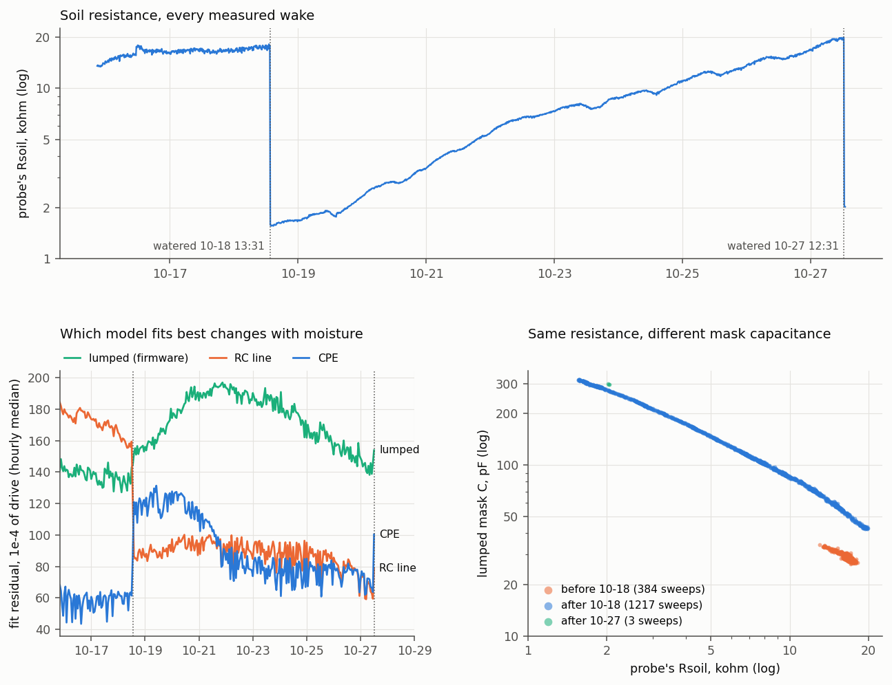

# MSV4 probe 11: the first full watering cycle of cloud raw sweeps (2026-10-15 to 2026-10-27)

This record follows `MSV4_SENSOR11_SWEEP_RECORD_2026-10-16.md`, which covered one day at one
moisture. Probe 11 (MSV4 board 2, Rs 3300, v262172) has now sent sweeps from 10-15 20:36 to
10-27 12:56. Over that time it went through one complete cycle in its own unweighed pot:

- watered 10-18 at about 13:31,
- dried for nine days,
- watered again 10-27 at about 12:29.

The 10-27 watering time comes from the maintainer, as does the plant: a Begonia. Both are recorded
in `MSV3/fleet.json`, `msv4_boards` board 2. The 10-18 watering is seen only in the telemetry; the
maintainer has not stated it. The pot is not weighed, so nothing here says which reading follows
the water best.

Reproduce:

    python MSV4/scripts/msv4_cloud_sweeps.py --sensor 11 --since-hours 290 --rs 3300 --cp 8.75 --cd0 13.71 \
        --out data/sensor_logs/msv4_sensor11_sweep_fits_2026-10-27.csv
    python cloud/scripts/fetch_supabase_history.py --receiver MSV2088A3104A7AC --sensor 11 --raw \
        --since-hours 290 --csv data/sensor_logs/msv4_sensor11_history_2026-10-27.csv
    python MSV4/scripts/msv4_sweep_cycle.py --fits data/sensor_logs/msv4_sensor11_sweep_fits_2026-10-27.csv \
        --history data/sensor_logs/msv4_sensor11_history_2026-10-27.csv \
        --water "2026-10-18 13:31" "2026-10-27 12:31" --plot MSV4/docs/msv4_sensor11_cycle_2026-10-27.png

The full output is in `data/sensor_logs/msv4_sensor11_cycle_2026-10-27.txt`. The script's
`--self-test` checks that it recovers a known temperature coefficient from a synthetic nine-day
dry-down that has a daily temperature swing.

## The feed (measured)

- **Sweeps stored:** 1,604 of the 1,678 measured wakes (95.6 %).
- **What was lost:** the main packet arrived for all 75 missing wakes, so the probe's own history
  is complete. What was lost each time is the scan response.
- **Longest gap:** 12 sweeps in a row, 10-20 09:36-11:26.
- **Fidelity:** refitting the cloud copy matches the probe's own Rsoil to a median of 0.000 %,
  worst 0.54 %.
- **Battery:** 3.82-3.85 V all twelve days and edging up since 10-22, so the cell is not draining.
  Commit 3eb51f9 measured it gaining charge on sunny days and not on the two dark days (10-21,
  10-22), so something on SP is harvesting. The panel itself is NOT STATED in fleet.json.

## The cycle (measured)

| | 10-18 after watering | 10-27 before watering | change |
|---|---|---|---|
| probe's Rsoil | 1,638 ohm | 18,770 ohm | x11.5 |
| lumped mask C | 308 pF | 44 pF | x0.14 |
| lumped Cd | 53.2 pF | 19.2 pF | x0.36 |
| CPE mask C | 154 pF | 12.0 pF | x0.08 |
| CPE n | 0.640 | 0.475 | -0.165 |
| receiver's stored number | 24,130 | 13,640 | -10,490 |

- **When it hit the dry bound:** the stored number crossed the receiver's dry bound (14,504) on
  10-26. It first touched it at 10:16 and stayed below from 11:46. That was 7.9 days after the
  10-18 watering. The maintainer watered 9.0 days after.
- **The step:** both waterings show up as a single step between consecutive sweeps.
  - 10-18: 13:26 -> 13:36.
  - 10-27: 12:26 -> 12:37.
- **10-27 vs 10-18:**
  - The 10-27 step reached Rsoil 2,030 ohm, against 1,570 ohm after 10-18 (1.3x higher).
  - The stored number reached 23,200 against 24,150.
  - Not stated: how much water each watering used, and whether either one had fertilizer.
  - The next few hours will show whether 10-27 keeps soaking in or holds where it is.

### Drying rate, day by day

Rsoil was corrected to 22 C at the measured -1.49 %/C, then compared at 06:00 and 18:00 each day.

| day | 24 h | day 06-18 | night 18-06 |
|---|---|---|---|
| 10-19 | +45 % | +13 % | +28 % |
| 10-20 | +51 % | +18 % | +28 % |
| 10-21 | +58 % | +24 % | +27 % |
| 10-22 | +27 % | +14 % | +12 % |
| 10-23 | +19 % | +8 % | +11 % |
| 10-24 | +29 % | +13 % | +14 % |
| 10-25 | +24 % | +11 % | +11 % |
| 10-26 | +24 % | +13 % | +10 % |

- **Measured:** the rate halved from 10-22 and stayed there, even though the afternoons got
  warmer (tip maximum 21.5 C on 10-22, 25.75-26.75 C on 10-23 to 10-26).
- **Measured:** in the first three days the nights rose faster than the days. After that, day and
  night were equal.
- **Not seen:** no daytime-faster pattern, which is what transpiration alone would give.
- **Not the dark days:** the maintainer reported 10-21 and 10-22 as dark and rainy (commit
  3eb51f9). But the 06:00 10-21 to 06:00 10-22 span was the fastest of the cycle (+58 %), and the
  rate did not recover when the sun came back on 10-23 to 10-26.
- **Inferred, not tested:** a fast early phase followed by a slower one is the usual pattern when
  soil dries (drainage, and evaporation from a wet surface, first).

## Which model fits best depends on the moisture (measured)

Median residual in 1e-4 of drive. The air floor is 55-63.

| phase, probe's Rsoil | sweeps | lumped (firmware) | CPE | two-branch | RC line | best |
|---|---|---|---|---|---|---|
| before 10-18, 14-18 kohm | 367 | 137-140 | 60-61 | 94-95 | 170-175 | CPE |
| after 10-18, under 5 kohm | 424 | 155-191 | 104-125 | 97-127 | 88-97 | RC line |
| after 10-18, 5-16 kohm | 704 | 154-193 | 78-83 | 97-119 | 80-91 | CPE |
| after 10-18, over 16 kohm | 89 | 142-148 | 72-75 | 89-94 | 69-73 | RC line |
| after 10-27, 2 kohm | 3 | 164 | 127 | 108 | 88 | RC line |

- **The 10-16 result does not generalise.** That record had the CPE best on every sweep, but it
  covered only the soil as first inserted. Over the cycle the RC line is best when wet and again
  when driest, and the CPE is best in between.
- **The firmware's lumped fit is never best.** Its residual is 1.8-2.3 times the best model's
  everywhere.
- **CPE n is not monotonic in water.** It went 0.64 wet, 0.44 at 3.5-14 kohm, then 0.48 at the dry
  end.

## Same resistance, different capacitance (measured)

The probe read 16-18 kohm both before the first watering and at the end of the cycle. The spectra
differ:

| at 16-18 kohm | before 10-18 (285 sweeps) | end of the cycle (41 sweeps) |
|---|---|---|
| lumped Cd | 20.3 pF | 19.9 pF |
| lumped mask C | 28.7 pF | 50.7 pF (x1.77) |
| CPE n | 0.595 | 0.471 |
| RC-line residual | 170 | 73 |

- **What differs:** Rsoil and Cd agree. The mask capacitance and the shape of the spectrum do not.
  The panel on the right of the figure shows the two states as separate branches.
- **Consequence:** a reading built on the mask capacitance, such as the soil-coupled
  Cm + Cd - Cd_air, does not map one-to-one onto one built on Rsoil, which is what the receiver
  displays. At the same resistance the two disagree about how wet the pot is, depending on its
  history.
- **Inferred, not tested:**
  - Candidate 1: the first full soak settled the soil against the blade, giving more mask contact
    at the same bulk resistance. That would match the one-way contact steps seen in the cup tests.
  - Candidate 2: water poured on top leaves a different moisture profile along the blade than the
    as-inserted soil had. That would suit the RC-line model, which describes a non-uniform path,
    fitting better after the watering.
  - Nothing measured so far separates the two.

## Temperature, now from a full cycle (measured)

Drying was removed with a piecewise-linear trend that has a knot every 12 hours. Over the cycle
the tip ranged 18.25-26.75 C.

| reading | tip coefficient | sweep-to-sweep scatter | wet-to-dry span / scatter | span per 1 C |
|---|---|---|---|---|
| probe's Rsoil | -1.48 +/- 0.03 %/C | 0.63 % | 390 | 165 |
| lumped mask C | +1.18 +/- 0.02 %/C | 0.42 % | 467 | 164 |
| lumped Cd | +0.46 +/- 0.02 %/C | 0.46 % | 219 | 220 |
| CPE mask C | +1.55 +/- 0.03 %/C | 0.73 % | 350 | 165 |
| RC-line R | -1.56 +/- 0.03 %/C | 0.62 % | 437 | 175 |
| RC-line mask C | +1.15 +/- 0.05 %/C | 1.58 % | 108 | 148 |
| two-branch mask C | +1.12 +/- 0.07 %/C | 1.64 % | 107 | 157 |

- **The 10-16 figures are superseded.** They were provisional, and these come from a whole cycle:
  Rsoil -2.24 (now -1.48), lumped mask C +1.40 (now +1.18), CPE mask C +2.12 (now +1.55).
- **Rsoil varies with wetness:** -1.76 %/C on the wet half of the cycle, -1.38 %/C on the dry
  half.
- **No reading escapes temperature.** Every one moves 0.45-0.7 % of its own wet-to-dry span per
  degree. On a 6 C day that is 3-4 % of the span.
- **Every reading resolves the cycle easily.** Each spans 100-470 times its own sweep-to-sweep
  scatter.
- **The firmware's Rsoil is as good a moisture reading as any other model's.** It has the same
  temperature share and about 390 times its scatter.

### The receiver's stored number

The stored number is 10,000 per decade of Rsoil, corrected to 25 C at the textbook 2 %/C
(`MSV4_EC_TEMPCO_PER_C`). This probe measures about 1.5 %/C, so the correction overshoots:

- **Over the whole cycle:** -28.1 +/- 1.0 counts per degree.
  - Wet half: -19.7 counts per degree.
  - Dry half: -31.8 counts per degree.
- **What that does on screen:** warm afternoons read drier. On 10-23 to 10-26 the tip swung
  5.75-6.75 C a day, which is 160-190 counts, or about 1.5-1.8 % of the 10,490-count cycle.
- **What would cancel it on this probe:** a 1.5 %/C correction. The constant is shared with probe
  10, which was measured at about 1.5-2 %/C on 10-10, so it is not changed here.
