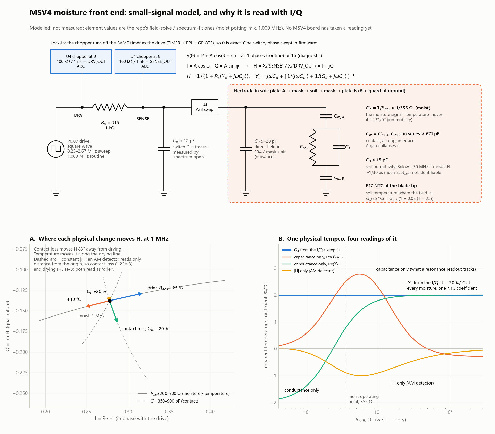

# MSV4 small-signal model, and the case for I/Q demodulation (2026-09-29)

**Everything here is modelled.** No MSV4 board has taken a reading. Element values are the repo's
field-solve / spectrum-fit ones for moist potting mix at the 1.000 MHz routine frequency. Reproduce
with `python MSV4/scripts/msv4_small_signal_iq_figure.py`. It imports `node_h`, the Python replica
of the firmware's `specNodeH` in
[`test_msv4_spectrum_fit.py`](../scripts/test_msv4_spectrum_fit.py), so the figure and the fit use
the same model.



A clean version for slides, with symbols only and no values, is
[`MSV4_SENSOR_SMALL_SIGNAL_SCHEMATIC.png`](MSV4_SENSOR_SMALL_SIGNAL_SCHEMATIC.png)
(`python MSV4/scripts/msv4_sensor_schematic.py`, needs `pip install schemdraw`). It draws the
textbook two-mixer I/Q demodulator. The board gets the same I and Q from one chopper swept in phase.

## The model, as built

Net names are from [`PIN_NET_REFERENCE.md`](../hardware/reference/PIN_NET_REFERENCE.md).
`DRV` (P0.07 square wave) → R15 = Rs = 1 kΩ → `SENSE` → U3 A/B swap → electrode A (B and guard at
ground). U4 chops `SENSE` and `DRV` at phase θ into R18/C18 and R19/C19 (100 kΩ / 1 nF) and on to the
ADC. The chopper and the drive come off one TIMER, so θ is exact. R17 is the NTC at the blade tip.

```
H(jw) = V_SENSE / V_DRV = 1 / (1 + Rs (Ye + jw Cp))
Ye    = jw Cd + [ 1/(jw Cm) + 1/(Gs + jw Cs) ]^-1          Cm = CmA, CmB in series
```

| element | value (moist) | carries | temperature |
|---|---:|---|---|
| Gs = 1/Rsoil | 1/355 Ω | **moisture** | +2 %/°C (ion mobility) |
| Cm | 671 pF (each mask ~1.34 nF) | contact, air gap, interface | taken as 0 |
| Cs | 14.9 pF | permittivity | −0.4 %/°C (water) |
| Cd | 5 pF | direct field in FR4 / mask / air | 0 |
| Cp | 12 pF | switch C + traces (`spectrum open` measures it) | 0 |

At 1 MHz, ωRsoilCm = 1.50. The electrode is neither a capacitor nor a resistor at the operating
point: H = 0.278 − 0.138j, |H| 0.310, phase −26.4°.

## 1. One physical temperature coefficient reads four different ways

The soil carries +2 %/°C in conductivity everywhere. What each reading reports per °C:

| Rsoil | ωRCm | \|H\| only (AM) | capacitance only, Im(Ye)/ω | conductance only, Re(Ye) | **Gs from I/Q fit** |
|---:|---:|---:|---:|---:|---:|
| 30 kΩ | 126 | −0.05 | −0.28 | +2.00 | **+1.98** |
| 3 kΩ | 12.6 | −0.47 | +0.43 | +1.97 | **+1.98** |
| 1 kΩ | 4.2 | −0.90 | +2.30 | +1.79 | **+1.98** |
| 355 Ω | 1.5 | −0.89 | +2.51 | +0.79 | **+1.98** |
| 150 Ω | 0.63 | −0.34 | +1.11 | −0.82 | **+1.98** |
| 60 Ω | 0.25 | −0.02 | +0.24 | −1.74 | **+1.98** |

(+1.98 is ln(1.02); it is the same +2 %/°C.)

A single-number readout projects the soil's +2 %/°C through a gain that depends on moisture. Across
the range, capacitance-only goes −0.28 → +2.51 → +0.24 and changes sign, conductance-only goes
+2.00 → −1.74 and changes sign, and |H| varies ×45. **No single compensation coefficient can
correct any of them.** The fitted Gs carries the physical coefficient at every moisture, so the tip
NTC removes it with one constant. MSV3's record looks like this: its FDC coefficients changed sign
between probes and across a watering, and `k·excess·(T − Tref)` compensation stalled at 77 %
(`MSV3_AM_VS_FM_SENSING_THERMAL_SELECTIVITY_2026-09-13.md`). That match is consistent with the
model; it is not a test of it.

## 2. Contact loss and drying separate in the I/Q plane, not in |H|

Direction each change moves H at 1 MHz, in degrees:

| Rsoil | +10 °C | drier, Rsoil +25 % | contact loss, Cm −20 % | Cs +20 % | contact vs drying |
|---:|---:|---:|---:|---:|---:|
| 1 kΩ | −177.9 | +0.6 | −75.8 | −88.6 | **76°** |
| 355 Ω | −165.9 | +12.5 | −70.3 | −76.7 | **83°** |
| 150 Ω | −159.8 | +19.2 | −65.8 | −70.2 | **85°** |

- Contact loss and drying move H 76–85° apart, so I and Q separate them. A magnitude-only detector
  cannot. At 355 Ω both *increase* |H| (+22e-3 for contact, +34e-3 for drying), so a probe pulling
  away from the soil reads as the soil drying.
- **Temperature moves H along the drying line** (178° from it at the moist point). I/Q does **not**
  separate temperature from moisture by direction. That is the NTC's job. What I/Q adds is isolating
  the one parameter, Gs, whose temperature dependence is known physics.
- Permittivity (Cs +20 %) moves H by 1.2e-3 against Rsoil +25 %'s 42.7e-3, about 1/30 per percent
  change. Below ~30 MHz this is a conductivity instrument. That agrees with
  `MSV4_SPECTRUM_FIT_CONDUCTANCE_ONLY_2026-09-23.md`, which dropped Cs from the fit.

## Why this matters for the thermal finding

[`MSV3_ALOCASIA_ELECTRODE_VS_CIRCUIT_2026-09-29.md`](../../MSV3/docs/MSV3_ALOCASIA_ELECTRODE_VS_CIRCUIT_2026-09-29.md)
found that the daily swing enters at the electrode and depends on the installation. In this model,
an interface change lands in Cm, which the sweep fit reports separately from Gs. A single-number
readout folds it into the moisture reading. Whether MSV4's real swing lands in Cm or in Gs is the
first thing its `moisture` log (`Rsoil25`, `Cm`, `Cd`) will show.

## Limits

- Cm and Cd are taken as temperature-independent. A real mask or interface tempco would show up in
  Cm, which is still better than having it mixed into Gs.
- 2 %/°C is the firmware's constant. Real potting-mix EC coefficients run about 1.8–2.2 %/°C, so
  expect a residual of about ±0.2 %/°C after correction.
- The lumped model's own bias against distributed physics is +1.2 % (dry) to +9.1 % (saturated) in
  Rsoil (spectrum-fit doc).
- The chopper and drive are square waves, so harmonics alias onto the fundamental. The firmware's
  `specModel` models that; this figure uses the fundamental only.
- Cp is the 12 pF default until `spectrum open` measures it on a real board.
