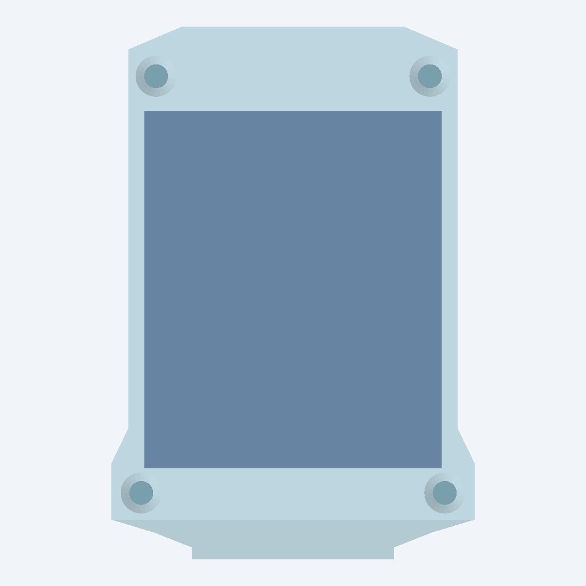
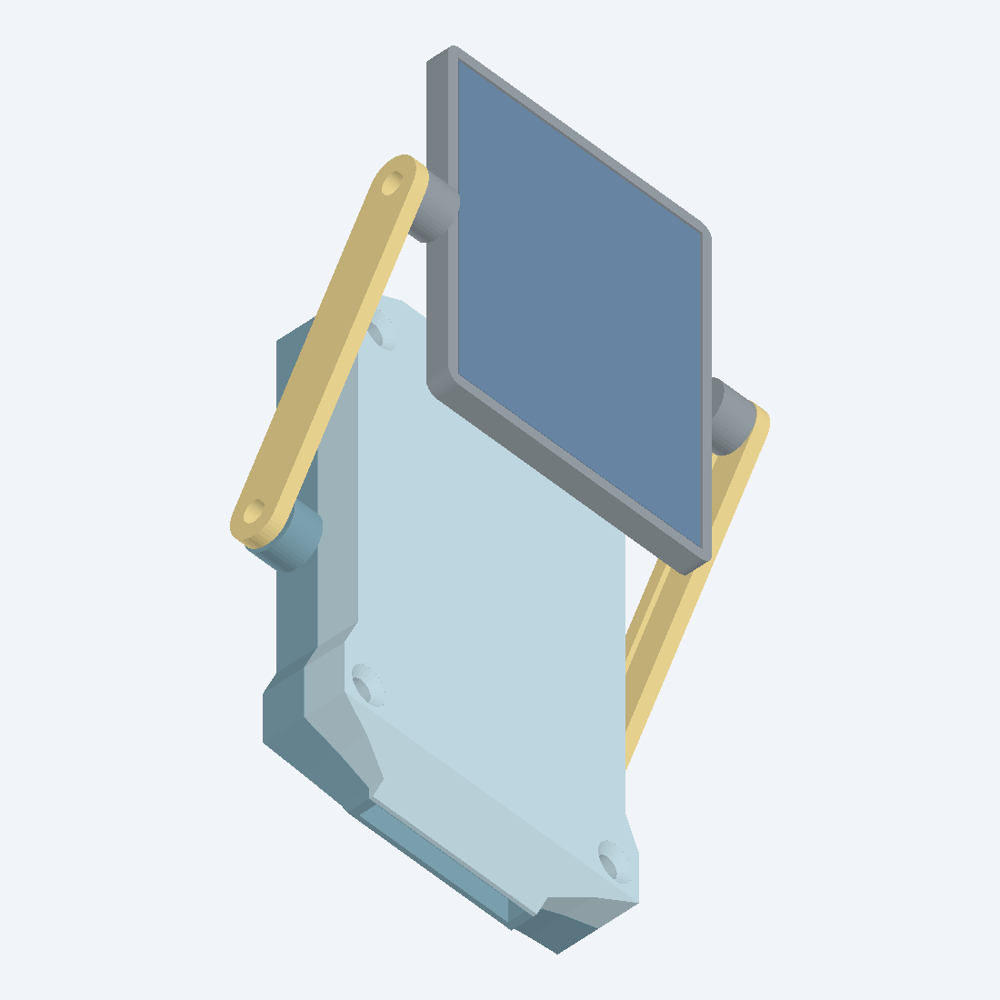
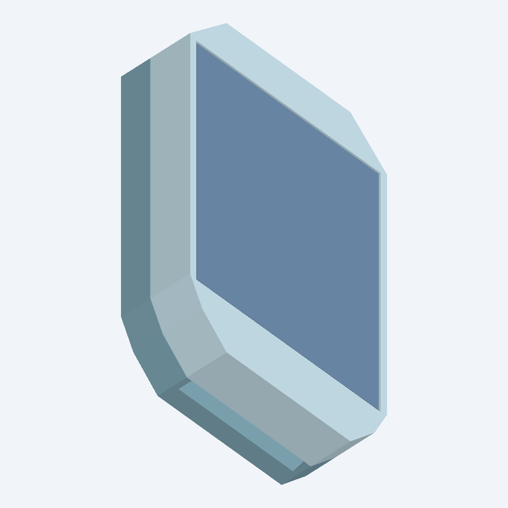

# MSV4 low-profile probe enclosures

This directory contains three printable, electronics-only enclosures derived
from the actual `../MSV4.step` assembly:

- **Integrated solar** - an MSV2-style lid with a bonded 36 x 30 mm panel
  recessed into its top.
- **Arm solar** - an MSV3-style articulated mount with two printable arms and
  a 36 x 30 mm panel frame.
- **Minimum-profile integrated solar** - a screwless two-piece enclosure with
  a thin closed back/base and a bonded solar lid. It has no gasket, screws,
  inserts, or moving parts. A PCB-shaped groove in the base registers the board
  during assembly.

All three enclosure bases have a teardrop window centered over the upper D1 LED
package on the back of the PCB. The point faces upward toward the antenna/top
edge. Fill this window flush with optically clear epoxy after assembly to make
the status LED visible without leaving an open water path.

All variants leave the sensing blade exposed. Version 5 follows the actual PCB
shoulders into a 20.4 mm-wide neck around the 18 mm blade. In side profile, the
top and bottom faces slope down to a 3.0 mm-thick shell around the 1.6 mm PCB,
instead of ending in a full-thickness rectangular wall. The central body is
33.2 mm wide; only the front screw shoulder reaches 36.6 mm so every M2
countersink has a complete circular land. Overall length is 53.7 mm.

The top-side cavity roof is fixed at 4.0 mm above the PCB. The base is no longer
sized around the battery: its floor follows the actual bottom-side component
envelope from `MSV4.step`, with 0.354 mm clearance below the lowest SWD/LED
geometry and a 1.2 mm closed floor. The battery belongs above the PCB.







## Deliverables

The source STEP assemblies and individual bodies are in `output/`. Files ending
in `_print.stl` are oriented and ready for OrcaSlicer or Bambu Studio. See
`output/PRINT_IN_BAMBU_OR_ORCA.md` before printing.

Convenience packages:

- `MSV4_v5_integrated_solar_slicer_pack.zip`
- `MSV4_v5_arm_solar_slicer_pack.zip`
- `MSV4_v5_minimum_profile_solar_slicer_pack.zip`
- `MSV4_v5_three_enclosure_CAD_pack.zip`

## Recommended development workflow

Start with the two reopenable, screw-closed versions while the electronics are
still being developed:

1. Print and test the **integrated solar** enclosure as the static-panel,
   non-arm baseline.
2. Print and test the **arm solar** enclosure to determine whether adjustable
   panel angle produces enough practical charging benefit to justify the extra
   parts, hardware, assembly time, and potential weather-sealing points.
3. Compare charging performance, placement flexibility, durability, water
   resistance, handling, and overall bulk while firmware, sensing behavior,
   battery operation, and solar charging are still being finalized.
4. Move to the permanently bonded **minimum-profile integrated solar**
   enclosure only after those systems are stable enough that routine access to
   the PCB is no longer needed.

A future arm-mounted enclosure with a glued base-to-lid seam and no body screws
may be worthwhile if testing shows that adjustable solar angle is valuable but
the case fasteners are not. That version is intentionally deferred; it is not
part of the current v5 release.

The normal assemblies contain the enclosure parts plus a clearly named
do-not-print solar-panel reference. The fit-check assemblies additionally
contain the corrected PCB and an illustrative 10 x 20 x 2 mm top-side battery
placement reference. The minimum-profile fit check also includes a red E73
antenna keepout reference. The STEP assemblies open directly in Fusion 360
and preserve separate assembly solids; no Fusion conversion is required.

## Design basis

The source STEP contains 233 solids. Its exported PCB substrate is 0.41148 mm
thick, while the MSV4 fabrication files specify 1.60 mm FR4. The fit-check
models preserve the top surface and move the bottom-side components down by
1.18852 mm. This avoids false clearances from the thin raw export.

The reconstructed 1.60 mm substrate is checked bidirectionally against the
original STEP footprint. The mismatch volume is 0 mm3. The validator also
checks the complete straight blade through both halves of the split throat;
the collision volume is 0 mm3 in both variants.

Measured and checked version 5 clearances are:

- 0.35 mm at each PCB side
- 0.898 mm above the tallest top component within the 4.0 mm roof envelope
- 0.354 mm below the lowest corrected bottom component
- 0.250 mm below the illustrative top-side battery placement
- 0.100 mm between that 2.2 mm battery reference and the internal roof
- 0.10 mm nominal PCB rail clamp interference
- 1.321 mm minimum arm sweep clearance over the lid
- 0 mm3 battery-to-component, panel-to-pocket, and reference-to-shell collision
- 100% of the validated perimeter ring present around all eight case countersinks

The integrated-panel central case is 10.90 mm thick and the arm-mount central
case is 9.50 mm thick. The arm pivot bosses are local features and bring that
variant to 10.10 mm only at the pivots. These stacks retain a 1.2 mm closed
floor and a 0.8 mm solar-pocket back wall while holding the user-selected
4.0 mm board-to-roof space.

The minimum-profile enclosure is 10.65 mm thick overall and 32.4 x 50.2 mm in
plan. Its base provides a 1.0 mm closed back below the component cavity. The
groove follows the real PCB head and shoulder with 0.25 mm XY and 0.15 mm Z
clearance, while the lowest corrected back-side component has 0.304 mm floor
clearance. The panel ends at Y = 140.00 mm; the E73 antenna keepout begins at
Y = 140.75 mm, giving a checked 0.75 mm plan-view separation.

The solar-panel pocket is 36.4 x 30.4 x 1.6 mm. The physical panel thickness
was not supplied. Measure it before committing to a final print and change
`solarPanelRecessDepth` in `design/generate_enclosures.mjs` if necessary.
Version 5.1 places the two 1.6 mm lead passages as a centered pair, 4.0 mm
apart, to match the rear terminals on the new 2.5 V panels. This centered
layout is shared by the integrated lid, minimum-profile lid, and arm frame.

## Water resistance

The design keeps the useful MSV3 features: continuous PCB retention, a split
close-fit blade throat, blind insert pockets, base-owned arm pivots, covered
wire passages, and a gasket land. The lid is now one continuous top skin. This
removes the old two-level, scalloped roof that looked like an inverted tray.

The seal path is a 0.80 mm-wide by 0.55 mm-deep groove. Use silicone cord,
formed-in-place RTV, or the supplied 0.8 mm TPU gasket. The gasket is open only
at the blade exit, where the split throat must be sealed with neutral-cure RTV
or a suitable potting compound. Seal the panel perimeter and wire passages as
described in the print guide.

This is a waterproof-oriented FDM design, not an IP-rated housing. Leak-test an
empty enclosure before installing electronics.

The minimum-profile enclosure has a closed back but no gasket or fasteners.
After confirming the board is fully seated in its base groove, bond and seal
the complete base-to-lid seam with electronics-compatible epoxy or outdoor
polyurethane adhesive. Seal the panel perimeter, wire passages, probe exit,
and LED window before leak testing.

## Fasteners

The integrated and arm cases use:

- integrated version: 4 x M2 x 10 mm, 90-degree countersunk flat-head screws
- arm version: 4 x M2 x 8 mm, 90-degree countersunk flat-head screws
- 4 x M2 heat-set inserts, nominally 3 mm OD x 3 mm long

The insert pilots are blind, 2.90 mm diameter x 3.20 mm deep. The arm variant
adds four M2 x 5-6 mm pivot screws and four more inserts of the same size.
Insert brands vary; verify one sacrificial pocket before installing all of them.
The minimum-profile enclosure uses no screws, inserts, gasket, or other
hardware; its lid is permanently bonded to the base.

## Regeneration and verification

From this directory:

```powershell
node design/generate_enclosures.mjs
node tools/validate_enclosures.mjs
```

The validator checks solid counts, source-PCB fidelity, component collisions,
fastener openings, arm sweep, assembly overlap, and STL manifoldness. The
current report is `output/MSV4_enclosure_validation_report.json`.

If native Fusion archives are desired later, run
`fusion/MSV4_Enclosure_Assemblies/MSV4_Enclosure_Assemblies.py` from Fusion's
Utilities > Scripts and Add-Ins dialog. It imports the checked STEP assemblies
and writes F3D plus Fusion-translated STEP files to `output/fusion_exports/`.
