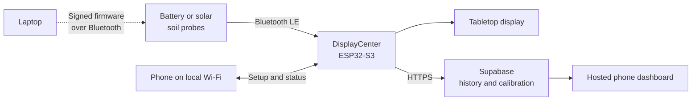

# Project Treebeard

**A wireless plant monitor built to answer one useful question: *does this plant need water?***

Project Treebeard is a ground-up hardware and software system for watching the moisture cycle of
houseplants. Small battery-powered probes sit in the soil, a tabletop receiver listens to them over
Bluetooth, and a local or hosted dashboard turns the readings into plant status and history.

This is an active engineering project, not a finished commercial sensor. The MSV2 system has been
monitoring real plants for months. MSV3 is the custom-PCB generation currently in the soil, and
MSV4 — a redesigned probe that came directly out of what MSV3 measured — was ordered on
**2026-09-19**.

<p align="center">
  
  &nbsp;&nbsp;
  
</p>

<p align="center"><em>The MSV3 solar-probe concept and the shared DisplayCenter receiver.</em></p>

[Open the hosted dashboard](https://msv2-plants.netlify.app) ·
[Read the current status](docs/STATUS_HANDOFF.md) ·
[See what is actually plugged in where](MSV3/fleet.json) ·
[Follow the engineering story](docs/paper/MSV_EVOLUTION_IEEE_PAPER_DRAFT.md)

## Where things stand

*Physical state last verified with the maintainer on 2026-09-19.*

| Piece | State |
| --- | --- |
| **MSV2 probes** | Deployed and in daily use, indoors and outdoors. |
| **DisplayCenter receiver** | Deployed. Runs the plant display, the phone setup app, and cloud upload. |
| **Cloud dashboard** | Live at the link above. |
| **MSV3 probes** | Five boards built. Three in soil, one on the desk as a temperature reference, one powered off. All of them update over Bluetooth. |
| **MSV4 probes** | Schematic, layout and bring-up firmware done; **five boards ordered 2026-09-19**. Nothing built yet. |

### Recent milestones (September 2026)

- **MSV3 probes update themselves over Bluetooth.** A signed bootloader, a fleet registry, and a
  fail-closed preflight mean a probe buried in a pot — or sealed in conformal coating with no
  physical access left — can still take new firmware safely.
- **The bare-tank reference channel was retired** in exchange for a roughly **4× larger** soil
  response. Hardware, firmware, receiver and cloud all changed together.
- **The coating problem was explained** — and the explanation turned out to be a geometry problem,
  not a chemistry one. It is the main reason MSV4 exists.
- **A solar bug that had been quietly overcharging cells** was traced to the panel's voltage, not
  the charger's settings.
- **MSV4 was designed, audited against its own netlist, and ordered**, with a new electrode, a new
  front end, and a new solar array.
- **The receiver got more reliable.** The periodic display freeze, the missing learned percentages,
  and the failing cloud uploads each had a real root cause; all three are fixed and running.

## The system in one minute

Each probe wakes briefly, takes a capacitive measurement, broadcasts it, and returns to sleep. The
wall-powered DisplayCenter does the expensive work: it listens continuously, filters readings,
shows every plant on its screen, hosts the setup interface, and uploads history when Wi-Fi is
available. The plants remain visible locally even if the internet is down.



In day-to-day use, the system can:

- monitor several plants from one receiver;
- show moisture, battery level, stale probes, and watering alerts;
- configure plant names, artwork, probe assignments, Wi-Fi, and calibration from a phone;
- retain raw and filtered history instead of only showing the latest value;
- learn plant-specific dry and wet ranges from supported watering cycles;
- apply temperature compensation to MSV3 readings in the receiver and in the cloud; and
- expose detailed diagnostics for packet loss, battery behavior, and sensor experiments.

## Where the project is now

### MSV2: the working field system

MSV2 proved the complete product architecture. Its nRF52840 probes measure a relaxation oscillator,
send short BLE advertisements, and sleep between readings. The shared ESP32-S3 receiver, local setup
app, Supabase backend, and hosted dashboard were all developed around these probes and are in active
use.

Field testing also uncovered the unglamorous problems that make real sensor products difficult:
sleep-current leaks, timer quantization, BLE packet loss, receiver concurrency, long-history
pagination, stale web caches, and calibration drift. Those failures and their fixes are preserved in
the repository rather than polished out of the story.

### MSV3: the probe currently in the soil

MSV3 replaced GPIO timing with a dedicated **FDC2214 28-bit resonant capacitance converter**, added
a **TMUX1109** to switch the electrode routing and an **E73/nRF52840** module for measurement and
BLE, and gave the probe a solar power path. The custom board, firmware, enclosure, solar mount, and
manufacturing files all live here.

**What is now solid:**

- **Field-updatable firmware.** Probes run a custom signed bootloader and accept new images over
  Bluetooth in roughly 30–50 seconds. A registry ([`MSV3/fleet.json`](MSV3/fleet.json)) binds each
  probe's identity to the Bluetooth addresses it is allowed to appear on, so an image built for one
  plant cannot silently land on another and mix two plants' data. The updater refuses tampered
  packages, downgrades, and any image the probe could not be recovered from afterwards. USB is a
  second, equal transport for boards on a bench, and a battery probe pays nothing for it.
- **A much larger soil signal.** Removing one fixed capacitor (`C17`) roughly quadrupled the
  response to moisture. The cost was the disconnected "bare tank" reference channel, which is no
  longer measurable — and which had only been removing about 12% of the daily wobble anyway.
- **Low power, measured rather than estimated.** Timed sleep is **10–15 µA**; averaged over real
  wake cycles a probe draws about **126 µA / 528 µW**, or **3.03 mAh/day** — roughly 50 days on a
  full cell with no sun at all. A working solar path measured **8–9 mAh/day** of harvest.
- **Rich telemetry.** Every packet carries the moisture count, die temperature, battery voltage,
  mux phase, and status flags, so environmental drift can be studied instead of guessed at.

**What is still open:** the probe reads **drier when it gets warmer**, and that is essentially the
whole remaining problem. A probe left by a window read *flat in air* and *flat in pure water*, then
wobbled substantially in moist soil — so the effect needs the soil itself, not the board. Four
sensors now share one Alocasia pot to separate how much of the drift comes from the **electrode**
and how much from the **readout electronics**. The working model is that both contribute, which is
why earlier single-cause answers kept contradicting each other.

> [!IMPORTANT]
> MSV3 reports an experimental capacitance-related signal, not laboratory-calibrated volumetric
> water content. Its higher numerical resolution does not automatically make it a better soil
> sensor; sealing, electrode geometry, acquisition timing, and calibration still have to be proven
> together.

Recent detail: [electrode vs. readout thermal comparison](MSV3/docs/MSV3_ELECTRODE_VS_READOUT_THERMAL_2026-09-19.md),
[the no-bare-tank policy](MSV3/docs/MSV3_CAPLESS_NO_BARE_TANK_POLICY_2026-09-14.md),
[solar charging state](MSV3/docs/MSV3_SOLAR_CHARGING_STATE_2026-09-19.md).

### MSV4: designed from what MSV3 measured

MSV4 is not a tidy-up of MSV3. Three measurements pointed at three different parts of the design,
and all three change:

- **A new electrode** — two symmetric electrodes inside a guard ring, mirrored front and back on an
  18 × 110 mm blade, with a temperature sensor at the tip.
- **A new front end** — the FDC2214 comes out, replaced by a single chopper switch with phase *and*
  frequency as firmware parameters. That is a software lock-in amplifier, deliberately run at a
  fixed 1–3 MHz rather than tracking a resonance.
- **A new solar array** — two commodity 1.5 V panels in parallel, comfortably inside the charger's
  input limit, instead of one 6 V panel that was well outside it.

Bring-up firmware, a BLE console, a build script, a pin/net reference and an electrode field solver
are written and checked in, and the layout was audited pin-for-pin against its final netlist. None
of it has run on hardware yet — the boards were ordered on 2026-09-19.

Start here: [MSV4 electrode architecture](MSV3/docs/MSV4_ELECTRODE_ARCHITECTURE_2026-09-15.md),
[MSV4 front-end architecture](MSV3/docs/MSV4_FRONT_END_ARCHITECTURE_2026-09-16.md),
[bring-up firmware and first-board checklist](MSV4/docs/MSV4_BLE_BRINGUP_FIRMWARE_2026-09-18.md).

## Three findings that changed the design

**1. Electrode spacing alone sets how deep the probe can see.** Penetration depth works out to
`spacing / π`, and nothing else in the geometry matters — not finger count, not blade length, not
board area. MSV3's 1.5 mm pitch reads a soil skin only **0.48 mm** thick. That is why coating the
probe hurt so much: a 75 µm coating holds **14.5%** of MSV3's field energy, absorbs water,
saturates, and then stops responding to the soil. No change of coating material can fix a 0.48 mm
sensor. The MSV4 electrode reaches **2.90 mm** and drops the coating's share to **2.6%**.

**2. The temperature wobble lives in the soil, not the board.** The same uncoated probe was flat in
air and flat in pure water, and only wobbled in moist soil — which rules out the board, the clock,
the inductor, the battery, and temperature acting on the electronics. Dissolved-ion mobility rises
about 2 %/°C, and soil conductivity reaches the converter as apparent capacitance. The outstanding
experiment is a salty-water test, to separate a conductivity artefact from genuine thermally driven
moisture movement.

**3. The solar charger's overvoltage protection was never doing anything.** A boost converter
cannot output below its input. The 6 V panel exceeded the BQ25504's 3 V recommended input, so
current took the high-side body diode straight to the cell — a passive path with no comparator to
stop it. One cell reached 4.49 V while a 3.89 V ceiling was programmed. The fix is a clamp on the
panel input now, and in MSV4 a panel that never gets near the limit.

## How the design evolved

| Generation | The idea | What it taught the project | Status |
| --- | --- | --- | --- |
| **MSV1** | Interdigitated PCB sensor, two 555 timers, analog filtering, and a comparator | Soil capacitance was measurable, but the analog output compressed most of the useful range | Completed proof of concept |
| **MSV2** | Digitally count a capacitive oscillator and broadcast it from a sleeping nRF52840 | A practical monitor is a whole system: sensing, power, radio, display, calibration, and history all matter | Deployed and actively used |
| **MSV3** | Custom FDC2214/TMUX probe with solar harvesting and a purpose-built enclosure | Resolution was not the bottleneck. Electrode geometry, soil temperature, and the solar input limit were | In soil, under active validation |
| **MSV4** | New electrode geometry, a firmware-defined lock-in front end, and a safe solar array | — | Ordered 2026-09-19, not yet built |

MSV2 and MSV3 are not separate ecosystems. Both report to the same DisplayCenter and appear in the
same local and hosted dashboards.

## Repository tour

| Folder | What lives there |
| --- | --- |
| [`MSV1/`](MSV1/) | Original analog prototype and final course report |
| [`MSV2/`](MSV2/) | Working XIAO nRF52840 probe firmware, experiments, and field notes |
| [`MSV3/`](MSV3/) | Custom FDC2214 probe: firmware, PCB, enclosure, solar, bootloader, procurement, validation |
| [`MSV4/`](MSV4/) | Next-generation probe: bring-up firmware, layout reference, BOM, procurement |
| [`DisplayCenter/`](DisplayCenter/) | ESP32-S3 receiver/display firmware, local phone UI, assets, enclosure, test scripts |
| [`cloud/`](cloud/) | Supabase migrations and Edge Function plus the Netlify-hosted dashboard |
| [`docs/`](docs/) | Current handoff, known issues, roadmap, and the cross-generation engineering paper |
| [`hardware/`](hardware/) | Shared Altium libraries and cross-generation procurement |
| [`data/`](data/), [`dumps/`](dumps/) | Captured measurements and probe diagnostic dumps used for debugging |
| [`scripts/`](scripts/) | Shared tooling: the BLE OTA updater, the fleet scanner, and the SWD utilities |

If you are trying to understand a specific subsystem, start in that subsystem's `docs/` directory.

> [!NOTE]
> **Dated documents are history, and they are never edited after the fact.** Hardware moves between
> work sessions. [`MSV3/fleet.json`](MSV3/fleet.json) is the only place that describes the
> *present* — where each probe is, which electrode is in its soil, what powers it, and what has been
> reworked. Read it before drawing conclusions from any dated write-up.

Checked-in source, successfully compiled firmware, flashed firmware, and observed live behavior are
deliberately treated as four different claims throughout this repository.

## Getting started

### I just want to see what it does

- Visit the [hosted dashboard](https://msv2-plants.netlify.app). The historical `MSV2` URL remains
  in use so existing receivers and saved links continue to work.
- Read the short [engineering paper](docs/paper/MSV_EVOLUTION_IEEE_PAPER_DRAFT.md).
- Browse the [MSV3 enclosure renders](MSV3/hardware/MSV3_Probe_PCB_Enclosure/renders/) or the
  [DisplayCenter hardware](DisplayCenter/hardware/MSV2_ESP32_DisplayCenter/V2/).

### I want to work on the firmware

The firmware helpers expect Windows PowerShell and the `arduino-cli.exe` bundled with Arduino IDE.
They perform clean, repeatable builds and keep generated files outside the sketch directories.

From the repository root:

```powershell
# Working MSV2 probe
powershell -ExecutionPolicy Bypass -File MSV2\scripts\arduino_probe.ps1 -Action compile

# Shared ESP32-S3 DisplayCenter
powershell -ExecutionPolicy Bypass -File DisplayCenter\scripts\arduino_display.ps1 -Action compile

# MSV3 field firmware
powershell -ExecutionPolicy Bypass -File MSV3\scripts\arduino_msv3_probe.ps1 -Action doctor
powershell -ExecutionPolicy Bypass -File MSV3\scripts\arduino_msv3_probe.ps1 -Action compile -Sketch arduino/MSV3_Moisture_BLE_Sleep

# MSV4 bring-up firmware
powershell -ExecutionPolicy Bypass -File MSV4\scripts\arduino_msv4_probe.ps1 -Action doctor
```

> [!WARNING]
> **Always use the per-generation script — never the Arduino IDE Upload button and never a raw
> `arduino-cli` command.** MSV3 and MSV4 need *opposite* clock settings. The MSV3 board has no
> 32.768 kHz crystal and must select the internal oscillator before Bluetooth, FreeRTOS, or RTC code
> can start; MSV4 has a crystal and no USB. Each script enforces its own board's rules and refuses
> unsafe states. Run the `doctor` action first, and read [Known Issues](docs/KNOWN_ISSUES.md)
> before changing clock, sleep, watchdog, or BLE behavior.

Updating a deployed MSV3 probe over Bluetooth goes through `scripts/ble_ota_update.py`, which
resolves `--probe N` through the fleet registry; run it with `--preflight-only` first. Wired SWD
work goes through the scripts in [`scripts/`](scripts/), which wait for stable pogo-pin contact
before touching a target, because the pins are held by hand. Both workflows are spelled out in
[`CLAUDE.md`](CLAUDE.md).

Upload and serial-monitor commands, board ports, required libraries, Wi-Fi provisioning, and local
receiver endpoints are covered in the [DisplayCenter guide](DisplayCenter/README.md). MSV3 hardware
bring-up and production details are under [`MSV3/docs/`](MSV3/docs/).

### I want to run the cloud side

The root [`netlify.toml`](netlify.toml) publishes
[`cloud/web/plant-dashboard/`](cloud/web/plant-dashboard/). Supabase schema, security, Edge Function,
claiming, and receiver-bootstrap instructions are in the
[Supabase setup guide](cloud/docs/SUPABASE_SETUP.md).

The receiver is intentionally local-first: it makes outbound HTTPS requests, but it should never be
exposed directly to the internet. Wi-Fi credentials stay on the receiver, while remote access uses
per-device secrets and account-free household share tokens.

## What comes next

**On the bench, before the MSV4 boards arrive:**

1. finish the electrode-versus-readout comparison in the shared pot, which is waiting on one bench
   measurement of the older front end's millivolts-per-picofarad slope;
2. run the salty-water test that separates a conductivity artefact from real moisture movement; and
3. confirm whether the solar clamp on probe 7 actually caps its cell, and whether probe 4's daytime
   charging returns once its battery falls back into the harvester's restart band.

**When the MSV4 boards land:**

4. bring up one board — crystal, radio, console, then the frequency sweep;
5. characterise the new electrode against the older reference electrode in the same pot; and
6. prove the solar energy budget through real light and low-battery conditions.

Only after those pass does it make sense to turn a raw count into a confident plant-moisture scale,
or to call any probe production-ready.

## Project notes

Project Treebeard is a personal, experimental hardware project by **Sam Amezcua**. It includes
working deployments alongside unfinished research, failed approaches, diagnostic firmware, and
manufacturing iterations. That history is intentional: it is often the most useful part of the
repository for anyone building a low-power environmental sensor.

This repository does not currently include an open-source license. Please do not assume permission
to redistribute the hardware or software as a product.
