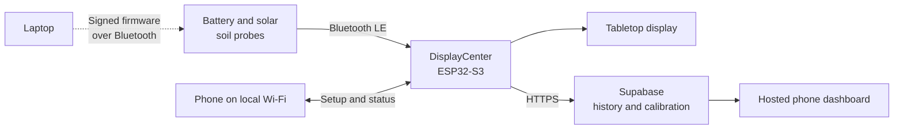

# Project Treebeard

**A wireless plant monitor built to answer one question: *does this plant need water?***

Project Treebeard is a home-built system for watching how the soil in a houseplant's pot dries out
and gets watered again. A small probe sits in the soil and runs on a battery topped up by a tiny
solar panel. A receiver on a shelf listens to the probes over Bluetooth and shows each plant on a
screen. A phone dashboard keeps the history.

Sam Amezcua designed the hardware: the circuit boards, the analog front ends and sensing
electrodes, the solar power path, the enclosures, and every bench and field test. He specified,
debugged and validated the firmware, receiver software and cloud backend, which were implemented
with AI coding agents (Claude Code and Codex) under his direction. The project started in April
2026 with MSV1. It is an active engineering project, not a finished product, and the repository
keeps the failures alongside the things that worked.

<p align="center">
  
  &nbsp;
  
  &nbsp;
  
</p>

<p align="center"><em>An MSV3 probe in its pot, five probes sharing one pot for a side-by-side test,
and the DisplayCenter receiver.</em></p>

[Open the hosted dashboard](https://msv2-plants.netlify.app) ·
[See where every probe is right now](MSV3/fleet.json) ·
[Read the latest write-up](MSV4/docs/MSV4_MOISTURE_SLOPE_AND_THERMAL_FIT_2026-10-17.md) ·
[Follow the engineering story](docs/paper/MSV_EVOLUTION_IEEE_PAPER_DRAFT.md)

## The hardware

Every board was designed in Altium. Each one links to its schematic, layout and the Gerbers it was
built from.

**MSV4 probe** (current): a lock-in impedance front end built from two analog switches, a guarded
two-electrode blade, a soil-temperature NTC at the tip and solar charging. 2 layers.
[Board page](MSV4/hardware/MSV4_Probe_PCB/) ·
[Schematic](MSV4/hardware/MSV4_Probe_PCB/images/MSV4_schematic_overview.png) ·
[Gerbers](MSV4/hardware/MSV4_Probe_PCB/MSV4_Probe_PCB_fabrication_2026-09-18.zip)

<p>
  
  
  
</p>

**MSV3 probe**: an FDC2214 capacitance-to-digital converter, an electrode-swap multiplexer and a
BQ25504 solar harvester on an nRF52840 module. 4 layers.
[Board page](MSV3/hardware/MSV3_Probe_PCB/) ·
[Schematic (PDF)](MSV3/hardware/MSV3_Probe_PCB/MSV3_schematic_export_2026-07-26.pdf) ·
[Gerbers](MSV3/hardware/MSV3_Probe_PCB/MSV3_Probe_PCB_fabrication_2026-08-10.zip)

<p>
  
  
  
  
</p>

**DisplayCenter receiver**: an ESP32-S3 board that hears every probe, drives a 480 × 320 touch
display and uploads over Wi-Fi. 2 layers.
[Board page](DisplayCenter/hardware/MSV2_ESP32_DisplayCenter/pcb/) ·
[Schematic](DisplayCenter/hardware/MSV2_ESP32_DisplayCenter/pcb/images/DisplayCenter_schematic_overview.png) ·
[Gerbers](DisplayCenter/hardware/MSV2_ESP32_DisplayCenter/pcb/DisplayCenter_controller_fabrication_2026-07-14.zip)

<p>
  
  
</p>

**MSV2 probe**: a XIAO nRF52840 module counting a moisture-controlled oscillator, with solar
charging. **MSV1**: the analog 555-timer prototype.
[MSV2 board page](MSV2/hardware/) · [MSV1 board page](MSV1/hardware/)

<p>
  
  
  
</p>

## Engineering highlights

The write-ups worth reading first. Each one is a problem that was measured to the bottom rather
than patched around.

- **A firmware hang that no watchdog could catch.** The MSV3 board froze solid after almost exactly
  115–122 sensor reads, every time. Four real bugs were found and fixed along the way; none was the
  cause. The operating system's tick runs from the low-frequency clock, and the board has no
  32.768 kHz crystal for it. Every build now selects the internal oscillator before the OS and
  radio stack start, and the build scripts refuse anything else. Verified with 900 consecutive
  reads and no hangs.
  ([Root cause](MSV3/docs/MSV3_LFCLK_RTC1_HANG_2026-08-21.md))
- **Twenty bootloader builds, then one look upstream.** Wired firmware updates failed through a
  long series of local fixes. The cause was a single local change to the vendored bootloader: it
  ran wired updates with the radio stack enabled, which upstream never does. Every race chased
  afterwards came from that one change.
  ([What it cost](MSV3/docs/MSV3_WIRED_DFU_RESOLVED_2026-09-21.md))
- **A solar charger cannot protect a battery from the wrong panel.** A 6 V panel drove current
  through the charger chip into the cell, which reached 4.49 V against a 3.89 V limit.
  ([Root cause](MSV3/docs/MSV3_VIN_DC_OVERVOLTAGE_ROOT_CAUSE_2026-09-15.md))
- **Electrode or electronics?** Four sensor combinations shared one pot so each could be swapped
  independently. The daily temperature wobble entered at the electrode, not the circuit.
  ([Write-up](MSV3/docs/MSV3_ALOCASIA_ELECTRODE_VS_CIRCUIT_2026-09-29.md))
- **A lock-in impedance measurement on a microcontroller.** MSV4 drives its electrodes at eight
  frequencies from 250 kHz to 2.67 MHz, demodulates in firmware and fits a circuit model. A
  simulation of the analog front end matches the first board within a few degrees of phase.
  ([Notes](MSV4/docs/MSV4_LOCKIN_MEASUREMENT_NOTES_2026-10-01.md),
  [electrode models on raw sweeps](MSV4/docs/MSV4_BOARD2_RAW_SWEEP_MODELS_2026-10-15.md))
- **Checked against a kitchen scale.** The MSV4 test pot is weighed every day, so every candidate
  reading can be scored in grams of water.
  ([Why the readings miss the scale](MSV4/docs/MSV4_MOISTURE_SLOPE_AND_THERMAL_FIT_2026-10-17.md))
- **A receiver that stopped uploading for 6.7 hours with Wi-Fi up.** Nothing was lost: 1,812 rows
  were queued and delivered after a reset. The receiver now records the real TLS error and
  restarts itself after a stall.
  ([Incident report](DisplayCenter/docs/RECEIVER_TLS_STALL_2026-10-14.md))

## How it works

There are three parts.

- **The probe.** A narrow circuit board you push into the soil. About once a minute it wakes up,
  takes a measurement, broadcasts it over Bluetooth and goes back to sleep. Sleeping almost all the
  time is what lets it run from a tiny rechargeable battery and a solar panel about 3 cm across.
- **The receiver ("DisplayCenter").** A wall-powered box with a screen. It listens all the time,
  cleans up the readings, shows every plant, and uploads the history when Wi-Fi is available. The
  plants stay visible on its screen even if the internet is down.
- **The dashboard.** A web page for your phone with each plant's status and history.



In day-to-day use the system can:

- monitor several plants from one receiver;
- show moisture, battery level, probes that have gone quiet, and watering alerts;
- set up plant names, artwork, probe assignments, Wi-Fi and calibration from a phone;
- keep raw and filtered history instead of only the latest value;
- learn each plant's own dry and wet range from its watering cycles; and
- send new firmware to a probe over Bluetooth while it stays in its pot.

**Why it is harder than it sounds.** Sticking two electrodes in soil and getting a number is easy.
Getting a number that means "wet" or "dry" is not. The reading also moves with temperature, with
sunlight on the pot, with fertiliser salts, and with how tightly the soil grips the probe. Most of
this project has been about separating those effects from the water.

## Where things stand

*As of 2026-10-18.*

| Piece | State |
| --- | --- |
| **MSV4 probe** (newest) | Two boards built and running. Board 1 has been in an Alocasia pot since 2026-10-08, and the pot is weighed daily so its readings can be scored against grams of water. Board 2 is in a pot of its own and sends its raw measurement sweeps to the cloud. Ten PCBs are on hand; more boards are being assembled. |
| **MSV3 probes** | Five boards built. One is back in soil and being watered; the others are on the desk or out of soil since a two-week comparison experiment was taken apart on 2026-09-30. |
| **MSV2 probes** | The original working system, which monitored real plants for months. One probe is still in a pot outdoors. |
| **DisplayCenter receiver** | Running. It hears all three probe generations, shows a "water now" region learned from each plant's own waterings, and uploads to the cloud. |
| **Cloud dashboard** | Live at the link above. |

### Recent milestones (September and October 2026)

- **MSV4 saw its first watering.** On 2026-10-10 the test pot took 461 g of water. Board 1's soil
  resistance fell from 15.3 kΩ to 3.0 kΩ.
- **Seven candidate readings, scored in grams.** Eighteen weighings over eight days put every
  MSV4 reading on the same scale as the water in the pot. The best candidate, a derived soil
  capacitance, stays within about 23 g of the scale over a 460 g watering. The number the
  firmware uses today misses by about 57 g. Most of that miss is a steady offset, not temperature;
  the next watering will show whether it is the probe settling in or something each watering adds.
- **A second MSV4 board, and raw sweeps in the cloud.** Board 2 was built with a different sense
  resistor, so the firmware now takes that value per board. It went through filtered, tap and
  salted water and a warm bath. Its raw eight-point sweeps are stored so other electrode models can
  be fitted later; a constant-phase-element model fits soil best.
- **"Water now", learned from the plant.** The receiver marks a watering region on each plant's
  meter from where that plant was actually watered, and recalibrates at every watering.
- **MSV4 came to life.** The boards arrived on 2026-09-23. The first one was assembled and brought
  up on 2026-10-01, and it has run its real wake-measure-sleep firmware since 2026-10-06.
- **MSV4's solar charging works.** The battery was drained on purpose overnight. The next morning
  weak window light started the recharge, about half an hour of direct sun finished it, and the
  charger stopped at its programmed limit, the same level it had stopped at the day before.
- **MSV4 read real soil for the first time.** In air it reports "nothing conducting". Ten minutes
  after going into an Alocasia pot it reported a soil resistance of about 20 kΩ.
- **A probe now checks it is in clean air before calibrating itself.** A board that restarted
  while being held calibrated against a hand and reported a wrong value for hours. The firmware
  now takes a moisture reading first and only calibrates if that reading looks like air.

## The four generations

| Generation | The idea | What it taught the project | Status |
| --- | --- | --- | --- |
| **MSV1** | A printed-circuit sensor read by two 555 timers and analog filtering | Soil moisture can be measured this way, but the analog output squeezed most of the useful range together | Finished proof of concept |
| **MSV2** | Count a capacitance-controlled oscillator digitally and broadcast it from a sleeping radio chip | A useful monitor is a whole system: sensing, power, radio, display, calibration and history all matter | Worked in the field for months |
| **MSV3** | A custom board with a precision capacitance chip, solar charging and a purpose-built enclosure | Resolution was never the bottleneck. Electrode shape, soil temperature and the solar panel's voltage were | Five built; one back in soil |
| **MSV4** | A new electrode, a new way of measuring, and a solar panel that suits the charger | Still being learned | Two boards running, one in a weighed pot |

All generations report to the same DisplayCenter and appear in the same dashboards.

### MSV2: the system that proved the idea

MSV2 used an off-the-shelf radio module (XIAO nRF52840) and a simple oscillator whose speed changes
with soil moisture. The receiver, the phone setup app, the cloud backend and the dashboard were all
built around it. Field use also turned up the unglamorous problems that make sensor products
difficult: batteries drained by sleep-current leaks, lost radio packets, calibration drift and
stale web caches. Those failures and their fixes are kept in the repository.

### MSV3: the custom board

MSV3 moved to a custom circuit board with a dedicated capacitance-measuring chip (FDC2214), a
solar charging circuit and a 3D-printed enclosure with an adjustable panel mount.

What it got right:

- **Firmware updates over Bluetooth**, in roughly 30 to 50 seconds, with checks that stop an image
  built for one probe landing on another.
- **Measured low power**: about 3 mAh a day, or roughly 50 days on a full battery with no sun.
- **Rich telemetry**: every packet carries the reading, board temperature, battery voltage and
  status flags, so drift can be studied instead of guessed at.

What it could not fix: its reading moved with temperature and sunlight even when the soil's water
had not changed. Working out why is what led to MSV4.

> [!IMPORTANT]
> MSV3 reports an experimental capacitance-related signal, not laboratory-calibrated water
> content. Higher numerical resolution did not make it a better soil sensor.

### MSV4: built from what MSV3 measured

MSV4 changes three things at once.

- **A new electrode.** Two matching electrodes inside a guard ring, on both faces of an
  18 × 110 mm blade, with a temperature sensor at the tip.
- **A new way of measuring.** MSV3 measured capacitance. MSV4 measures how well the soil conducts.
  It drives the electrodes at eight frequencies between 250 kHz and 2.67 MHz, fits a small circuit
  model to the response, and reports the soil's resistance. Wet soil conducts; air does not. The
  tip temperature is sent alongside so the receiver can correct for it.
- **A new solar panel.** One small 2 V panel that stays well inside the charger's input limit,
  instead of a 6 V panel that was far outside it.

Board 1 has been through a watering in a pot that is weighed every day. Board 2 has been through
filtered, tap and salted water, a warm bath and soil. Power draw is modelled at a fraction of
MSV3's but has not been measured yet.

Start here: [board 1 bring-up](MSV4/docs/MSV4_BOARD1_BRINGUP_2026-10-01.md),
[lock-in measurement notes](MSV4/docs/MSV4_LOCKIN_MEASUREMENT_NOTES_2026-10-01.md),
[solar charge test](MSV4/docs/MSV4_OUTDOOR_SOLAR_CHARGE_TEST_2026-10-06.md),
[moisture against the scale](MSV4/docs/MSV4_EXPERIMENTAL_MOISTURE_2026-10-10.md),
[board 2 in water and salt](MSV4/docs/MSV4_BOARD2_CUP_WATER_SALT_TEST_2026-10-14.md),
[electrode design](MSV3/docs/MSV4_ELECTRODE_ARCHITECTURE_2026-09-15.md).

## What the project has learned

**1. How deep a probe "sees" depends on how far apart its electrodes are.** MSV3's finely spaced
comb only sensed the half-millimetre of soil touching its surface. That is why a protective
coating hurt it so much: the coating itself took up a meaningful share of what the sensor could
see. MSV4's electrodes are spaced to reach several times deeper.

**2. The daily wobble comes in through the electrode, and sunlight on the pot matters.** In the
shared-pot test, the MSV3 blade swung about ten times more over a day than an older electrode
read by the same kind of circuit, and the circuit could account for at most about a fifth of it.
A blade of the same design was quiet on the shaded side of the pot. So the wobble is about where
and how the electrode sits in the soil, not a fixed property of the electronics.
([Write-up](MSV3/docs/MSV3_ALOCASIA_ELECTRODE_VS_CIRCUIT_2026-09-29.md))

**3. A solar charger cannot protect a battery from a panel whose voltage is too high.** MSV3's
6 V panel pushed current straight through the charger chip into the battery, past the programmed
limit. One cell reached 4.49 V with a 3.89 V limit set. MSV4's 2 V panel cannot do that, and its
charger has now been seen stopping where it should.
([Root cause](MSV3/docs/MSV3_VIN_DC_OVERVOLTAGE_ROOT_CAUSE_2026-09-15.md))

## Repository tour

| Folder | What lives there |
| --- | --- |
| [`MSV1/`](MSV1/) | The original analog prototype and its course report |
| [`MSV2/`](MSV2/) | The XIAO nRF52840 probe: firmware, experiments and field notes |
| [`MSV3/`](MSV3/) | The custom FDC2214 probe: firmware, circuit board, enclosure, solar, bootloader, test write-ups |
| [`MSV4/`](MSV4/) | The newest probe: firmware, board reference, enclosures, parts lists, test write-ups |
| [`DisplayCenter/`](DisplayCenter/) | The receiver: firmware, phone setup interface, artwork, enclosure, test scripts |
| [`cloud/`](cloud/) | The database setup and the hosted dashboard |
| [`docs/`](docs/) | Cross-project notes: known issues, roadmap and the engineering paper |
| [`hardware/`](hardware/) | Shared circuit-design libraries and parts ordering |
| [`data/`](data/), [`dumps/`](dumps/) | Captured measurements and probe diagnostic dumps used for debugging |
| [`scripts/`](scripts/) | Shared tools: the Bluetooth updater, the fleet scanner and the wired-programming utilities |

If you want to understand one part, start in that part's own `docs/` folder.

> [!NOTE]
> **Dated documents are history and are never edited afterwards.** Hardware moves between work
> sessions. [`MSV3/fleet.json`](MSV3/fleet.json) is the only place that describes the *present*:
> where each probe is, what is in its soil, what powers it and what has been reworked. Read it
> before drawing conclusions from any dated write-up.

Throughout the repository, "the code is written", "it compiles", "it was flashed" and "it was seen
working" are treated as four different claims.

## Getting started

### I just want to see what it does

- Visit the [hosted dashboard](https://msv2-plants.netlify.app). The old `MSV2` address is kept so
  existing receivers and saved links keep working.
- Read the short [engineering paper](docs/paper/MSV_EVOLUTION_IEEE_PAPER_DRAFT.md).
- Browse the [MSV3 enclosure renders](MSV3/hardware/MSV3_Probe_PCB_Enclosure/renders/), the
  [MSV4 enclosures](MSV4/hardware/MSV4_Probe_Enclosures/) or the
  [DisplayCenter hardware](DisplayCenter/hardware/MSV2_ESP32_DisplayCenter/V2/).

### I want to work on the firmware

The build helpers expect Windows PowerShell and the `arduino-cli.exe` that ships with Arduino IDE.
From the repository root:

```powershell
# MSV2 probe
powershell -ExecutionPolicy Bypass -File MSV2\scripts\arduino_probe.ps1 -Action compile

# DisplayCenter receiver
powershell -ExecutionPolicy Bypass -File DisplayCenter\scripts\arduino_display.ps1 -Action compile

# MSV3 probe
powershell -ExecutionPolicy Bypass -File MSV3\scripts\arduino_msv3_probe.ps1 -Action doctor
powershell -ExecutionPolicy Bypass -File MSV3\scripts\arduino_msv3_probe.ps1 -Action compile -Sketch arduino/MSV3_Moisture_BLE_Sleep

# MSV4 probe
powershell -ExecutionPolicy Bypass -File MSV4\scripts\arduino_msv4_probe.ps1 -Action doctor
powershell -ExecutionPolicy Bypass -File MSV4\scripts\arduino_msv4_probe.ps1 -Sketch arduino/MSV4_Moisture_BLE_Sleep -SensorId 10
```

> [!WARNING]
> **Always use the script for that generation. Never use the Arduino IDE Upload button or a raw
> `arduino-cli` command.** MSV3 and MSV4 need *opposite* clock settings: the MSV3 board has no
> 32.768 kHz crystal, and MSV4 has a crystal and no USB. Each script enforces its own board's rules
> and refuses unsafe states. Run the `doctor` action first, and read
> [Known Issues](docs/KNOWN_ISSUES.md) before changing clock, sleep, watchdog or Bluetooth
> behaviour.

Sending firmware to a probe over Bluetooth:

- **MSV3** uses `scripts/ble_ota_update.py --probe N`.
- **MSV4** uses `MSV4/scripts/msv4_ble_ota.py <package> --board N`.

Run either with `--preflight-only` first. Wired programming goes through the scripts in
[`scripts/`](scripts/), which wait for steady contact before touching a board because the
programming pins are held by hand. The rules for all of this are in [`CLAUDE.md`](CLAUDE.md).

Receiver setup, ports, libraries and Wi-Fi provisioning are covered in the
[DisplayCenter guide](DisplayCenter/README.md).

### I want to run the cloud side

The root [`netlify.toml`](netlify.toml) publishes
[`cloud/web/plant-dashboard/`](cloud/web/plant-dashboard/). Database setup, security and receiver
sign-up instructions are in the [Supabase setup guide](cloud/docs/SUPABASE_SETUP.md).

The receiver is local-first on purpose. It makes outbound requests but should never be exposed
directly to the internet. Wi-Fi passwords stay on the receiver.

## What comes next

1. **A second weighed watering.** Weights just before and after it will show whether MSV4's offset
   is the probe settling in or something each watering adds.
2. **Pick MSV4's moisture reading by the scale.** Derived soil capacitance leads so far; its
   temperature correction rests on a few days and needs more dry days to confirm.
3. **Measure MSV4's real power draw.** Every energy figure for it is still modelled.
4. **Build and bring up the next MSV4 boards** from the ten PCBs on hand.

Only after those does it make sense to call any probe production-ready.

## Project notes

Project Treebeard is a personal, experimental hardware project by **Sam Amezcua**. It includes
working deployments alongside unfinished research, failed approaches, diagnostic firmware and
manufacturing iterations. That history is intentional: it is often the most useful part of the
repository for anyone building a low-power environmental sensor.

© 2026 Sam Amezcua. All rights reserved. The repository is public so the work can be read and
reviewed; no license is granted to copy, modify or redistribute the hardware designs, firmware or
software.
