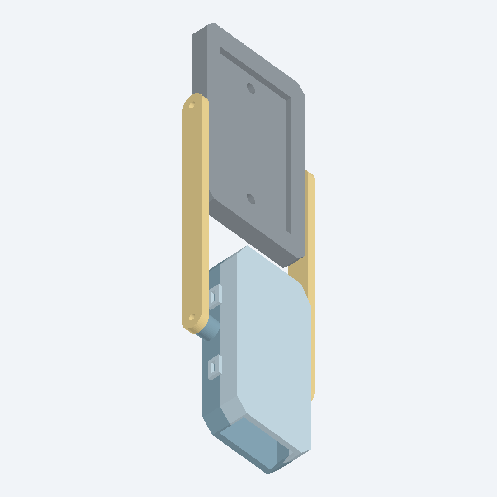
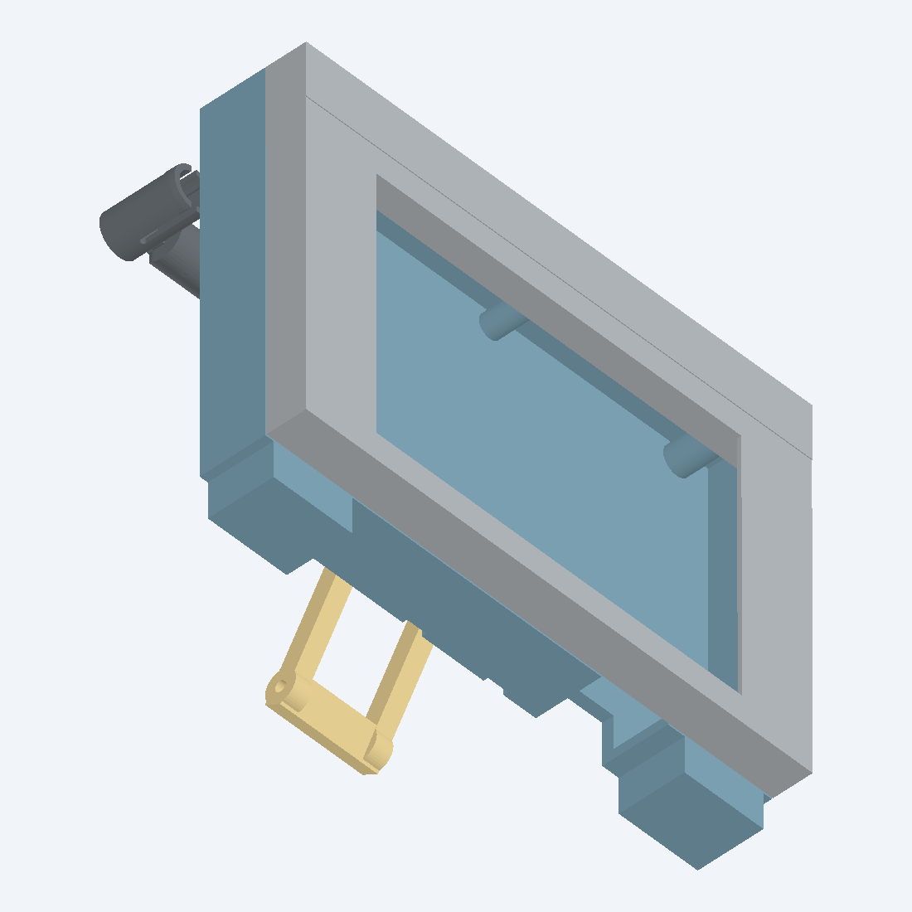
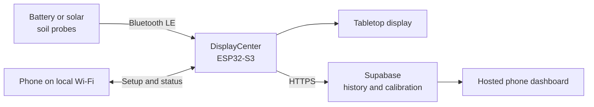

# Project Treebeard

**A wireless plant monitor built to answer one useful question: *does this plant need water?***

Project Treebeard is a ground-up hardware and software system for watching the moisture cycle of
houseplants. Small battery-powered probes sit in the soil, a tabletop receiver listens to them over
Bluetooth, and a local or hosted dashboard turns the readings into plant status and history.

This is an active engineering project, not a finished commercial sensor. The working MSV2 system is
already monitoring real plants. MSV3 is the current custom-PCB generation, built to explore whether
a more sensitive capacitance converter and solar-assisted power can make the probes more precise and
nearly maintenance-free.

<p align="center">
  
  &nbsp;&nbsp;
  
</p>

<p align="center"><em>The current MSV3 solar-probe concept and the shared DisplayCenter receiver.</em></p>

[Open the hosted dashboard](https://msv2-plants.netlify.app) ·
[Read the current status](docs/STATUS_HANDOFF.md) ·
[Follow the engineering story](docs/paper/MSV_EVOLUTION_IEEE_PAPER_DRAFT.md)

## The system in one minute

Each probe wakes briefly, takes a capacitive measurement, broadcasts it, and returns to sleep. The
wall-powered DisplayCenter does the expensive work: it listens continuously, filters readings,
shows every plant on its screen, hosts the setup interface, and uploads history when Wi-Fi is
available. The plants remain visible locally even if the internet is down.



In day-to-day use, the system can:

- monitor several plants from one receiver;
- show moisture, battery level, stale probes, and watering alerts;
- configure plant names, artwork, probe assignments, Wi-Fi, and calibration from a phone;
- retain raw and filtered history instead of only showing the latest value;
- learn plant-specific dry and wet ranges from supported watering cycles; and
- expose detailed diagnostics for packet loss, battery behavior, and sensor experiments.

## Where the project is now

### MSV2: the working field system

MSV2 proved the complete product architecture. Its nRF52840 probes measure a relaxation oscillator,
send short BLE advertisements, and sleep between readings. The shared ESP32-S3 receiver, local setup
app, Supabase backend, and hosted dashboard were all developed around these probes and are in active
use.

Field testing also uncovered the unglamorous problems that make real sensor products difficult:
sleep-current leaks, timer quantization, BLE packet loss, receiver concurrency, long-history
pagination, stale web caches, and calibration drift. Those failures and their fixes are preserved in
the repository rather than polished out of the story.

### MSV3: the current research probe

MSV3 replaces GPIO timing with a dedicated **FDC2214 28-bit resonant capacitance converter**. A
**TMUX1109** changes the electrode routing, an **E73/nRF52840** module handles measurement and BLE,
and a solar power path is intended to extend the interval between manual charges. The custom board,
firmware, enclosure, solar mount, and manufacturing files all live here.

Verified progress includes reliable BLE operation, guarded internal-clock startup, and timed sleep
around **10–15 µA**. The diagnostic packet now carries the moisture-connected FDC count, a
disconnected bare-tank reference, die temperature, battery voltage, and mux phase so environmental
drift can be studied instead of guessed at.

The main open problem is **repeatable behavior in soil**. Recent testing found that the temporary
nail-polish coating could admit and then trap water against the probe. Removing it produced a very
flat air baseline, making coating and exposed FR-4 edges the leading explanation for much of the
previous long-term drift. The current experiment is validating dry-out, epoxy edge sealing, acrylic
conformal coating, temperature/reference compensation, and a controlled dry-soil-to-wet-soil cycle.

> [!IMPORTANT]
> MSV3 currently reports an experimental capacitance-related signal, not laboratory-calibrated
> volumetric water content. Its higher numerical resolution does not automatically make it a better
> soil sensor; environmental sealing, electrode geometry, acquisition timing, and calibration still
> have to be proven together.

The latest investigation is documented in
[MSV3 soil-ingress and coating remediation](MSV3/docs/MSV3_SOIL_INGRESS_AND_COATING_REMEDIATION_2026-08-30.md)
and [FDC reference compensation](MSV3/docs/MSV3_FDC_REFERENCE_COMPENSATION_2026-08-30.md).

## How the design evolved

| Generation | The idea | What it taught the project | Status |
| --- | --- | --- | --- |
| **MSV1** | Interdigitated PCB sensor, two 555 timers, analog filtering, and a comparator | Soil capacitance was measurable, but the analog output compressed most of the useful range | Completed proof of concept |
| **MSV2** | Digitally count a capacitive oscillator and broadcast it from a sleeping nRF52840 | A practical monitor is a whole system: sensing, power, radio, display, calibration, and history all matter | Deployed and actively used |
| **MSV3** | Custom FDC2214/TMUX probe with solar harvesting and a purpose-built enclosure | High resolution must survive temperature, moisture ingress, soil chemistry, and low-power wake cycles | Active validation |

MSV2 and MSV3 are not separate ecosystems. Both report to the same DisplayCenter and appear in the
same local and hosted dashboards.

## Repository tour

| Folder | What lives there |
| --- | --- |
| [`MSV1/`](MSV1/) | Original analog prototype and final course report |
| [`MSV2/`](MSV2/) | Working XIAO nRF52840 probe firmware, experiments, and field notes |
| [`MSV3/`](MSV3/) | Custom probe firmware, PCB, enclosure, solar design, procurement, and validation records |
| [`DisplayCenter/`](DisplayCenter/) | ESP32-S3 receiver/display firmware, local phone UI, assets, enclosure, and test scripts |
| [`cloud/`](cloud/) | Supabase migrations and Edge Function plus the Netlify-hosted dashboard |
| [`docs/`](docs/) | Current handoff, known issues, roadmap, and the cross-generation engineering paper |
| [`data/`](data/) | Captured measurements used for debugging and validation |
| [`scripts/`](scripts/) | Utilities shared across more than one hardware generation |

If you are trying to understand a specific subsystem, start in that subsystem's `docs/` directory.
For the exact state of the working tree and hardware experiments, use the
[status handoff](docs/STATUS_HANDOFF.md). Checked-in source, successfully compiled firmware, flashed
firmware, and observed live behavior are deliberately treated as four different claims.

## Getting started

### I just want to see what it does

- Visit the [hosted dashboard](https://msv2-plants.netlify.app). The historical `MSV2` URL remains
  in use so existing receivers and saved links continue to work.
- Read the short [three-generation engineering paper](docs/paper/MSV_EVOLUTION_IEEE_PAPER_DRAFT.md).
- Browse the [MSV3 enclosure renders](MSV3/hardware/MSV3_Probe_PCB_Enclosure/renders/) or the
  [DisplayCenter hardware](DisplayCenter/hardware/MSV2_ESP32_DisplayCenter/V2/).

### I want to work on the firmware

The firmware helpers expect Windows PowerShell and the `arduino-cli.exe` bundled with Arduino IDE.
They perform clean, repeatable builds and keep generated files outside the sketch directories.

From the repository root:

```powershell
# Working MSV2 probe
powershell -ExecutionPolicy Bypass -File MSV2\scripts\arduino_probe.ps1 -Action compile

# Shared ESP32-S3 DisplayCenter
powershell -ExecutionPolicy Bypass -File DisplayCenter\scripts\arduino_display.ps1 -Action compile

# Current MSV3 field-test firmware
powershell -ExecutionPolicy Bypass -File MSV3\scripts\arduino_msv3_probe.ps1 -Action doctor
powershell -ExecutionPolicy Bypass -File MSV3\scripts\arduino_msv3_probe.ps1 -Action compile -Sketch arduino/MSV3_Moisture_BLE_Sleep
```

> [!WARNING]
> Never build or upload MSV3 with the Arduino IDE Upload button or a raw `arduino-cli` command. The
> custom board has no 32.768 kHz crystal, while its default Arduino board definition assumes one.
> The guarded helper selects and verifies the internal LFRC before Bluetooth, FreeRTOS, or RTC code
> can start. Run its `doctor` action first and read [Known Issues](docs/KNOWN_ISSUES.md) before
> changing MSV3 clock, sleep, watchdog, or BLE behavior.

Upload and serial-monitor commands, board ports, required libraries, Wi-Fi provisioning, and local
receiver endpoints are covered in the [DisplayCenter guide](DisplayCenter/README.md). MSV3 hardware
bring-up and production details are under [`MSV3/docs/`](MSV3/docs/).

### I want to run the cloud side

The root [`netlify.toml`](netlify.toml) publishes
[`cloud/web/plant-dashboard/`](cloud/web/plant-dashboard/). Supabase schema, security, Edge Function,
claiming, and receiver-bootstrap instructions are in the
[Supabase setup guide](cloud/docs/SUPABASE_SETUP.md).

The receiver is intentionally local-first: it makes outbound HTTPS requests, but it should never be
exposed directly to the internet. Wi-Fi credentials stay on the receiver, while remote access uses
per-device secrets and account-free household share tokens.

## What comes next

The immediate MSV3 milestone is not a prettier percentage—it is evidence that the raw measurement is
stable and useful:

1. establish a dry, coated air baseline;
2. verify sealed edges and faces do not absorb or trap water;
3. measure a controlled dry-soil-to-fully-watered response;
4. quantify how much die temperature and the disconnected tank reference remove environmental drift;
5. repeat the cycle over multiple days; and
6. prove the solar energy budget through real light and low-battery conditions.

Only after those gates pass does it make sense to turn MSV3's count into a confident plant-moisture
scale or call the probe production-ready.

## Project notes

Project Treebeard is a personal, experimental hardware project by **Sam Amezcua**. It includes
working deployments alongside unfinished research, failed approaches, diagnostic firmware, and
manufacturing iterations. That history is intentional: it is often the most useful part of the
repository for anyone building a low-power environmental sensor.

This repository does not currently include an open-source license. Please do not assume permission
to redistribute the hardware or software as a product.
