# Project Treebeard

[](https://github.com/samam624/ProjectTreebeard/actions/workflows/portfolio-checks.yml)

**Solar-powered soil-moisture probes, a receiver and a cloud dashboard, built to answer one
question: *does this plant need water?***

Project Treebeard watches how the soil in a houseplant's pot dries out and gets watered again. A
probe in the soil wakes about once a minute, takes a measurement, broadcasts it over Bluetooth LE
and goes back to sleep, running on a small battery charged by a solar panel. A receiver on a shelf
hears every probe, shows each plant on a screen and uploads the history to a phone dashboard. Four
probe generations, MSV1 to MSV4 ("moisture sensor version"), have been built since April 2026.

**Sam's role:** hardware architecture, Altium schematic and PCB design, hand assembly and rework,
test planning, bench and field measurement, firmware requirements, and hardware validation.
Software implementation was AI-assisted and verified against physical hardware and recorded data;
the exact contribution boundary is documented in [`CONTRIBUTIONS.md`](CONTRIBUTIONS.md). This is an
active engineering project, and the repository keeps the failures alongside the things that worked.

<p align="center">
  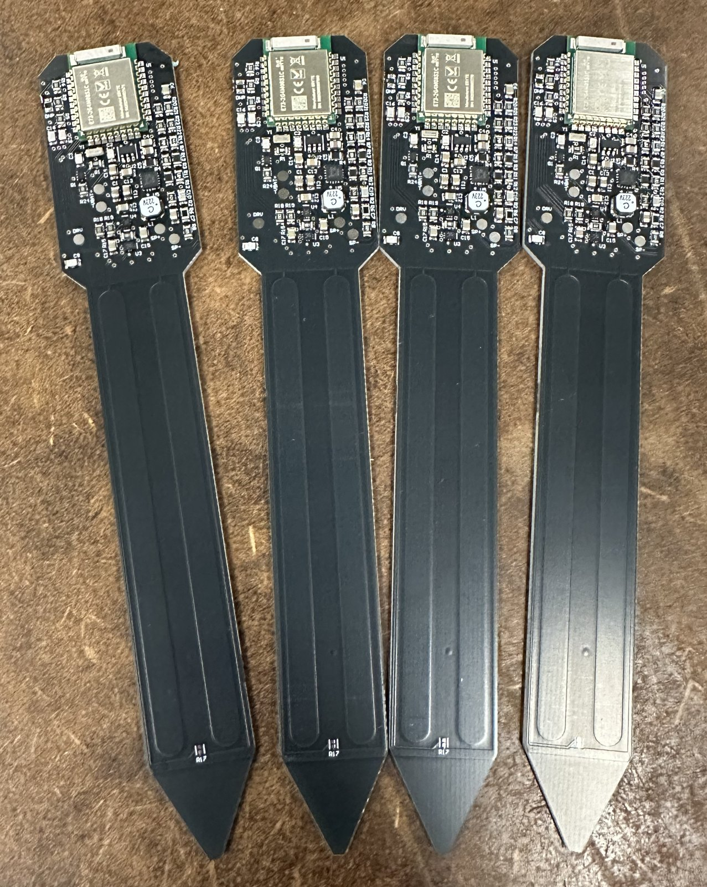
  &nbsp;
  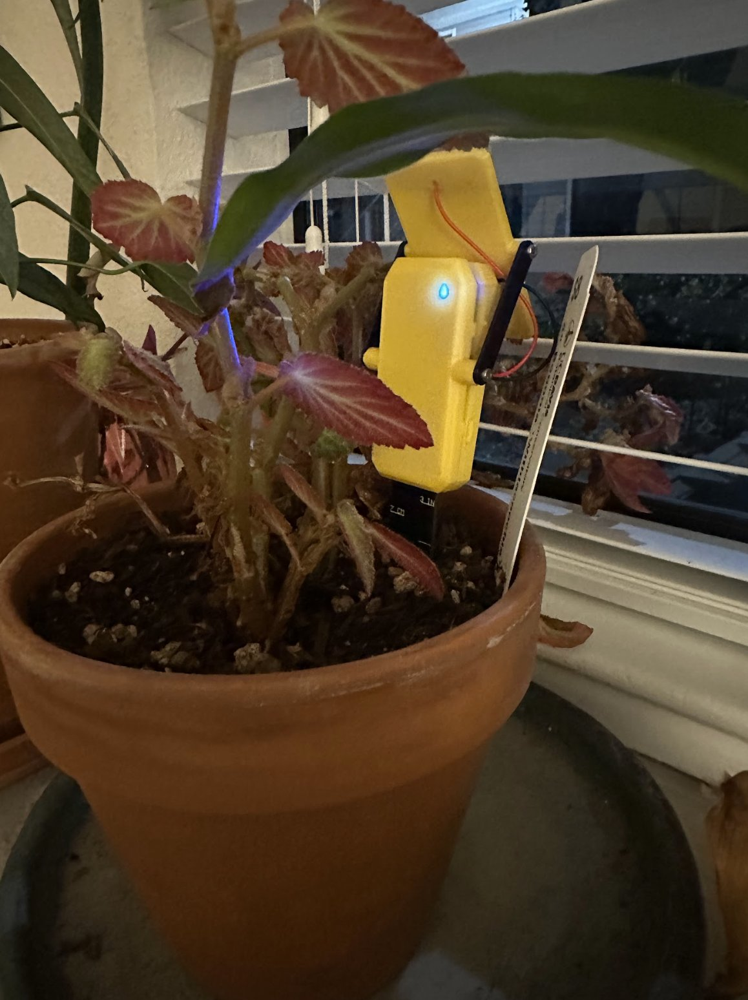
  &nbsp;
  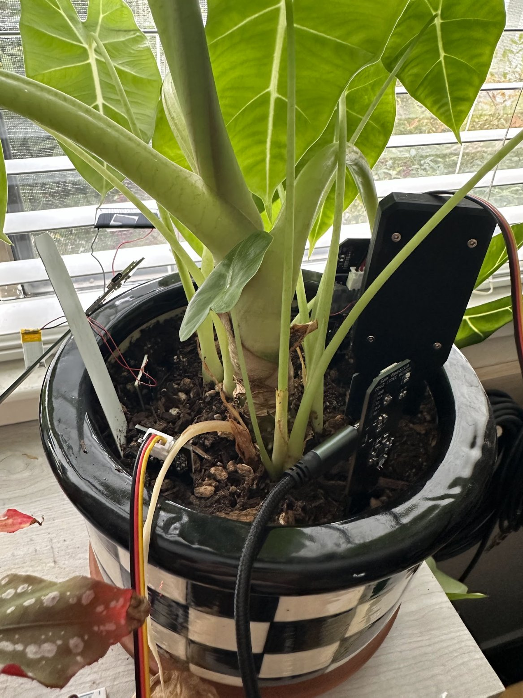
  &nbsp;
  
</p>

<p align="center"><em>Four assembled MSV4 boards, an MSV3 probe in its pot, five probes sharing one
pot for a side-by-side test, and the DisplayCenter receiver.</em></p>

<p align="center">
  <a href="https://msv2-plants.netlify.app/?demo=1">Interactive dashboard demo</a> ·
  <a href="docs/portfolio/START_HERE.md">60-second engineering tour</a> ·
  <a href="MSV4/hardware/MSV4_Probe_PCB/README.md">Latest PCB and bring-up evidence</a>
</p>

## Contents

- [How it works](#how-it-works)
- [Start here for engineering roles](#start-here-for-engineering-roles)
- [The hardware](#the-hardware)
- [Four generations](#four-generations)
- [Engineering highlights](#engineering-highlights)
- [Status and next steps](#status-and-next-steps)
- [Repository guide](#repository-guide)
- [Building and flashing](#building-and-flashing)
- [About](#about)

## Start here for engineering roles

The short [`engineering evidence map`](docs/portfolio/START_HERE.md) links each hardware claim to
photos, schematics, bring-up notes and measured results. The fastest paths are:

- **PCB design and bring-up:** four board generations, the ESP32-S3 receiver and fine-pitch fault
  isolation on MSV4.
- **Validation and reliability:** four-board mux screening, sleep-current measurement and explicit
  separation of measured, inferred and modeled results.
- **Analog and power:** the lock-in front end, electrode experiments and the 6 V panel / 4.49 V
  battery overvoltage root cause.
- **System integration:** BLE probes, receiver, cloud history and the clearly labeled
  [synthetic-data dashboard demo](https://msv2-plants.netlify.app/?demo=1).

## How it works

- **The probe.** A narrow circuit board pushed into the soil. Sleeping almost all the time is what
  lets it run from a small rechargeable battery and a solar panel about 3 cm across.
- **The receiver (DisplayCenter).** A wall-powered box with a screen. It listens all the time,
  filters the readings, shows every plant, and uploads the history when Wi-Fi is available. The
  plants stay on its screen even when the internet is down.
- **The dashboard.** A web page for a phone with each plant's status and history.

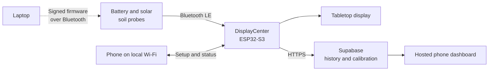

Plant names, artwork, probe assignments and Wi-Fi are set up from a phone. The receiver keeps raw
and filtered history, flags probes that have gone quiet, and marks a "water now" region on each
plant's meter, learned from where that plant was actually watered. Probes take signed firmware over
Bluetooth without leaving their pots.

**Why it is harder than it sounds.** Two electrodes in soil give a number easily. A number that
means "wet" or "dry" is another matter: the reading also moves with temperature, sunlight on the
pot, fertilizer salts, and how tightly the soil grips the probe. Most of this project has been
about separating those effects from the water.

## The hardware

Every board was designed in Altium. Each board page has the schematic, layout, 3D views and the
Gerbers the board was built from.

### MSV4 probe (current)

A two-layer probe that measures the soil's impedance with a lock-in front end built from two analog
switches, at eight frequencies from 250 kHz to 2.67 MHz. The blade carries two matching electrodes
inside a guard ring on both faces, and a temperature sensor at the tip.

**Main parts:** nRF52840 (E73 module) · 2 × FSUSB42 analog switch · BQ25504 solar harvester ·
TPS7A0233 LDO · 0402 NTC at the tip<br>
[Board page](MSV4/hardware/MSV4_Probe_PCB/) ·
[Schematic](MSV4/hardware/MSV4_Probe_PCB/images/MSV4_schematic_overview.png) ·
[Gerbers](MSV4/hardware/MSV4_Probe_PCB/MSV4_Probe_PCB_fabrication_2026-09-18.zip)

<p>
  
  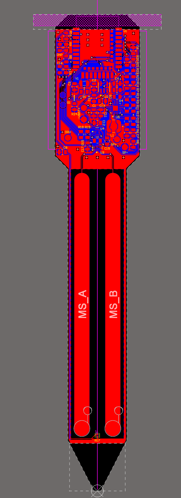
  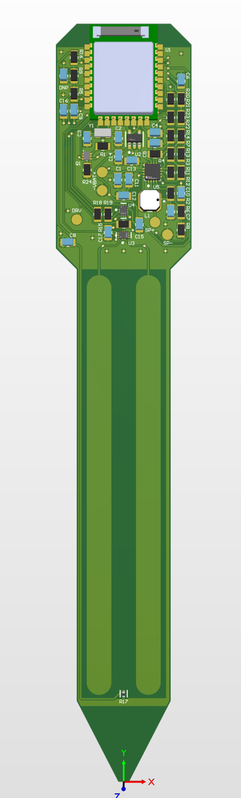
  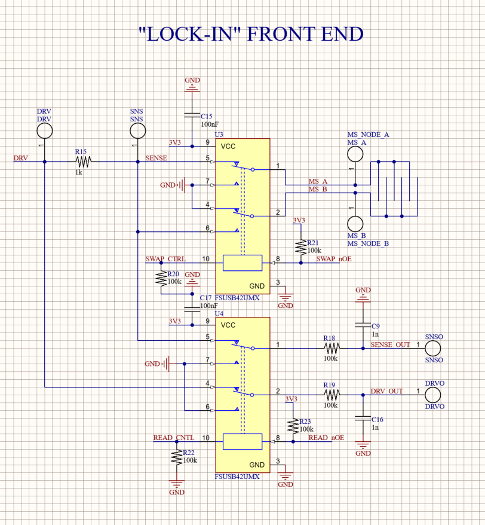
</p>

### MSV3 probe

A four-layer probe built around a capacitance-to-digital converter, with an analog multiplexer that
swaps the two electrode nodes, and solar and USB charging.

**Main parts:** nRF52840 (E73 module) · FDC2214 capacitance-to-digital converter · TMUX1109
multiplexer · BQ25504 solar harvester · BQ25170 charger · TPS7A0233 LDO<br>
[Board page](MSV3/hardware/MSV3_Probe_PCB/) ·
[Schematic (PDF)](MSV3/hardware/MSV3_Probe_PCB/MSV3_schematic_export_2026-07-26.pdf) ·
[Gerbers](MSV3/hardware/MSV3_Probe_PCB/MSV3_Probe_PCB_fabrication_2026-08-10.zip)

<p>
  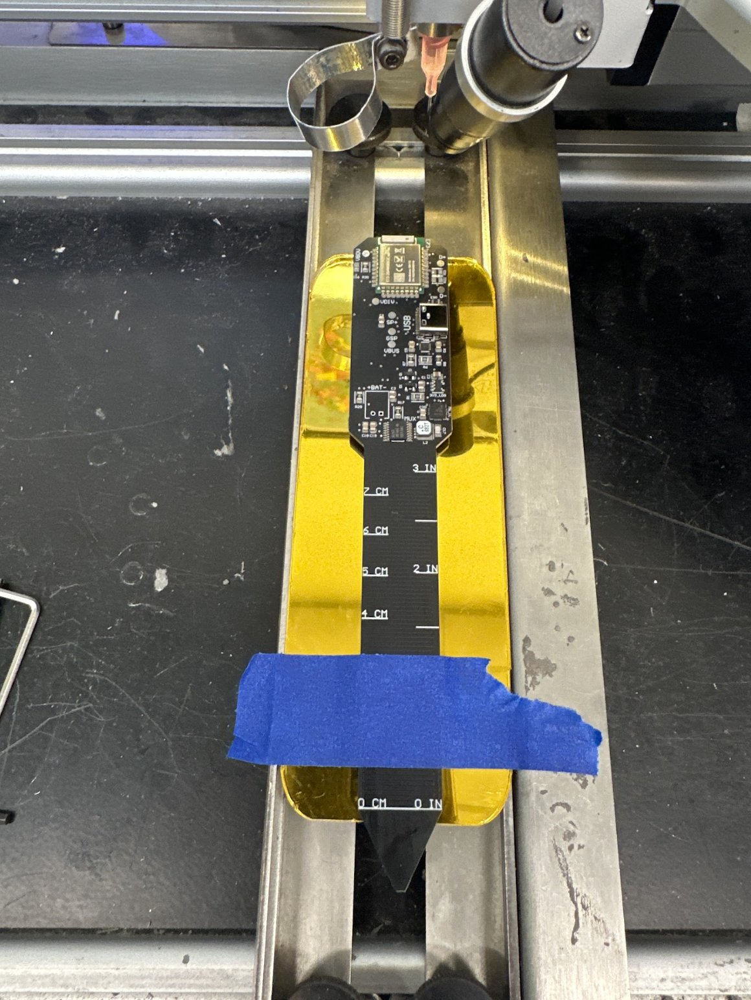
  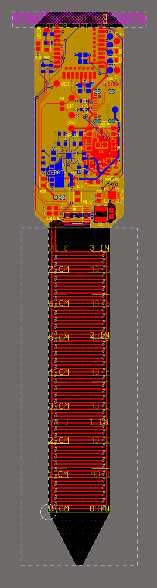
  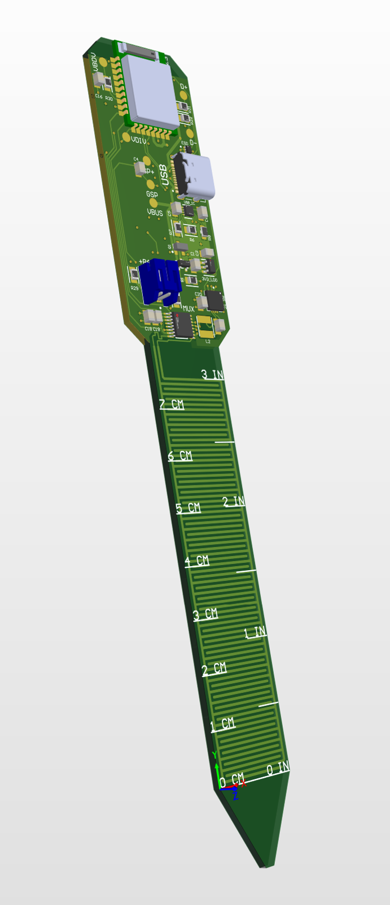
  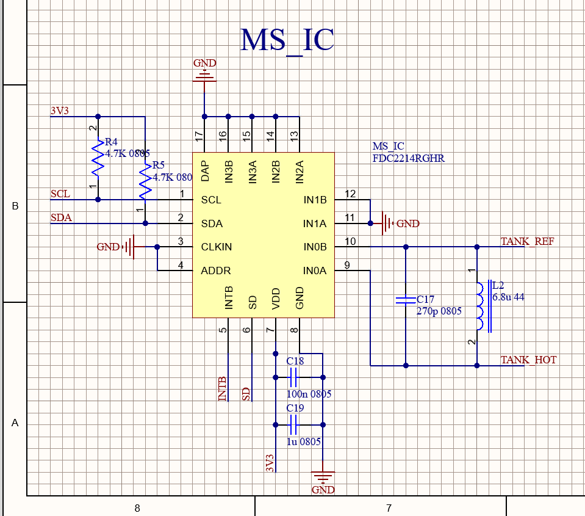
</p>

### DisplayCenter receiver

A two-layer controller board that hears every probe over Bluetooth LE, drives a 480 × 320 touch
display and uploads over Wi-Fi.

**Main parts:** ESP32-S3-WROOM-1U-N16R8 (external antenna) · AP2112K-3.3 LDO · 2N7002 switches ·
USB-C · buzzer<br>
[Board page](DisplayCenter/hardware/MSV2_ESP32_DisplayCenter/pcb/) ·
[Schematic](DisplayCenter/hardware/MSV2_ESP32_DisplayCenter/pcb/images/DisplayCenter_schematic_overview.png) ·
[Gerbers](DisplayCenter/hardware/MSV2_ESP32_DisplayCenter/pcb/DisplayCenter_controller_fabrication_2026-07-14.zip)

<p>
  
  
  
</p>

### MSV2 probe

A two-layer probe carrying a XIAO nRF52840 Sense module, which times how fast the electrode
charges through its own GPIO pins. Solar charging through a USB charger IC.

**Main parts:** Seeed XIAO nRF52840 Sense · BQ25100 charger<br>
[Board page](MSV2/hardware/) ·
[Schematic](MSV2/hardware/images/MSV2_schematic.png) ·
[Gerbers](MSV2/hardware/MSV2_Probe_PCB_fabrication_2026-06-19.zip)

<p>
  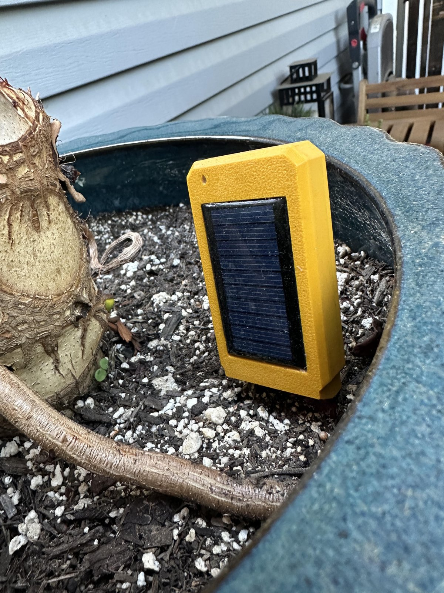
  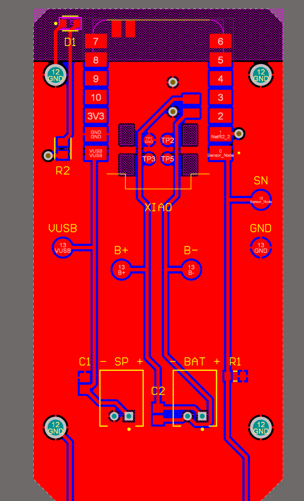
  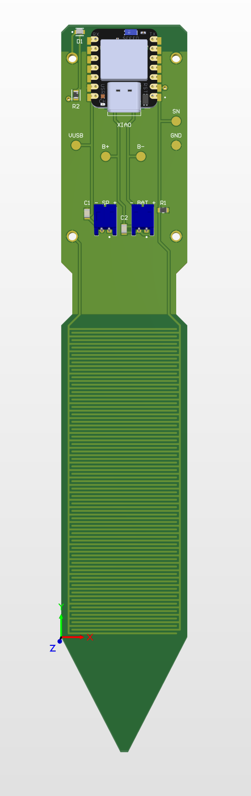
</p>

### MSV1 probe

The two-layer analog prototype: an interdigitated comb electrode read by 555 timers, an RC
low-pass filter and a comparator.

**Main parts:** 555 timers (astable and monostable) · RC low-pass filter · comparator<br>
[Board page](MSV1/hardware/) ·
[Schematic](MSV1/hardware/images/MSV1_schematic.png) ·
[Gerbers](MSV1/hardware/MSV1_fabrication_2026-05-01.zip) ·
[Course report](<MSV1/EEC284_Final_Paper (2).pdf>)

<p>
  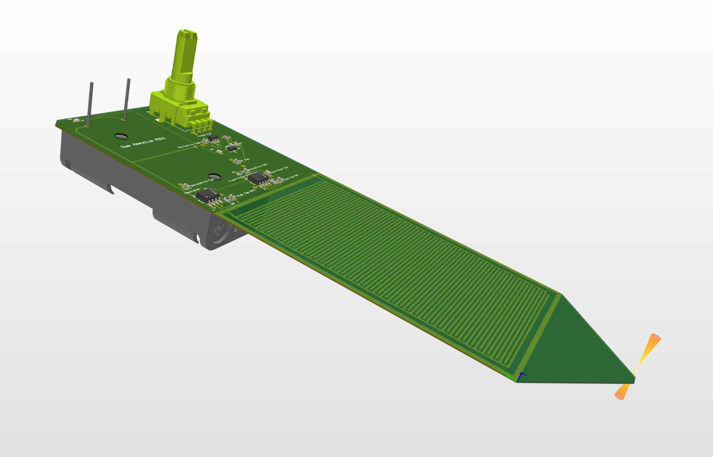
  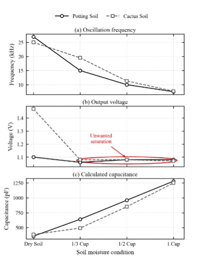
</p>

## Four generations

| | Approach | What it taught |
| --- | --- | --- |
| **MSV1** | A comb electrode read by 555 timers and analog filtering | Soil moisture can be measured this way, but the analog output squeezed most of the useful range together |
| **MSV2** | Time the electrode digitally and broadcast from a sleeping radio chip | A useful monitor is a whole system: sensing, power, radio, display, calibration and history all matter |
| **MSV3** | A custom board with a capacitance-to-digital converter and solar charging | Resolution was never the bottleneck. Electrode geometry, soil temperature and the solar panel's voltage were |
| **MSV4** | A new electrode, an impedance measurement instead of capacitance, and a panel that suits the charger | Still being learned |

**MSV2 proved the system.** The receiver, the phone setup, the cloud backend and the dashboard were
all built around it, and it monitored real plants for months. Field use turned up the problems
that make sensor products hard: sleep-current leaks that drained batteries, lost radio packets,
calibration drift and stale web caches.

**MSV3 got the platform right and the sensing wrong.** It updates over Bluetooth in 30 to 50
seconds, with checks that stop an image built for one probe from landing on another. It draws
about 3 mAh a day, roughly 50 days on a full battery with no sun, and every packet carries the
reading, board temperature, battery voltage and status flags. But its reading moved with
temperature and sunlight when the water in the soil had not. Its fine comb sensed only the
half-millimeter of soil touching the board, so a protective coating took up a large share of what
it could see, and the daily swing came in through the electrode rather than the electronics.

**MSV4 changes three things at once.** The electrodes are spaced to sense several times deeper.
Instead of capacitance, the probe measures the soil's impedance and fits a small circuit model, and
the tip temperature is sent alongside so the receiver can correct for it. And a 2 V solar panel
stays well inside the charger's input limit, where MSV3's 6 V panel did not. So far: a window-light
test produced a 108 mV battery rise over a morning and showed cutoff near 3.82-3.83 V; its first
watering took soil resistance from 15.3 kΩ to 3.0 kΩ; and a probe now checks that
it is in clean air before calibrating itself, after one calibrated against a hand. Its power draw
is still modeled, not measured.

## Engineering highlights

Problems that were measured to the bottom rather than patched around.

- **Sleep current measured, then reduced.** Disconnecting divider and status GPIOs during sleep
  reduced measured MSV3 current from about 65-71 µA to 10-15 µA.
  [Measurement record](MSV3/docs/MSV3_PRODUCTION_FIRMWARE_2026-08-22.md)
- **Four boards screened with one discriminating test.** A mux sweep initially suggested a dead
  part; repeated measurements after reseating showed the expected 8-15% switching step on all four
  boards and prevented unnecessary bypass rework.
  [Triage record](MSV3/docs/MSV3_FOUR_BOARD_MUX_TRIAGE_2026-08-31.md)
- **Fine-pitch assembly faults separated from design faults.** MSV4 board 1 had three hidden solder
  faults from excess paste, including a 0 Ω short under R15. Resistance checks and controlled
  reflow recovered the board without a schematic change.
  [Bring-up record](MSV4/docs/MSV4_BOARD1_BRINGUP_2026-10-01.md)
- **A solar charger cannot protect a battery from the wrong panel.** MSV3's 6 V panel drove
  current through the charger chip into the cell, which reached 4.49 V against a 3.89 V limit.
  [Root cause](MSV3/docs/MSV3_VIN_DC_OVERVOLTAGE_ROOT_CAUSE_2026-09-15.md)
- **Electrode or electronics?** Four sensor combinations shared one pot so the electrode and the
  readout could be swapped independently. The MSV3 blade swung about ten times more over a day than
  an older electrode on the same kind of circuit, the circuit accounted for at most a fifth of it,
  and a blade on the shaded side of the pot was quiet.
  [Write-up](MSV3/docs/MSV3_ALOCASIA_ELECTRODE_VS_CIRCUIT_2026-09-29.md)
- **A lock-in impedance measurement on a microcontroller.** MSV4 drives its electrodes at eight
  frequencies, demodulates in firmware and fits a circuit model. A simulation using parameters
  fitted from board measurements provides a consistency check within a few degrees of phase; it is
  not an independent predictive validation. Raw sweeps from the second board are stored in the
  cloud so other electrode models can be compared; a constant-phase-element model had the lowest
  residual on the documented soil capture. [Notes](MSV4/docs/MSV4_LOCKIN_MEASUREMENT_NOTES_2026-10-01.md) ·
  [Electrode models](MSV4/docs/MSV4_BOARD2_RAW_SWEEP_MODELS_2026-10-15.md)
- **Compared with a pot-mass reference.** In one pot over eight days and one 460 g watering, daily
  mass measurements were used to compare seven candidate moisture metrics and temperature effects.
  The result is exploratory—not a calibrated accuracy specification or a general winner—and the
  write-up records where the estimators did not match the reference closely enough.
  [Why the readings miss](MSV4/docs/MSV4_MOISTURE_SLOPE_AND_THERMAL_FIT_2026-10-17.md)
- **A receiver that stopped uploading for 6.7 hours with Wi-Fi up.** Nothing was lost: 1,812 rows
  were queued and delivered after a reset. The receiver now records the real TLS error and
  restarts itself after a stall. [Incident report](DisplayCenter/docs/RECEIVER_TLS_STALL_2026-10-14.md)

## Status and next steps

*As of 2026-10-18. [`MSV3/fleet.json`](MSV3/fleet.json) is the live record of where every board is.*

| | State |
| --- | --- |
| **MSV4** | Two boards running. Board 1 has been in a weighed Alocasia pot since 2026-10-08; board 2 is in a pot of its own and sends raw measurement sweeps to the cloud. More boards are being assembled from a batch of ten PCBs. |
| **MSV3** | Five boards built. One is back in soil; the rest are on the desk or out of soil since a two-week comparison experiment ended on 2026-09-30. |
| **MSV2** | One probe is still in a pot outdoors. |
| **DisplayCenter** | Running. It hears all three probe generations and uploads to the cloud. |
| **Dashboard** | [Live](https://msv2-plants.netlify.app). |

Next:

1. **A second weighed watering.** Weights just before and after it will show whether MSV4's offset
   is the probe settling in or something each watering adds.
2. **Choose MSV4's moisture reading by the scale.** Derived soil capacitance leads so far; its
   temperature correction rests on a few days and needs more dry days to confirm.
3. **Measure MSV4's real power draw.** Every energy figure for it is still modeled.
4. **Bring up the next MSV4 boards** from the batch being assembled.

## Repository guide

| Folder | What lives there |
| --- | --- |
| [`MSV1/`](MSV1/) | The analog prototype: board files and course report |
| [`MSV2/`](MSV2/) | The XIAO nRF52840 probe: board files, firmware, experiments and field notes |
| [`MSV3/`](MSV3/) | The FDC2214 probe: board files, enclosure, firmware, bootloader, test write-ups and the fleet registry |
| [`MSV4/`](MSV4/) | The impedance probe: board files, enclosures, firmware, parts lists and test write-ups |
| [`DisplayCenter/`](DisplayCenter/) | The receiver: board files, enclosure, firmware, phone setup interface and test scripts |
| [`cloud/`](cloud/) | The database, its edge functions and the hosted dashboard |
| [`docs/`](docs/) | Cross-project notes: known issues, roadmap and the engineering paper |
| [`hardware/`](hardware/) | Shared Altium libraries and parts ordering |
| [`scripts/`](scripts/) | Shared tools: the Bluetooth updater, the fleet scanner and the wired-programming utilities |
| [`data/`](data/), [`dumps/`](dumps/) | Captured measurements and probe diagnostic dumps |

> [!NOTE]
> **Dated documents are history and are never edited afterwards.** Hardware moves between work
> sessions, so [`MSV3/fleet.json`](MSV3/fleet.json) is the only place that describes the present:
> where each probe is, what is in its soil, what powers it and what has been reworked. Throughout
> the repository, "the code is written", "it compiles", "it was flashed" and "it was seen working"
> are four different claims.

## Building and flashing

The build helpers expect Windows PowerShell and the `arduino-cli.exe` that ships with the Arduino
IDE. From the repository root:

```powershell
# MSV2 probe
powershell -ExecutionPolicy Bypass -File MSV2\scripts\arduino_probe.ps1 -Action compile

# DisplayCenter receiver
powershell -ExecutionPolicy Bypass -File DisplayCenter\scripts\arduino_display.ps1 -Action compile

# MSV3 probe
powershell -ExecutionPolicy Bypass -File MSV3\scripts\arduino_msv3_probe.ps1 -Action doctor
powershell -ExecutionPolicy Bypass -File MSV3\scripts\arduino_msv3_probe.ps1 -Action compile -Sketch arduino/MSV3_Moisture_BLE_Sleep

# MSV4 probe
powershell -ExecutionPolicy Bypass -File MSV4\scripts\arduino_msv4_probe.ps1 -Action doctor
powershell -ExecutionPolicy Bypass -File MSV4\scripts\arduino_msv4_probe.ps1 -Sketch arduino/MSV4_Moisture_BLE_Sleep -SensorId 10
```

> [!WARNING]
> **Always use the script for that generation, never the Arduino IDE Upload button or a raw
> `arduino-cli` command.** MSV3 and MSV4 need opposite clock settings: the MSV3 board has no
> 32.768 kHz crystal, and MSV4 has a crystal and no USB. Each script enforces its own board's rules
> and refuses unsafe states. Run `doctor` first, and read [Known Issues](docs/KNOWN_ISSUES.md)
> before changing clock, sleep, watchdog or Bluetooth behavior.

- **Firmware over Bluetooth:** MSV3 uses `scripts/ble_ota_update.py --probe N`; MSV4 uses
  `MSV4/scripts/msv4_ble_ota.py <package> --board N`. Run either with `--preflight-only` first.
- **Wired programming** goes through the scripts in [`scripts/`](scripts/), which wait for steady
  contact before touching a board because the programming pins are held by hand. The rules are in
  [`CLAUDE.md`](CLAUDE.md).
- **Receiver** setup, wiring, libraries and Wi-Fi provisioning: the
  [DisplayCenter guide](DisplayCenter/README.md).
- **Cloud:** [`netlify.toml`](netlify.toml) publishes
  [`cloud/web/plant-dashboard/`](cloud/web/plant-dashboard/); database setup, security and
  receiver sign-up are in the [Supabase setup guide](cloud/docs/SUPABASE_SETUP.md). The receiver is
  local-first: it makes outbound requests only, should never be exposed to the internet, and keeps
  Wi-Fi passwords to itself.

## About

Project Treebeard is a personal hardware project by **Sam Amezcua**. It includes working
deployments alongside unfinished research, failed approaches, diagnostic firmware and manufacturing
iterations, on purpose: that history is often the most useful part for anyone building a low-power
environmental sensor.

© 2026 Sam Amezcua. All rights reserved. The repository is public so the work can be read and
reviewed; no license is granted to copy, modify or redistribute the hardware designs, firmware or
software.
