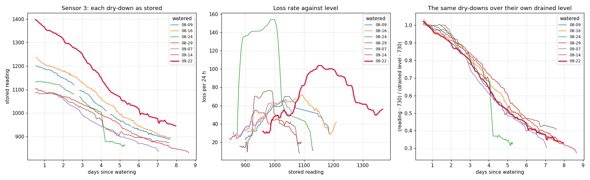
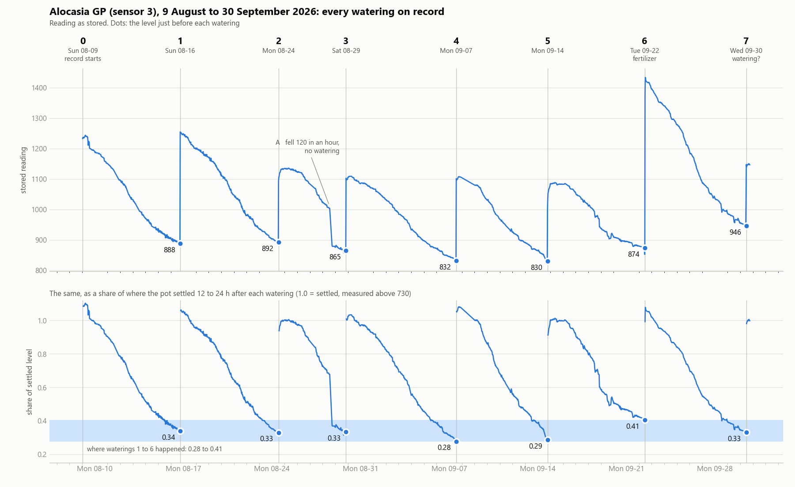
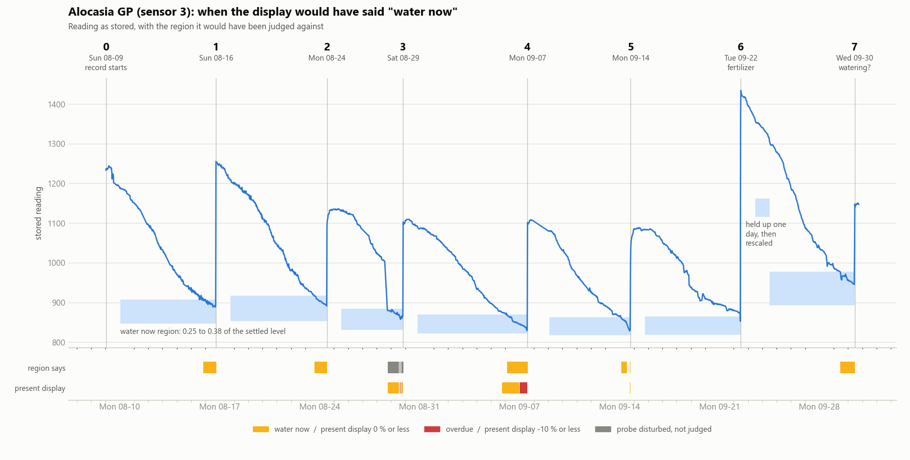

# Moisture percent: why the range moves, and what a fertilizing does to it (2026-10-11)

The maintainer, 2026-10-11: the percentage "still favor[s] increase in watering over time ... if
you dont water exactly when it says 0% and you were over it will jump up and set a new max
level", and there is "a big jump in Alocaisa GP when adding fertilizer to the soil". Absolute
values are out (they move with the soil's ions) and the present moving range is out (it teaches
itself earlier waterings). Asked for: how the number is made, analysis, and strategies. Worked
through with Codex (phone-a-friend consultation `moisture-range-fertilizer-2026-10-11`).

**What the record shows**

- **The dry end of the range is wherever the last waterings happened.** By its weights the newest
  watering alone carries 54 % of it at a weekly cadence. One watering at +16 % moved zero up by 11–14 % of the
  range (replayed, sensor 3).
- **The wet end is the pour, not the pot.** It is the highest reading in the three hours after
  the step, which stood up to 134 % of the step above where the pot settled.
- **One large event erases the others.** Every threshold is a share of the last 21 days' spread,
  so the 09-22 step raised the bar until the six earlier waterings no longer counted.
- **The 09-22 dry-down on sensor 3 fits a rescaled copy of the other six far better than it fits
  "more water".** Divided by its own settled level it lies on them. **09-22 was the fertilizing**
  (the maintainer, later the same day: "Yeah the one you found was the fertilizing, it was like a
  liquid pot fertilizer 1 cap per 2 liters of water and then spread out among the plants").
- **In a simulated closed loop the present calibration moves zero toward wetter readings, so the
  user waters earlier and earlier, with no fertilizer at all.** A "driest ever" zero moves toward
  drier readings. A zero that is a fixed share of each watering's settled level does neither.

The analysis sections below changed nothing in the receiver, the cloud function or the
dashboard. The "water now" region that came out of them was built and flashed the same evening:
see "Built".

## How the percent is made today

`percent = min(100, round(100 × (reading − dry) / (wet − dry)))`, not clamped below zero; 0 is
the watering line and −10 the alarm. The same on the display, the receiver's page and the
dashboard (`moisturePercent()` in the receiver sketch, `percent()` in `app.v15.js`).

`dry` and `wet` come from the cloud every ten minutes (`msv2_read_sensor_auto_calibration`,
migration 027, and `receiver-snapshot/autocal.ts`), from the last 21 days or since the last
manual reset:

1. Five-minute medians. Their 5th and 95th percentiles are the fallback range.
2. A watering is a step between neighbouring medians of at least 20 % of that range, with the
   three hours after it at least 50 % up and hours 6–12 still 20 % up.
3. For each one: **dry = 0.75 × the median just before the step + 0.25 × the 20th percentile of
   the two hours before. Wet = the highest median in the three hours after.**
4. `dry` = average of those dry values, each weighted by 0.5^(age / 7 days); the span likewise;
   both pulled 10–20 % toward the fallback; `wet = dry + span`.

What each generation sends as the reading:

| Probe | Reading | What ions do to it |
|---|---|---|
| MSV2 (sensors 1, 2) | RC oscillator counts | not measured here |
| v1.2 module on the AM detector (sensor 3, "Alocasia GP") | the module's millivolts, inverted | raise it (below) |
| MSV3 | FDC counts below a reference, linear | raise it (conduction reaches the coated blade as capacitance) |
| MSV4 (sensor 10) | 10,000 × log10(400 kΩ / Rsoil at 25 °C) | **+3010 for a doubling**, 46 % of the one watering step on record (6595) |

## What that did on the stored record

`cloud/scripts/autocal_replay.py` is the SQL and the TypeScript ported to Python and run at any
past moment. Sensor 3, Alocasia pot, eight waterings at 5.3–8.7 day intervals (replayed, as if no
manual reset had been made):

| Watered | Level before | Percent shown at that moment | Range a day later |
|---|---:|---:|---|
| 08-16 | 888 | −2 | 886–1305 |
| 08-24 | 892 | +1 | 889–1187 |
| 08-29 | 865 | −8 | 876–1186 |
| 09-07 | 832 | −14 | 847–1140 |
| 09-14 | 830 | −3 | 833–1097 |
| **09-22** | 874 | **+16** | **862–1383**, 871–1431 a week later |
| 09-30 | 946 | +13 | |

- **One early watering moved zero.** Watered at +16 % (874 on a range of 833–1097), and `dry`
  went 833 → 862 the next day → 871 a week later: +29 and +38, which is 11 and 14 % of the range
  it had.
- **The weights make that the rule** (arithmetic from the constants, not a measured weight):
  waterings 0, 7 and 14 days old weigh 1, 0.5 and 0.25 and the fallback 0.1, so the newest
  carries 54 %. At a 10-day cadence 62 %, at 14 days 74 %.
- **The 09-22 step took `wet` from 1097 to 1431 and left itself as the only evidence.** The
  number of waterings the detector could still see fell 3 → 2 → 1: the new peak stretched the
  21-day spread, and the earlier steps of about 250 no longer made 50 % of it.
- **After that a normal watering reads half full.** The 09-30 watering settled at 1148; on
  871–1431 that is 50 %.

Sensor 2 (MSV2, same pot, same waterings, at the same unchanged intervals): the percent at each
watering was +13, +11, +28, 0, +20, −7, 0, and its replayed `dry` a day after each was 165, 166,
166, 169, 171, 170, 171, on a range of about 14.

Sensor 1 (MSV2, outdoors): by 09-22 the replayed range was 253–267, 14 counts on a probe whose
waterings step by 100 or more, and the percent read 0 or 100 from one day to the next. With the
spread that narrow its own 13-count steps passed as waterings.

### The peak against where the pot settles

`cloud/scripts/moisture_cycle_analysis.py`, section 1. "Settled" is the median 12–24 h after.

| Sensor | Waterings | Peak in 3 h, beyond the settled step |
|---|---:|---:|
| 3 (v1.2 + AM) | 5 | −6 to +37 % |
| 2 (MSV2) | 7 | +7 to +92 % |
| 4 (v1.2 + FDC), 09-22 | 1 | +67 % |
| 5 (blade + FDC), 09-22 | 1 | +134 % |
| 9 (blade + AM), 09-22 | 1 | −46 % (still rising a day later) |

On sensor 3 the 3–6 h, 6–12 h and 12–24 h medians agree within 3 % (1248 / 1244 / 1222, 1130 /
1133 / 1134, 1106 / 1109 / 1097, 1075 / 1085 / 1084, 1419 / 1415 / 1383).

## The 09-22 cycle fits a rescaled copy of the earlier dry-downs (measured, sensor 3)

| Watered | Level before | Settled, 12–24 h | Step | Level before the next |
|---|---:|---:|---:|---:|
| 08-16 | 888 | 1222 | 334 | 892 |
| 08-24 | 892 | 1134 | 242 | 865 |
| 08-29 | 865 | 1097 | 232 | 830 |
| 09-07 | 832 | 1080 (18–24 h) | 248 | 830 |
| 09-14 | 830 | 1084 | 254 | 873 |
| **09-22** | 874 | **1383** | **509** | 945 |
| 09-30 | 946 | 1148 (6–12 h) | 202 | (teardown) |

The settled level fell over five waterings (1222 → 1084), doubled its step on 09-22, and was
back at 1148 one watering later.



- **It never rejoined the earlier curves** (left and middle panels). More water in the pot would
  have: the same loss at the same reading. At 945–995 the earlier cycles lose 53–58 a day; the
  09-22 cycle lost 31–32 there.
- **Divided by its own settled level it lies on them** (right panel, base 730).
- **Each cycle predicted from the other six** (rms error of ln loss-per-day, section 3):

| Held out | 08-09 | 08-16 | 08-24 | 08-29 | 09-07 | 09-14 | **09-22** |
|---|---:|---:|---:|---:|---:|---:|---:|
| at the same raw reading | 0.36 | 0.40 | 1.35 | 0.57 | 0.20 | 0.78 | **0.59** |
| at the same fraction of its settled level, base 650 | 0.14 | 0.17 | 0.61 | 0.21 | 0.30 | 0.61 | **0.16** |
| base 730 | 0.13 | 0.17 | 0.60 | 0.21 | 0.31 | 0.56 | **0.18** |
| base 830 | 0.12 | 0.20 | 0.52 | 0.27 | 0.41 | 0.44 | **0.30** |

  Better in six of seven; 09-07 is the exception. On 09-22 only 16 of its 26 points have any
  earlier cycle at the same raw reading to compare with, so the first row is at a disadvantage
  there. Peak loss per day: 42–77 raw on the earlier
  cycles and 104 on 09-22; as a share of (settled − 730), 0.105–0.218 and 0.159.
- **The base is not pinned down: 650 to 830.** It is the reading the water-dependent part scales
  about. Three estimates of it from where each cycle's loss peaks, halves, and where it was next
  watered, with and without 09-22: 833, 740, 661, 822, 733, 726 (section 2).
- **Where the maintainer watered, as a fraction of the settled level of the cycle it ended (base
  730): 0.34, 0.33, 0.33, 0.28, 0.29, 0.41, 0.33.** The last is the end of the doubled cycle
  itself; the 0.41 is the fertilized watering, the one the display showed +16 % for.
- **A percent built that way, with the fraction fixed from 08-24 and 08-29 and not touched
  again**, against the present calibration (section 4):

| | 09-07 | 09-14 | 09-22 | 09-30 | A day after a watering |
|---|---:|---:|---:|---:|---:|
| Present calibration, percent just before watering | −14 | −3 | +16 | +13 | 69–97 |
| Settled level as 100 %, base 730 | −9 | −9 | +12 | −1 | 89–100 |
| base 650 | −5 | −6 | +15 | −7 | 89–100 |
| base 830 | −15 | −15 | +4 | +8 | 90–100 |

- **On sensor 2 it is worse than the present calibration:** −49 to +29 before waterings. One
  count there is 7 % of the range, and a fraction fixed from two cycles is not enough.
- **The 08-24 cycle has a step of −120 on 08-28 with no watering in it** (1000 → 880 inside an
  hour, then an ordinary slope). That is what a disturbance looks like on this record, as against
  a watering (step up, then drains) or the 09-22 cycle (step up, then the whole dry-down scaled).

One pot, one sensor, seven weeks, similar weather and intervals. It supports "the settled level
is this cycle's scale" as an approximation for sensor 3. It does not show that the change was a
pure scale, or why, and it does not carry to another probe type.

## Closed loop: what each calibration does when the user follows it

`cloud/scripts/moisture_percent_closedloop.py`. A pot that loses water at a constant rate above a
critical level and in proportion below it, with demand changing day to day (it is not built from
the curve above); three sensors; a user who looks once a day, waters when the display is at or
below 0, sometimes early (15 % of days when it shows 30 or less), and at visible wilting whatever
it shows. 80 % of waterings are full; 20 % of the full ones carry fertilizer (ions × 1.6–2.4) and
each later watering leaches 30–60 % of the excess. 28 days of watering by the true level, then
142 by the display; 40 pots per row, the same random draws for every calibration. Water level is
0 at nothing available and 1 at full; the user's own target at watering averages 0.254.

Sensor that ions scale about a base:

| Calibration | Waterings per 30 d | Water level at watering, first third → last | Days between | Below 0.8 × target, % of time | Below half of target | Shown reads > 20 points wetter than true, % of days | Drier |
|---|---:|---:|---:|---:|---:|---:|---:|
| True level (reference) | 5.36 | 0.253 → 0.260 | 5.7 → 6.3 | 1.6 | 0.1 | 0 | 0 |
| Fixed raw bounds | 3.86 | 0.184 → 0.141 | 8.0 → 9.8 | 24.0 | 14.7 | 53.4 | 0 |
| **Present calibration** | **6.36** | **0.286 → 0.428** | **5.6 → 4.8** | 8.3 | 4.2 | 9.4 | 38.6 |
| Settled level as wet, zero = lowest level ever watered at, no scaling | 3.39 | 0.134 → 0.106 | 9.0 → 10.7 | 32.0 | 19.8 | 57.9 | 0.2 |
| Settled level as the scale, zero = lowest fraction ever watered at | 4.08 | 0.188 → 0.148 | 7.1 → 9.0 | 21.1 | 10.7 | 26.6 | 3.8 |
| Settled level as the scale, zero a fixed fraction, every new settled level trusted | 4.72 | 0.210 → 0.232 | 6.6 → 7.1 | 10.9 | 5.1 | 18.1 | 0.2 |
| **The same, a lower settled level held as a partial watering** | **5.92** | **0.270 → 0.342** | **5.5 → 5.4** | **3.0** | **0.5** | **1.0** | 20.3 |
| The same, zero following the point where daily loss halves | 5.51 | 0.246 → 0.299 | 5.9 → 5.9 | 5.2 | 1.1 | 2.6 | 15.5 |

- **The present calibration ratchets**: the water level it has the user watering at rises from
  0.286 to 0.428 and the interval shortens from 5.6 to 4.8 days, 19 % more waterings than the
  reference. It also lets the pot get too dry 4.2 % of the time, in the cycles after a
  fertilizing, when the reading is high for the water that is there.
- **"Driest ever" moves zero toward drier readings.** A user who waters at or just after zero
  waters a little below it each time, and each time that becomes the new zero: 10–20 % of the
  time too dry. This is the direction that harms the plant.
- **A fixed fraction of the settled level does neither.** Holding a lower settled level as a
  partial watering trades dryness (5.1 → 0.5 %) for waterings (4.72 → 5.92 per 30 days): after a
  fertilizing leaches out it reads low for a few cycles.
- **Following the point where the loss halves is no better than the fixed fraction here**, and it
  cannot be seen through a log sensor at all (below the critical level the loss in log units is
  flat), where it fell back to the fixed fraction.

The other two sensors, the same columns:

| Sensor | Calibration | Waterings per 30 d | Water level at watering | Below half of target | Wetter > 20 | Drier > 20 |
|---|---|---:|---:|---:|---:|---:|
| Coated electrode (ions are not a pure scale) | Present | 5.50 | 0.243 → 0.346 | 4.2 | 10.2 | 29.0 |
| | Fixed fraction, lower level held | 4.89 | 0.211 → 0.236 | 2.6 | 11.2 | 0.4 |
| | Fixed fraction, every level trusted | 4.39 | 0.192 → 0.192 | 5.8 | 24.3 | 0.1 |
| Log conductance (MSV4's number; the range slides, it does not stretch) | Present | 5.02 | 0.217 → 0.299 | 5.3 | 15.5 | 21.5 |
| | Fixed span below the settled level, lower level held | 5.35 | 0.233 → 0.272 | 0.7 | 4.6 | 4.4 |

How it moves with the assumptions (sensor that ions scale about a base):

| Fertilized share of full waterings / full share of waterings | Calibration | Waterings per 30 d | Water level at watering | Below half of target | Wetter > 20 | Drier > 20 |
|---|---|---:|---:|---:|---:|---:|
| **none** / 80 % | Present | 6.02 | **0.286 → 0.339** | 0.3 | 0.3 | 38.6 |
| | Fixed fraction, lower level held | 5.13 | 0.226 → 0.250 | 0.7 | 1.8 | 0.1 |
| 5 % / 80 % | Present | 6.15 | 0.289 → 0.375 | 1.4 | 2.8 | 41.6 |
| | Fixed fraction, lower level held | 5.34 | 0.244 → 0.274 | 0.7 | 1.6 | 4.9 |
| 20 % / 50 % | Present | 6.45 | 0.242 → 0.361 | 5.6 | 12.5 | 27.3 |
| | Fixed fraction, lower level held | 6.19 | 0.246 → 0.269 | 2.0 | 8.7 | 8.8 |
| | Fixed fraction, every level trusted | 4.52 | 0.174 → 0.187 | 15.6 | 46.2 | 0.1 |
| 5 % / 50 % | Present | 6.36 | 0.253 → 0.309 | 3.2 | 7.6 | 24.3 |
| | Fixed fraction, lower level held | 5.70 | 0.227 → 0.225 | 3.2 | 12.7 | 1.8 |

- **The present calibration ratchets with no fertilizer in the world at all** (0.286 → 0.339).
- With half the waterings partial, trusting every settled level is the worst row on the page.

The base given to the calibration wrong, fixed fraction with the lower level held: 50 % of the
range too low, 6.75 waterings per 30 days and 0.5 % too dry; 25 % too low, 6.38 and 0.4 %; 25 %
too high, 5.23 and 2.1 %. A base that is too low errs toward watering. Readings quantized to 13
counts changed nothing material.

With a user who waters by the calendar (so nothing feeds back), median distance between shown and
true, and the share of days reading more than 20 points wetter: fixed raw bounds 13–18 points and
37–42 %; present 13–15 and 10–13 %; fixed fraction with the lower level held 7.5–9.7 and 1–8 %.

These are worlds chosen to show the failure of each kind, and the rates are not predictions for
a pot.

- **Varied and reported above:** how often a watering is fertilized, how often it is partial,
  the base, quantization, the three sensors.
- **Not simulated:** a probe that shifts by an offset and not a scale; a refill point that moves
  with growth or season; any cost of watering too early. Each could turn the ordering over.
- Every figure is a mean over 40 pots. The worst pots were not looked at separately.
- "Below half of target" is severe dryness; "below 0.8 × target" is the milder miss.

## MSV4: conductance and capacitance separately

`MSV4/scripts/msv4_ion_index.py`, sensor 10, three-hour medians through the 10-10 watering
(tap water, 461 g), temperature-corrected:

- **Dry and watered lie on one line:** G = 25.2 µS/pF × (Cs − 5.87 pF), rms 8.8 µS on 104–494 µS
  (Cs and G as derived in `MSV4_EXPERIMENTAL_MOISTURE_2026-10-10.md`). Hilhorst (2000) has the
  same form for bulk conductivity against permittivity, with the slope set by the soil water's
  conductivity.
- **The ratio k = G / (Cs − 5.87 pF) scatters 4.0 % dry and 2.9 % watered**, block to block. The
  two means agree by construction: the line was fitted through both groups.
- **On the stored number a doubling of the soil water's conductivity is +3010, 46 % of the
  watering step.** In log units ions slide the whole range; they do not stretch it.
- One watering fixes the line and cannot test it. Whether a fertilizing moves k and a watering
  does not has not been seen once.

## Strategies

Each with what it rests on.

1. **Stop learning zero from where waterings happen.** A level just before a watering says only
   that the dry point is at or below it. Averaged by recency, it moves zero toward wetter
   readings (replayed and simulated); kept as a running minimum it moves zero toward drier ones
   (simulated).
2. **Make the detector's thresholds independent of the recent spread**, so one large event cannot
   disqualify the earlier ones and a quiet three weeks cannot promote noise (sensors 3 and 1,
   replayed).
3. **Take the full reference from where the pot settles, not from the peak**: the median over
   6–12 h or 12–24 h after the step (measured: the peak overshoots by up to 134 %).
4. **Let the settled level of a full watering set the scale for that cycle, and make zero a
   fixed fraction of it.** For a linear reading the fraction is about a base (650–830 on sensor
   3; too low is the safe side). For MSV4's log number it is a fixed span below the settled
   level. Sensor 3: zero fell within 12 percentage points of where the maintainer watered in four
   cycles it had not seen, including the doubled one. Not shown on any other probe; worse on
   sensor 2. A settled level well above or below the established one is provisional (6 and 7).
5. **Zero has to be defined, since it can no longer be learned from waterings. This is the
   maintainer's call and the one thing a build waits on.** (Answered the same day: a "water now"
   region, not a level; next section.) The candidates on the record: his own
   first cycles (0.29–0.41 of the settled level above base 730), which is still his habit, only
   no longer fed back; or the point where daily loss has halved from its peak (0.36–0.55), which
   he has been watering 0.03–0.18 below. That point repeats from cycle to cycle; it has not been
   shown to be where the plant is stressed.
6. **A settled level above the established one is a fertilizing, a first truly full watering, or
   a moved probe, and the step alone does not say which.** Rescaling zero with it is the careful
   reading only if the change is a scale. If the probe shifted by an offset, a rescaled zero
   rises by only part of the shift and the pot reads wetter than it is. The reading that cannot
   hide dryness is to raise zero by the whole step until the dry-down shows a scaled copy (0.59
   against 0.16–0.18 on 09-22, a few days in). On 09-22 that would have put zero near 1150,
   reached four days into an eight-day cycle, so it costs an early alarm if the shape test is
   slow. Keep the earlier cycles; do not relearn from the one event.
7. **A settled level below it: the reading alone cannot tell a small watering from ions that
   have left.** Holding the old scale reads low (simulated: 0.5 % too dry against 5.1 %, for 25 %
   more waterings). The same shape test should separate them after a day or two (not built). A
   question on the dashboard, "small watering, full watering, or fertilizer", settles it at once.
8. **MSV4 may be able to tell sooner**, from whether k moved across the step. Nothing shows it
   yet: water and fertilizer arrive together, and the one line on record was fitted through the
   event it would have to judge. It needs several plain waterings and one fertilizing on record
   first, with the offset fixed beforehand.

Not built and not tested: the shape test as a running rule; anything on a second fertilizing; any
MSV4 fertilizing; probes other than sensor 3.

## Decided next: a "water now" region (2026-10-11)

The maintainer, on being asked what 0 % should mean: "I want a 'water now' range where if they
water in there its good to go, it can be a reigon doesnt have to be an exact level, the goal is
to walk over to the display and see water now when the conditionsa are acutally met."

So zero stops being a line. The display says "water now" while the reading is inside a band, and
watering anywhere in it is right. Where the band's two edges go is his to say from the record,
which the History page cannot show him (sensor 3 has no probe attached now):



`python cloud/scripts/moisture_cycle_analysis.py --review-figure cloud/docs/ALOCASIA_GP_WATERINGS_2026-10-11.png`

| # | Watered | Days since the last | Reading before | Share of settled level | Percent the display showed |
|---:|---|---:|---:|---:|---:|
| 1 | Sun 08-16 18:05 | 7.7 | 888 | 0.34 | −2 |
| 2 | Mon 08-24 12:35 | 7.8 | 892 | 0.33 | +1 |
| 3 | Sat 08-29 20:20 | 5.3 | 865 | 0.33 | −8 |
| 4 | Mon 09-07 13:20 | 8.7 | 832 | 0.28 | −14 |
| 5 | Mon 09-14 18:40 | 7.2 | 830 | 0.29 | −3 |
| 6 | Tue 09-22 10:50, fertilizer | 7.7 | 874 | 0.41 | +16 |
| 7 | Wed 09-30 11:20 (a watering? not on record) | 8.0 | 946 | 0.33 | +13 |

"Share" is (reading − 730) / (settled level of the cycle that watering ended − 730). The shaded
band in the figure is only where waterings 1 to 6 fell, 0.28 to 0.41; it is not the region.

**His answers, looking at the figure:**

- "they were all pretty much on time more or less, the ones toward the end were probably a
  little early since i was watering based on the percentage thing. The first 5 were pretty much
  right on time though."
- A: "i think I must have taken the probe out for some reason or that was when my fiance knocked
  my setup off the table on accident."
- 7: "not sure, i took it out on that date so probably not."

What the record adds to them (measured):

- **A: sensor 3 was off the air from 13:30 to 18:25 on 08-28 and came back 123 lower.** Sensor 2,
  in the same pot, did not move. Sensor 3 settled at 1196, 1222 and 1134 after the three
  waterings before it and at 1097, 1080 and 1084 after the three plain ones following it, so
  part of the fall in settled level that the sections above leave open is this reseating.
- **Watering 5's "830 before" also follows a gap.** Sensor 3 was off the air from 11:50 to 17:40
  on 09-14 (sensor 9 went into the pot that evening) and read 852 before it: 0.35 of the settled
  level, not 0.29.
- **7: every in-pot sensor steps up at 11:20 and stays up until its last rows that evening**, the
  two FDC probes with a peak that drains. That is what a watering looks like and not what a
  removal looks like; it stays not established.

### The region, replayed over the record

`cloud/scripts/water_now_replay.py` runs the rule forward through sensor 3's record, seeing only
the past at each moment:

1. A watering is a step up of 15 % of the scale.
2. The level the pot settles at 12–24 h later is that cycle's scale; share = (reading − base) /
   (settled − base).
3. "Water now" while the share is at or below the top edge; "overdue" below the bottom edge; the
   first 24 h are "just watered".
4. A settled level more than 10 % of the scale above the one in force is held as a shift (the
   region moves up by the whole step) until the pot has dried for a day. Then the first day's
   loss is put over both scales and the one nearer the pot's own earlier first days is kept.
5. A fall of 20 % of the scale in a few hours with no watering is a disturbed probe: not judged
   again until the next watering.



Top edge 0.38, bottom 0.25, base 730:

| # | Watered | The maintainer | The region said | "Water now" had been on for | Present display showed | and had been at 0 or less for |
|---:|---|---|---|---:|---:|---:|
| 1 | Sun 08-16 | on time | water now | 21 h | (still starting up) | |
| 2 | Mon 08-24 | on time | water now | 21 h | +1 | 0 h |
| 3 | Sat 08-29 | on time | probe disturbed, not judged | | −8 | 26 h |
| 4 | Mon 09-07 | on time | water now | 34 h | −15 | 43 h |
| 5 | Mon 09-14 | on time | water now | 15 h | −3 | 6 h |
| 6 | Tue 09-22 | a little early | not yet (share 0.40) | | +15 | 0 h |
| 7 | Wed 09-30 | a little early, if a watering | water now | 24 h | +13 | 0 h |

- **It said "water now" at each on-time watering it could judge and "not yet" at the fertilized
  one he calls a little early.** It was on for 114 hours of the 52 days and never said overdue.
- **Top edge at 0.36:** on for 11, 15, 28 and 10 h before waterings 1, 2, 4 and 5. **At 0.41:**
  33, 30, 49 and 29 h, and on for 4 h at watering 6.
- **The fertilized step** was +84 % of the scale. Held as a shift for a day, then: the first
  day's loss was 0.079 of the new scale and 0.145 of the old, against 0.032–0.081 on the five
  earlier first days. Judged a change of scale; the region went from 818–865 to 893–977.
- **The knock** was flagged at 18:45 on 08-28, twenty minutes after the rig came back.
- **His "first five on time" narrows the base.** With the region held at the same raw levels on
  the usual scale, base 650 gives the same verdicts (on for 29, 32, 35, 15 h); base 830 says
  "not yet" at waterings 1 and 2. The top of the 650–830 range is out.
- **Watering 7 is the one disagreement.** He counts it a little early, going by a display that
  read +13. As a share of that cycle's settled level it stood at 0.33, where waterings 1 and 2
  stood.
- The present display column is this record replayed with no manual reset; what he saw on the
  day may have differed.

Open before a build:

- **A settled level below the one in force is taken as the new scale here**, because this record
  needs it (−18 % after watering 2). The simulation above says that is the unsafe choice where
  small waterings are common.
- **The bottom edge has nothing under it.** He never let the pot go below 0.27, and that was on
  time.
- One pot, one probe. Each probe needs its own base and one watering before it can say anything.
  Sensor 10 (MSV4) has one watering and no on-time judgement yet.

## Built (2026-10-11 evening)

At the maintainer's word ("yeah lets build this now into the receiver"). The rule runs in the
cloud, where the whole history is; the receiver draws what it is handed.

| Piece | Where | State |
|---|---|---|
| The rule | `supabase/functions/receiver-snapshot/region.ts`, `region.test.ts` (12 tests; sensor 3's record is the fixture) | deployed with `receiver-snapshot` |
| Hourly medians, the stored anchor | migration `041_msv2_water_now_region.sql` | applied |
| The receiver | build `2026-10-11 water-now-region-v1` | flashed 19:23 PDT (`DisplayCenter/docs/ESP32_DISPLAY_FLASHING.md`) |
| The receiver's own page | same build | served |
| The cloud dashboard | `web/plant-dashboard/assets/app.v16.js` | **in the repo, not deployed** |

How it differs from the replay above:

- **It works on hourly medians**, kept in a table (`msv2_sensor_hourly_moisture`). Reading 60
  days of raw rows on every pull took 6 s warm and 18 s cold; the receiver waits 8 s. The
  trailing 48 h are recomputed on each pull (18–120 ms).
- **The watering line is learned, not typed in.** The drop below the settled level at which the
  first two waterings after a calibration reset happened is averaged, stored, and never moved by
  a later watering. "Water now" starts at 0.925 of that drop below the settled level and
  "overdue" at 1.12 of it. On sensor 3 that gives 0.377 and 0.246 of the settled level, against
  the 0.38 and 0.25 used above.
- **One number does it on the receiver.** With those two multiples the bottom of the region is
  always −21 % of the scale the card draws, so the cloud sends the top of the region as
  `dryBound` and the settled level as `wetBound`, and the danger threshold moved from −10 to −21
  on all three surfaces.
- **A settled level below the one in force takes half of the fall.** The replay above trusted
  it. A small top-up would otherwise drop the region out from under a drying pot.
- **A linear reading needs a base; MSV4 does not.** MSV3 capless uses its in-air value, 40,500.
  MSV4's log number slides the region with the settled level. A scale-1 probe (sensors 1, 2, 3,
  9) has no base on record and is treated the same way unless `region_base` is set for it in
  `msv2_sensor_calibration_reset` (sensor 3: 730).
- **Going into soil is not a watering** (a step up from "nothing conducting").
- **No region, no guess.** Before a watering has settled, and after a disturbance, the sensor is
  not ready and its card shows the manual range.
- The receiver asks with `region=1`. Without it the function answers as it did before.

On sensor 3's record it says "water now" for 19, 34, 11 and 24 h before waterings 2, 4, 5 and 7,
"not yet" before the fertilized one, nothing while the probe was knocked, and never "overdue"
(`node cloud/scripts/region_replay.mjs --sensor 3 --base 730 ...`).

Live at 19:25 (`node cloud/scripts/region_live_check.mjs MSV2088A3104A7AC`, and the receiver's
`/data`):

| Sensor | Now | 100 % at | Water now at | Overdue below | Shown |
|---|---:|---:|---:|---:|---:|
| 10, MSV4 in the Alocasia pot | 20,521 | 20,778 | 14,640 | 13,346 | 96 % |
| 7, MSV3, not in soil | 44,235 | 42,817 | 42,059 | 41,900 | 100 % |
| 1 and 4 | | | | | not ready: manual range |

- **Sensor 10's line comes from one watering, and the maintainer called it on time** ("Yes it
  was on time", 2026-10-11 ~19:40 PDT, asked about the 10-10 watering). It was watered at
  14,142, so "water now" starts a little above that, at 14,640. The second watering will be
  averaged in and the drop stored then.
- **A probe that is not in soil still gets a region.** Sensor 7 sits in a window; its sunlit
  afternoons pass as waterings and its card can say `WATER NOW` on a cool morning.
- **Four probes that are out of soil had their drop stored at the first pull** (19:23:23):
  sensors 3, 4 and 9 from their waterings in the Alocasia pot, sensor 7 from the sun. A stored
  drop holds until that sensor's calibration is reset, which planting it again calls for anyway.
  Sensor 3's is a span (330.5); giving it `region_base` 730 only takes effect after a reset.
- Not seen: the display itself, and `WATER NOW` on any card.

## What is published on this

- Irrigation scheduling with uncalibrated capacitance probes sets a per-probe "full point" where
  the trace stops falling fast after irrigation and starts stepping down daily, and a "refill
  point" where daily uptake starts to fall; absolute values are not used
  ([WSU](https://wpcdn.web.wsu.edu/wp-ecommerce/uploads/sites/2/product-4725-sku-FS377E.pdf),
  [NSW DPI](https://www.dpi.nsw.gov.au/__data/assets/pdf_file/0009/165078/using-capacitance-probes-for-irrigation-scheduling.pdf),
  [mango industry guide](https://industry.mangoes.net.au/resources/resources-library/water-monitoring-systems)).
  Field capacity and extraction limits read from sensor records alone:
  [Chandler et al. 2017](https://doi.org/10.3389/feart.2017.00025) (abstract only read).
- Hilhorst (2000): soil-water conductivity = ε(water) × bulk conductivity / (bulk permittivity −
  ε0), ε0 reported 1.9–7.6, for water contents above 0.10
  ([abstract](https://synapsesocial.com/papers/W1496938099)). Later tests find the line but a
  soil-dependent slope
  ([Lund 2002](https://lup.lub.lu.se/record/339976),
  [WET sensor, four soils](https://ascelibrary.com/doi/10.1061/%28ASCE%29IR.1943-4774.0000218)),
  and one reports it failing in soilless substrate at high moisture
  ([Sensors 2018](https://www.mdpi.com/1424-8220/18/12/4403)). Search summaries, not the papers.
- Bulk conductivity as soil-water conductivity times a function of water content, plus a surface
  term (Rhoades 1976, Archie; summarized in [pedophysics](https://arxiv.org/pdf/2403.07473)): in
  log units the soil water's conductivity is an offset, which is the MSV4 case above.
- Low-frequency capacitance sensors read high in saline media; 70 MHz largely removes it
  ([Kizito et al. 2008](https://rex.libraries.wsu.edu/esploro/outputs/journalArticle/Frequency-electrical-conductivity-and-temperature-analysis/99900548220001842)).
  All four generations here work below 10 MHz.
- Fertilizer in a container substrate leaves quickly with clear water: 65–76 % of the charge
  after about 2.2 container capacities ([ISHS](https://ishs.org/ishs-article/891_10/)).

## Not known

- **How much fertilizer this pot got.** Stated: a liquid pot fertilizer, 1 cap per 2 liters,
  spread among the plants (`MSV3/fleet.json`, `pots.shared-alocasia.fertilizing_events`). Not
  stated: the product, the cap's size, this pot's share, which other plants. The sections above
  were written before the date was confirmed, which is why they say "the 09-22 cycle".
- **Every 2026-09-24 comparison that divided by "the watering step" divided by a fertilized
  step.** It was ×2.0 its usual size on sensor 3 and about usual on sensor 2; sensors 4, 5 and 9
  have no earlier watering in that pot to compare. Flagged in `fleet.json`
  (`measurement_model.fertilized_step_2026_09_22`); not re-derived.
- **Whether the step every in-pot sensor shows at 11:20 on 09-30 was a watering.** It is not in
  `fleet.json`, which has the teardown that evening.
- Why sensor 3's settled level fell from 1222 to 1084 over five waterings.

## Reproduce

```
python cloud/scripts/fetch_moisture_buckets.py --receiver MSV2088A3104A7AC --sensors 1 2 3 4 5 7 9 10
python cloud/scripts/autocal_replay.py --sensor 3 --start "2026-08-08 12:00" --end "2026-09-30 18:00" --clip 700,1600
python cloud/scripts/autocal_replay.py --sensor 2 --start "2026-07-27 00:00" --end "2026-09-30 18:00" --clip 140,200
python cloud/scripts/autocal_replay.py --sensor 1 --start "2026-08-10 00:00" --end "2026-10-01 00:00" --clip 150,440
python cloud/scripts/moisture_cycle_analysis.py --figure cloud/docs/MOISTURE_PERCENT_DRYDOWNS_2026-10-11.png
python cloud/scripts/moisture_percent_closedloop.py --self-test
python cloud/scripts/moisture_percent_closedloop.py --worlds 40
python cloud/scripts/moisture_percent_closedloop.py --worlds 40 --sensitivity
python cloud/scripts/moisture_percent_closedloop.py --worlds 40 --base-error
python cloud/scripts/fetch_supabase_history.py --receiver MSV2088A3104A7AC --sensor 10 --raw --since-hours 120 --csv data/sensor_logs/msv4_sensor10.csv
python MSV4/scripts/msv4_ion_index.py data/sensor_logs/msv4_sensor10.csv --from "2026-10-09 19:00" --watered "2026-10-10 19:14"
```

The fetches need the linked Supabase CLI; the rest need numpy, pandas and matplotlib (the system
Python, not the portable one under `MSV3/.arduino-build`).
